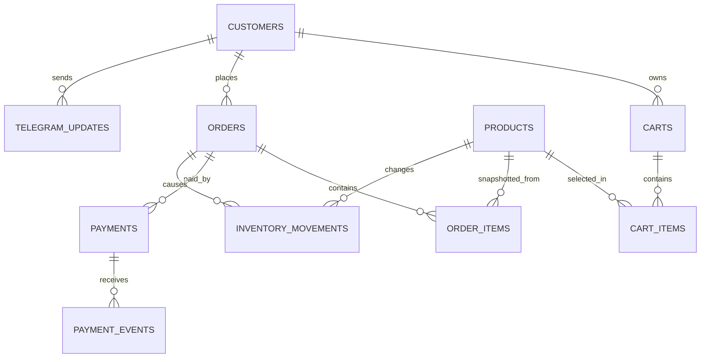

# Product Requirements Document (PRD)

## Proyek

**Sistem E-Commerce Hibrida: Web Admin & Telegram Bot**

## Versi

**2.1 — Revisi Wajib Pra-Implementasi**

Dokumen ini adalah versi revisi dari PRD v2.0. Revisi ini memasukkan perubahan wajib hasil review teknis sebelum implementasi dimulai.

## Status Dokumen

**Approved with required revisions before implementation.**

Implementasi boleh dimulai setelah poin-poin wajib di dokumen ini diterima sebagai baseline.

---

# 1. Ringkasan Eksekutif

Sistem ini dibuat untuk memfasilitasi transaksi jual-beli otomatis melalui dua antarmuka utama:

1. **Telegram Bot** sebagai etalase, kanal transaksi, dan kanal notifikasi pelanggan.
2. **Web Admin Panel** sebagai pusat kendali pemilik toko untuk mengelola produk, stok, transaksi, pembayaran, dan operasional.

Target utama sistem:

- efisien untuk VPS kecil **2GB RAM / 2 CPU**,
- aman untuk transaksi pembayaran,
- memiliki data transaksi yang konsisten,
- mudah dioperasikan,
- siap dimigrasikan ke infrastruktur lebih besar tanpa rewrite besar.

Arsitektur awal tetap berupa **Laravel monolith modular**, bukan microservices.

---

# 2. Version Matrix Wajib

| Komponen | Target | Catatan |
|---|---:|---|
| PHP | 8.4 | Runtime utama aplikasi. |
| Laravel | 13.x | Framework backend utama. |
| FilamentPHP | 5.x direkomendasikan | Filament v4 sudah berstatus previous version. Untuk project baru gunakan v5 kecuali ada alasan teknis khusus. |
| PostgreSQL | 16+ | Database utama. |
| Queue | Database driver untuk MVP | Redis boleh ditambahkan saat trafik naik. |
| Web Server | Nginx atau Caddy | Wajib HTTPS untuk production. |
| Deployment | Docker Compose single-host | Untuk VPS kecil; bukan orchestrator kompleks. |

## Keputusan Revisi

Target admin panel diubah dari:

```text
FilamentPHP v4
```

menjadi:

```text
FilamentPHP v5 recommended
```

Jika implementasi tetap memakai Filament v4, alasan teknisnya harus ditulis eksplisit sebelum coding dimulai.

---

# 3. Arsitektur & Strategi Deployment

## 3.1 Arsitektur Aplikasi

Aplikasi dibangun sebagai **Laravel monolith modular** dengan pemisahan domain secara logis:

- Catalog
- Cart
- Order
- Payment
- Inventory
- Telegram Bot
- Admin / Filament
- Audit & Operations

Monolith dipilih karena lebih cocok untuk VPS 2GB RAM / 2 CPU dan lebih mudah dirawat untuk tahap MVP.

## 3.2 Docker Compose

Docker Compose digunakan untuk deployment single-host ringan.

Komposisi container minimum:

1. **app**
   - PHP 8.4 runtime.
   - Laravel app.
   - PHP-FPM.
   - Queue worker.

2. **web**
   - Nginx atau Caddy.

3. **db**
   - PostgreSQL 16+.
   - Persistent volume.

## 3.3 Batasan Docker Compose

Docker Compose valid untuk MVP single-host. Untuk scale-up serius, aplikasi harus tetap stateless agar bisa dipindahkan ke:

- load balancer,
- managed PostgreSQL,
- Redis terpisah,
- object storage untuk upload,
- orchestrator seperti Docker Swarm atau Kubernetes jika diperlukan.

Compose tidak boleh dianggap sebagai solusi orkestrasi kompleks.

---

# 4. Production Deployment Baseline Wajib

Sebelum production, deployment wajib memenuhi baseline berikut:

## 4.1 Secrets & Environment

- Semua credential wajib berasal dari `.env` atau secret manager.
- Tidak boleh hardcode password database di `docker-compose.yml`.
- Gunakan database user non-root.
- `.env` tidak boleh dicommit.

## 4.2 Container Hardening

- Container aplikasi tidak boleh berjalan sebagai root untuk proses runtime utama.
- Production image harus immutable.
- Jangan bind-mount seluruh source code ke container production.
- Volume production hanya untuk data persisten seperti:
  - PostgreSQL data,
  - Laravel storage/uploads,
  - backup output jika diperlukan.

## 4.3 Healthcheck & Restart

- `app`, `web`, dan `db` wajib punya healthcheck.
- Gunakan restart policy yang jelas.
- Gunakan `depends_on` dengan health condition bila diperlukan.

## 4.4 TLS / HTTPS

Semua endpoint public wajib melalui HTTPS:

- `/admin`
- `/api/webhook/telegram`

Opsi ringan:

- Caddy,
- Nginx + Certbot,
- reverse proxy TLS lain.

## 4.5 Backup & Restore

- PostgreSQL wajib dibackup minimal harian.
- Backup wajib dikirim ke lokasi offsite.
- Restore drill wajib diuji sebelum launch.
- Backup sebaiknya terenkripsi.

## 4.6 Build Strategy

- Jangan menjalankan Composer/NPM build berat di VPS runtime production.
- Composer install sebaiknya dilakukan saat build image.
- Gunakan `composer install --no-dev --optimize-autoloader` untuk production.
- Aktifkan OPcache.

---

# 5. Database & Data Model Revisi

## 5.1 Prinsip Data

Sistem menggunakan PostgreSQL dengan prinsip:

- transaksi pembayaran harus idempotent,
- order dan payment memiliki state machine terpisah,
- riwayat order tidak boleh rusak walaupun produk berubah atau dihapus,
- stok harus aman dari overselling,
- semua callback payment disimpan sebagai event log.

## 5.2 Tipe Uang

Untuk data uang, sistem menggunakan integer amount dalam satuan minor currency.

Contoh untuk IDR:

```text
150000 berarti Rp150.000
```

Kolom amount wajib ditemani `currency`, default:

```text
IDR
```

Decimal masih boleh dipakai hanya jika seluruh kalkulasi dan validasi payment gateway dijaga presisi. Untuk implementasi awal, integer amount lebih disarankan.

---

# 6. ERD Revisi Wajib



---

# 7. Kamus Data Revisi

## 7.1 `customers`

Menyimpan pengguna Telegram.

| Kolom | Tipe | Atribut | Keterangan |
|---|---|---|---|
| id | bigint | PK | ID internal. |
| telegram_id | bigint | unique, indexed | ID unik dari Telegram. |
| first_name | string | not null | Nama depan Telegram. |
| username | string | nullable | Username Telegram. |
| phone_number | string | nullable | Nomor dari share contact. |
| created_at / updated_at | timestamp | not null | Timestamp Laravel. |

## 7.2 `products`

Menyimpan katalog produk.

| Kolom | Tipe | Atribut | Keterangan |
|---|---|---|---|
| id | bigint | PK | ID produk. |
| name | string | indexed | Nama produk. |
| description | text | not null | Deskripsi produk. |
| price_amount | bigint | not null | Harga dalam minor unit. |
| currency | string(3) | default `IDR` | Mata uang. |
| stock | integer | default 0 | Stok tersedia. |
| reserved_stock | integer | default 0 | Stok yang sedang dikunci checkout. |
| image_path | string | nullable | Path gambar. |
| is_active | boolean | default true | Muncul di bot atau tidak. |
| deleted_at | timestamp | nullable | Soft delete. |
| created_at / updated_at | timestamp | not null | Timestamp Laravel. |

## 7.3 `carts`

Menyimpan keranjang aktif pelanggan.

| Kolom | Tipe | Atribut | Keterangan |
|---|---|---|---|
| id | bigint | PK | ID cart. |
| customer_id | bigint | FK | Pemilik cart. |
| status | string | indexed | active, checked_out, abandoned, expired. |
| expires_at | timestamp | nullable | Batas waktu cart. |
| created_at / updated_at | timestamp | not null | Timestamp Laravel. |

## 7.4 `cart_items`

Menyimpan item pada keranjang.

| Kolom | Tipe | Atribut | Keterangan |
|---|---|---|---|
| id | bigint | PK | ID cart item. |
| cart_id | bigint | FK | Relasi ke cart. |
| product_id | bigint | FK | Produk yang dipilih. |
| quantity | integer | not null | Jumlah. |
| created_at / updated_at | timestamp | not null | Timestamp Laravel. |

## 7.5 `orders`

Menyimpan induk transaksi.

| Kolom | Tipe | Atribut | Keterangan |
|---|---|---|---|
| id | uuid | PK | ID transaksi non-sekuensial. |
| customer_id | bigint | FK | Pembeli. |
| invoice_number | string | unique, indexed | Nomor invoice. |
| order_status | string | indexed | Status order. |
| payment_status | string | indexed | Ringkasan status pembayaran. |
| total_amount | bigint | not null | Total dalam minor unit. |
| currency | string(3) | default `IDR` | Mata uang. |
| expires_at | timestamp | nullable | Batas waktu pembayaran/order. |
| created_at / updated_at | timestamp | not null | Timestamp Laravel. |

## 7.6 `order_items`

Menyimpan detail transaksi dengan snapshot produk.

| Kolom | Tipe | Atribut | Keterangan |
|---|---|---|---|
| id | bigint | PK | ID item. |
| order_id | uuid | FK | Relasi ke order. |
| product_id | bigint | nullable FK | Produk asal, nullable agar histori tetap aman. |
| product_name | string | not null | Snapshot nama produk saat beli. |
| quantity | integer | not null | Jumlah beli. |
| unit_price | bigint | not null | Harga satuan saat beli. |
| subtotal | bigint | not null | `quantity * unit_price`. |
| created_at / updated_at | timestamp | not null | Timestamp Laravel. |

## 7.7 `payments`

Menyimpan transaksi payment gateway.

| Kolom | Tipe | Atribut | Keterangan |
|---|---|---|---|
| id | uuid | PK | ID payment internal. |
| order_id | uuid | FK, indexed | Order terkait. |
| method | string | not null | QRIS, OVO, VA_MANDIRI, dll. |
| amount | bigint | not null | Nominal payment. |
| currency | string(3) | default `IDR` | Mata uang. |
| status | string | indexed | pending, paid, failed, expired, refunded. |
| paid_at | timestamp | nullable | Waktu lunas. |
| expired_at | timestamp | nullable | Waktu expired. |
| created_at / updated_at | timestamp | not null | Timestamp Laravel. |

## 7.8 `payment_events`

Menyimpan seluruh callback/event dari payment provider secara append-only.

| Kolom | Tipe | Atribut | Keterangan |
|---|---|---|---|
| id | bigint | PK | ID event. |
| payment_id | uuid | nullable FK | Payment terkait jika ditemukan. |
| event_type | string | indexed | callback, reconciliation, manual_update. |
| provider_reference | string | nullable, indexed | Reference dari provider. |
| raw_payload | jsonb | not null | Payload mentah. |
| signature | string | nullable | Signature dari provider. |
| received_at | timestamp | not null | Waktu diterima. |
| processed_at | timestamp | nullable | Waktu selesai diproses. |

## 7.9 `telegram_updates`

Menyimpan update Telegram untuk idempotency.

| Kolom | Tipe | Atribut | Keterangan |
|---|---|---|---|
| id | bigint | PK | ID internal. |
| update_id | bigint | unique, indexed | Telegram update ID. |
| customer_id | bigint | nullable FK | Customer terkait jika diketahui. |
| payload | jsonb | not null | Payload mentah Telegram. |
| processed_at | timestamp | nullable | Waktu selesai diproses. |
| created_at | timestamp | not null | Waktu diterima. |

## 7.10 `inventory_movements`

Menyimpan log perubahan stok.

| Kolom | Tipe | Atribut | Keterangan |
|---|---|---|---|
| id | bigint | PK | ID movement. |
| product_id | bigint | FK | Produk terkait. |
| order_id | uuid | nullable FK | Order terkait jika ada. |
| type | string | indexed | adjustment, reservation, release, sale. |
| quantity | integer | not null | Positif/negatif sesuai tipe. |
| notes | text | nullable | Catatan. |
| created_at | timestamp | not null | Waktu movement. |

## 7.11 `audit_logs`

Menyimpan aktivitas penting admin dan sistem.

| Kolom | Tipe | Atribut | Keterangan |
|---|---|---|---|
| id | bigint | PK | ID audit. |
| user_id | bigint | nullable | Admin terkait. |
| action | string | indexed | Aksi. |
| subject_type | string | nullable | Tipe objek. |
| subject_id | string | nullable | ID objek. |
| old_values | jsonb | nullable | Nilai lama. |
| new_values | jsonb | nullable | Nilai baru. |
| ip_address | string | nullable | IP admin/request. |
| created_at | timestamp | not null | Waktu aksi. |

---

# 8. State Machine Wajib

## 8.1 `order_status`

Status order dipisah dari status payment.

Nilai minimum:

```text
draft
pending_payment
processing
completed
cancelled
expired
```

Transisi utama:

```text
draft -> pending_payment
pending_payment -> processing
pending_payment -> expired
pending_payment -> cancelled
processing -> completed
processing -> cancelled
```

## 8.2 `payment_status`

Nilai minimum:

```text
pending
paid
failed
expired
refunded
```

Transisi utama:

```text
pending -> paid
pending -> failed
pending -> expired
paid -> refunded
```

## 8.3 Aturan Konsistensi

- Payment `paid` tidak otomatis berarti order `completed`.
- Payment `paid` dapat mengubah order menjadi `processing`.
- Order menjadi `completed` setelah fulfilment selesai.
- Callback yang datang berulang tidak boleh mengubah data dua kali.
- Callback telat untuk order expired harus diproses melalui aturan eksplisit, bukan langsung ditolak tanpa log.

---

# 9. Idempotency Wajib

## 9.1 Telegram Webhook

Setiap update Telegram wajib dicatat di `telegram_updates` berdasarkan `update_id` unik.

Jika update yang sama diterima ulang:

- jangan proses ulang order,
- jangan kurangi stok ulang,
- jangan kirim pesan duplikat jika sudah selesai diproses.


Callback wajib diproses secara idempotent berdasarkan kombinasi:

- provider,
- merchant_ref,
- provider_reference,
- status event.

Jika callback yang sama masuk ulang, sistem hanya boleh mengembalikan response sukses tanpa membuat perubahan ganda.

## 9.3 Order Creation

Pembuatan order dari cart harus transaction-safe.

Sistem tidak boleh membuat lebih dari satu order aktif untuk checkout cart yang sama.

---


## 10.1 Create Transaction


## 10.2 Callback Verification


1. membaca raw payload,
2. menyimpan event awal ke `payment_events`,
4. memvalidasi `merchant_ref`,
5. memvalidasi nominal pembayaran,
6. memvalidasi payment method/channel jika tersedia,
7. memproses status secara idempotent,
8. menjalankan update order/payment dalam database transaction,
9. dispatch notifikasi Telegram melalui queue.

## 10.3 Reconciliation Job


Tujuannya:

- menangani callback hilang,
- menangani callback telat,
- menyamakan status internal dengan provider,
- membuat catatan `payment_events` untuk hasil rekonsiliasi.

---

# 11. Inventory & Stock Reservation

## 11.1 Aturan Stok

Sistem wajib mencegah overselling.

Saat checkout:

1. cek stok tersedia,
2. lock row produk dalam database transaction,
3. buat reservation,
4. tambah `reserved_stock`,
5. buat `inventory_movements` tipe `reservation`,
6. buat order `pending_payment`.

Saat payment expired/cancelled:

1. release reservation,
2. kurangi `reserved_stock`,
3. buat `inventory_movements` tipe `release`.

Saat payment paid:

1. ubah reservation menjadi sale,
2. kurangi stok final,
3. kurangi `reserved_stock`,
4. buat `inventory_movements` tipe `sale`.

## 11.2 Expiry Job

Order pending wajib memiliki `expires_at` dan diproses oleh scheduled job untuk release stok jika pembayaran tidak selesai.

---

# 12. Telegram Bot Requirement Revisi

## 12.1 Commands Minimum

- `/start`
- `/katalog`
- `/batal`
- `/pesanan` atau `/status`

## 12.2 Conversation Safety

Bot harus aman terhadap:

- spam tombol,
- callback query lama,
- input jumlah invalid,
- produk nonaktif,
- stok habis,
- user menjalankan command baru di tengah checkout,
- duplicate Telegram webhook.

## 12.3 Webhook Processing

Endpoint Telegram webhook harus cepat.

Alur wajib:

1. terima update,
2. cek idempotency `update_id`,
3. simpan payload,
4. dispatch job ke queue,
5. response cepat ke Telegram.

Processing berat tidak boleh dilakukan langsung di request utama.

## 12.4 Telegram Security

- Gunakan secret token header Telegram jika tersedia.
- Rate limit per user.
- Validasi semua callback data.
- Jangan percaya harga/jumlah dari callback client tanpa cek database.

---

# 13. Admin Panel Requirement Revisi

## 13.1 Admin Framework

Admin panel menggunakan FilamentPHP.

Target default:

```text
FilamentPHP v5
```

## 13.2 Role Minimum

Minimal role:

- owner,
- admin,
- finance,
- support.

## 13.3 Product Management

Admin dapat:

- membuat produk,
- mengedit produk,
- upload gambar,
- aktif/nonaktifkan produk,
- soft delete produk,
- melakukan stock adjustment,
- melihat audit perubahan produk dan stok.

## 13.4 Order Management

Admin dapat:

- melihat daftar order,
- filter berdasarkan status,
- melihat detail order item,
- melihat payment terkait,
- melihat payment event/callback log,
- cancel order sesuai aturan state machine,
- resend receipt/notifikasi jika perlu,
- export CSV.

## 13.5 Payment Management

Admin dapat:

- melihat payment status,
- menjalankan manual reconciliation terbatas,
- melihat raw callback event,
- melihat paid_at dan expired_at.

## 13.6 Admin Security

- Login wajib rate-limited.
- Role/permission wajib diterapkan.
- Audit log wajib untuk aksi sensitif.
- 2FA disarankan untuk owner/admin.
- Session timeout wajib dikonfigurasi.

---

# 14. Queue & Background Job

## 14.1 Queue Driver

MVP menggunakan database queue driver PostgreSQL.

Migration wajib:

- `jobs`
- `failed_jobs`
- `job_batches` jika batch digunakan.

## 14.2 Queue Separation

Queue dipisahkan minimal secara logis:

- `payments`
- `telegram`
- `notifications`
- `default`

Payment-related job memiliki prioritas lebih tinggi daripada notifikasi umum.

## 14.3 Redis Scale-Up

Jika queue mulai bottleneck, Redis dapat ditambahkan untuk:

- queue,
- cache,
- session,
- lock.

Redis bukan requirement MVP, tapi arsitektur tidak boleh menghalangi migrasi ke Redis.

---

# 15. Security Requirement Wajib

## 15.1 Webhook Security

- Telegram webhook wajib memakai secret token jika tersedia.
- Semua callback disimpan raw payload-nya.
- Semua callback diproses idempotent.
- Replay protection wajib dipertimbangkan.

## 15.2 File Upload Security

- Validasi MIME type gambar.
- Validasi ukuran maksimal file.
- Jangan izinkan upload executable.
- Simpan upload di storage yang tidak mengeksekusi file sebagai script.

## 15.3 Data Security

- `.env` tidak boleh dicommit.
- Backup database dienkripsi jika dikirim offsite.
- Permission Laravel `storage` dan `bootstrap/cache` harus benar.
- Production `APP_DEBUG=false`.

---

# 16. Observability & Operations

## 16.1 Logging

Sistem wajib memiliki structured logs untuk:

- Telegram webhook,
- order creation,
- payment transition,
- inventory movement,
- failed jobs,
- admin action.

## 16.2 Correlation ID

Setiap order/payment harus mudah dilacak dengan:

- invoice_number,
- payment merchant_ref,
- provider_reference,
- request ID jika tersedia.

## 16.3 Health Endpoint

Tambahkan endpoint healthcheck internal untuk memeriksa:

- app boot,
- database connection,
- queue readiness jika memungkinkan.

## 16.4 Alert Minimum

Minimal perlu mekanisme pengecekan untuk:

- failed jobs,
- queue menumpuk,
- backup gagal,
- disk hampir penuh,

---

# 17. Testing Requirement

Minimal test sebelum production:

## 17.1 Payment Tests

- Duplicate callback tidak menggandakan proses.
- Amount mismatch ditolak.
- Merchant reference tidak ditemukan dicatat sebagai event.

## 17.2 Order Tests

- Checkout membuat order dan payment.
- Order item menyimpan snapshot produk.
- Order expiry merilis stok.
- Paid order mengubah payment status dan order status dengan benar.

## 17.3 Inventory Tests

- Stok tidak bisa oversold.
- Reservation dibuat saat checkout.
- Reservation dilepas saat expired/cancelled.
- Sale movement dibuat saat paid.

## 17.4 Telegram Tests

- `/start` membuat customer baru.
- `/katalog` hanya menampilkan produk aktif.
- Duplicate update ID tidak diproses ulang.
- Callback tombol lama ditangani aman.

---

# 18. Alur Kerja Utama Revisi

## 18.1 Catalog Flow

```text
Customer -> /katalog -> Telegram webhook -> queue job -> baca produk aktif -> kirim daftar produk
```

## 18.2 Checkout Flow

```text
Customer pilih produk
-> input quantity
-> backend validasi stok
-> buat cart/order/payment dalam transaction
-> reserve stock
-> kirim instruksi pembayaran / QRIS ke customer
```

## 18.3 Payment Callback Flow

```text
-> simpan raw event
-> verify signature
-> cek merchant_ref dan amount
-> proses idempotent dalam transaction
-> update payment/order/inventory
-> dispatch receipt notification ke Telegram queue
```

## 18.4 Expiry Flow

```text
Scheduled job
-> cari order pending melewati expires_at
-> mark payment/order expired
-> release reserved stock
-> kirim notifikasi jika perlu
```

---

# 19. Implementation Sequencing

Urutan implementasi wajib mengikuti fondasi transaksi terlebih dahulu, bukan langsung bot.

## Phase 1 — Foundation

- Laravel 13 baseline.
- Docker Compose production baseline.
- PostgreSQL.
- `.env`.
- queue tables.
- healthcheck.
- backup script.
- test command dasar.

## Phase 2 — Core Database

- customers,
- products,
- carts,
- cart_items,
- orders,
- order_items,
- payments,
- payment_events,
- telegram_updates,
- inventory_movements,
- audit_logs.

## Phase 3 — Admin Catalog

- Filament setup.
- Product resource.
- image upload.
- stock adjustment.
- soft delete.
- admin auth.
- RBAC dasar.

## Phase 4 — Order & Cart Domain

- cart flow,
- checkout,
- invoice generation,
- stock reservation,
- expiry job,
- order/payment state machine.


- create transaction,
- signature verification,
- callback idempotency,
- payment event log,
- reconciliation command,
- duplicate callback tests.

## Phase 6 — Telegram Bot

- `/start`,
- `/katalog`,
- inline keyboard,
- cart selection,
- quantity input,
- checkout,
- payment response,
- receipt notification.

## Phase 7 — Admin Operations

- order list,
- payment status,
- callback logs,
- manual reconciliation,
- resend notification,
- audit logs.

## Phase 8 — Hardening

- HTTPS,
- rate limit,
- backup restore test,
- failed job alert,
- log rotation,
- resource tuning,
- smoke test production.

---

# 20. Acceptance Criteria Pra-Implementasi

PRD dianggap siap untuk implementation session baru jika semua poin berikut diterima:

- [x] Target Filament direvisi ke v5 recommended atau alasan v4 ditulis eksplisit.
- [x] `payments` dan `payment_events` masuk data model.
- [x] `telegram_updates` masuk data model untuk idempotency.
- [x] `order_status` dan `payment_status` dipisahkan.
- [x] `order_items` menyimpan snapshot produk.
- [x] Stock reservation dan inventory movement didefinisikan.
- [x] Deployment baseline mencakup TLS, healthcheck, secrets, backup, dan restore.
- [x] Admin security mencakup RBAC dan audit log.
- [x] Testing minimum untuk payment, order, inventory, dan Telegram sudah didefinisikan.

---

# 21. Catatan untuk Sesi Implementasi Baru

Sesi implementasi berikutnya harus membaca dokumen ini sebagai baseline utama.

Prioritas implementasi tidak boleh langsung ke Telegram Bot sebelum fondasi berikut selesai:

1. database core,
2. payment state machine,
3. idempotency,
4. stock reservation,
5. queue baseline,
6. admin product management dasar.

Implementasi harus dimulai dari **Phase 1** dan bergerak bertahap sesuai sequencing di atas.
