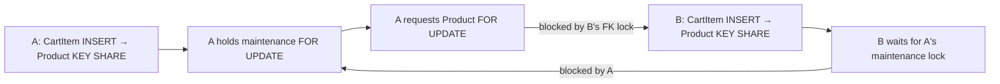

# Customer API integrated acceptance (S11, #628)

Contract: [#617 sections 6–10](https://github.com/Alhiefikri/telegram-bot/issues/617). All ten implementing dependencies #618–#627 were closed before this qualification began. Their closure was a sequencing prerequisite, not financial activation authority.

Production financial/API exposure remains **NO-GO**. This report records disposable technical evidence, not provider permission, custody qualification, a production capacity promise or deployment approval. No CI run was dispatched, inspected, waited on or rerun. No production settings, funds, deployment, commit or push were used.

## Defects found and corrected

### API Cart foreign-key locks inverted the checkout graph

The 40-Customer, 16-client actual HTTP create-order workload initially returned 79 temporary-unavailable responses and one accepted purchase from 80 attempts. PostgreSQL recorded 237 deadlocks. The lock graph was:



`EloquentInventoryLedger` now uses PostgreSQL `FOR NO KEY UPDATE` for checkout and lifecycle Product locks. `SupplierFulfillmentService::lockedOrderResources()` retains that mode rather than upgrading it during paid processing. Stock/pricing writes, deletion and key changes still conflict; FK `KEY SHARE` checks no longer block a non-key Product write. Other database drivers retain their existing update lock. No lock-order prefix, financial owner, key constraint or retry limit was removed.

[PostgreSQL 16 row-lock compatibility](https://www.postgresql.org/docs/16/explicit-locking.html#LOCKING-ROWS) defines the distinction. The retained two-Customer regression barriers both API Cart inserts before either checkout, sets a bounded lock deadline ahead of deadlock detection, and checks two paid Orders/debits/allocations. It failed before the fix with one `temporarily_unavailable` outcome; after the fix it passed with nine assertions. This avoids treating a successful deadlock retry as proof that the inversion disappeared.

### Supplier availability refresh upgraded the Product lock (#631)

The #628 FK-barrier fixture used local stock, so it never called
`SupplierFulfillmentService::reserve()` and its nested
`SupplierAvailability::refreshProducts()`. That refresh still requested Product
`FOR UPDATE`, recreating the maintenance/FK cycle for supplier-backed API Orders.
The new supplier-only fixture failed with one accepted Order and one
`err:temporarily_unavailable`. PostgreSQL 16.15 logged
`canceling statement due to lock timeout` on `checkout_maintenance_settings`.

`refreshProducts()` now uses PostgreSQL `FOR NO KEY UPDATE`, retaining the
existing update lock on other drivers. It changes only non-key availability
and retail-price columns. Product IDs remain sorted before Supplier IDs and
SupplierCatalogItem IDs; reserve/price/hold semantics, maintenance locking,
database constraints and existing `FOR UPDATE SKIP LOCKED` acquisitions are unchanged.

Lock-site audit: `EloquentInventoryLedger::lockedCheckoutProducts()` and
`orderInventoryState()`, and
`SupplierFulfillmentService::lockedOrderResources()` already retain
`FOR NO KEY UPDATE`. Supplier reserve, release, delivery, fallback and refund
paths all use the corrected availability refresh. `OrderStateMachine` and
`UsdtOrderRefundService` add no direct Product lock. A multiline search for
`Product::` through `lockForUpdate()` found only separate cart-edit, Admin,
supplier management/catalog-sync and notification worker operations after
this correction; none is a nested Product acquisition in this financial chain.
Those independent entry points were not changed.

Verification on PHP 8.4.26, PostgreSQL 16.15 and disposable Redis:

- The local-stock and supplier-stock FK barriers passed together:
  2 tests, 22 assertions. Each forces both `CartItem::created` callbacks to
  finish their Product FK checks before checkout proceeds, with a two-second
  lock timeout preceding five-second deadlock detection.
  A second isolated run passed the same 2 tests/22 assertions; PostgreSQL logs
  for its complete 2026-10-17 08:18:29–08:18:54 UTC window contained zero
  lock-timeout or deadlock records.
- The supplier regression requires two distinct accepted Orders, two Payments,
  two USD purchase debits, both Customer wallets exhausted, two pending
  supplier fulfillments, SKU quantity held at 2 and supplier wallet held at
  2,000,000 micro-USDT. No local credentials are allocated.
- A separate runtime smoke held Product `KEY SHARE` on another connection,
  acquired the checkout's `FOR NO KEY UPDATE`, then committed the actual nested
  refresh with a one-second lock timeout. `pgrowlocks('products')` observed
  `{"Key Share","For No Key Update","No Key Update"}` simultaneously.
  Supplier capacity remained 8 with the two-unit and 2,000,000-micro holds.
- All three required concurrency classes passed with no skips:
  41 tests, 639 assertions (329.227 seconds), using `phpunit.concurrency.xml`.
  The isolated test database was `issue631_test` in disposable
  `issue631-postgres`, with `issue631-redis` on the local Docker test network,
  `DB_CONNECTION=pgsql` and `RUN_CONCURRENCY_TESTS=1`. Invocation inside the
  PHP 8.4 application image:

  ```sh
  php vendor/bin/phpunit -c phpunit.concurrency.xml \
    --filter 'CustomerApiOrderPostgresConcurrencyTest|UsdtBalanceCheckoutPostgresConcurrencyTest|SupplierPostgresConcurrencyTest' \
    --fail-on-skipped
  ```

- `vendor/bin/pint --test` passed for both changed PHP files.

### Last-stock checkout expanded every notification recipient inside the money transaction

After fresh workers loaded the lock correction, last-stock checkout reached `StockNotificationDeliveryPipeline::materialize()` inside `recordSales()`. With more than 10,000 synthetic Telegram Customers, recipient/effect expansion exceeded the client's 60-second timeout. A snapshot of `pg_stat_activity` identified recipient materialization, not a new financial lock cycle.

Normal and late sales now call the existing `register()` seam, matching Stock Intake, stock deletion and supplier availability. The event commits beside the sale; existing postcommit `SendProductStockNotifications` and bounded recovery own recipient expansion. There is no new queue, outbox, compatibility adapter or notification policy. A renderer-failure regression failed before this cutover because notification generation rolled back the purchase. It now proves a paid purchase survives renderer failure, notification materialization recovers without duplicate recipients, and accepted replay never debits again (12 assertions).

### Catalog existence projection scanned the entire stock-key table

The PostgreSQL baseline for a bounded Product page used a hashed `EXISTS`
subplan over all 21,000 stock keys. Constant relationship-query count alone
did not make that work bounded by the requested page. The canonical
`Product::withAvailability()` owner now uses a correlated scalar `SELECT 1
... LIMIT 1` projection for local credential existence, retaining the indexed
available-unit count and the existing legacy-versus-managed stock decision.
It does not hydrate or decrypt stock credentials. A focused compatibility
regression distinguishes legacy numeric stock, available managed stock and
retired-only inventory without decrypting deliberately invalid ciphertext;
the catalog/pricing batch passed 33 tests and 469 assertions.

### Stale pre-API home-menu test pins

The first complete local run reached 4,799 tests and reported six failures:
inherited tests still assumed fixed menu-row positions before S08 added API
management. No production menu was moved to satisfy them. Positional and
copy assertions were deleted from the retained Admin authorization cases;
those cases now locate the configured dashboard URL and statistics action
independently of row order. The non-Admin case supplies a valid external
Admin URL so its rejection cannot pass merely because a local URL was
unusable. The duplicate welcome-copy test and the large caption/layout
snapshot test were removed, not repinned to the new text or layout.
Fresh-balance, drift-failure and group-privacy coverage remains. The two
affected files then passed 37 tests and 189 assertions.

### Missing release-lane registration

`phpunit.postgres.xml` now includes the existing `CustomerApiCredentialsPostgresTest` and `CustomerApiAdmissionPostgresTest` files. Both already declare `postgres-release`. Required callers supply `RUN_CONCURRENCY_TESTS=1` and `RUN_CUSTOMER_API_REDIS_TESTS=1` with isolated PostgreSQL/Redis, and use `--fail-on-skipped` for qualification. The existing local concurrency launcher fails skipped lanes; it does not silently enable Redis or supply those extra prerequisites.

Only missing behavioral regressions were retained: three distinct API/API/Bot contenders; real Admin tier/reseller edits against API price consent; the FK lock inversion; financial independence from stock-recipient rendering; legacy versus retired-only catalog stock; encoded-key/nested-context redaction without invoking secret-bearing serializers. Existing same-path coverage was reused.

The machine-readable measurements, representative plans and source hashes
are retained in [S11 evidence JSON](customer-api-s11-evidence.json).

## Disposable runtime and fixtures

Application image: `telegram-bot:local`, PHP 8.4.26, Laravel 13.34.0, PHPUnit 12.5.30. PostgreSQL 16.15 on Alpine; Redis 7.4.11. Host SQLite checks use PHP 8.5.9. The workstation is x86-64, Intel i5-8265U, four cores/eight logical CPUs, shared with local verification workloads. These are development-server diagnostics, not dedicated production hardware measurements.

All databases used an `s11_*test` name and existed only in the local `s11-postgres` container. The existing unrelated `s06-pg3` container was not used. Redis logical databases separated performance (1), security (2), financial recovery (3), surfaces (4), concurrency (5), and Binance walkthrough (6); security and financial crash drills moved to dedicated disposable Redis containers. Loss injection used only disposable state. No real Customer, credential, deposit, receiver or purchased account was used.

- Performance HTTP: loopback port 18648, eight PHP child workers plus the serving parent, opcode caching disabled, actual `/api/v1` middleware/controllers/services. Query listeners and a transport-denial guard recorded SQL/upstream counts. Invalid ciphertext and a credential-model hydration guard made unintended catalog/history decryption fail visibly.
- Security HTTP: four PHP workers on port 18628, plus two independently addressable workers on 18629/18630 for deterministic SIGKILL. Three Customers, one IDR 10,000 local Product, three stock units and canonical IDR 100,000 funding. The synthetic hold middleware ran only after actual admission, before commerce dispatch.
- Financial HTTP: port 18638, real v1 checkout/result routes, actual supplier and notification queue workers/recovery commands. Supplier/Binance/Telegram responses were deterministic transport fixtures outside financial locks.
- Surface HTTP: port 18864 and a separate local Telegram HTTP fixture service on the same Docker network. Actual webhook ingress, processor, canonical navigation and `TelegramBotClient`; not the testing fake-client binding.

## Section-10 matrix

| Scenario | Evidence and observable invariant |
| --- | --- |
| 1. Matching and changed idempotency across processes/restart | Existing API PostgreSQL races use at least three independent processes; one accepted Order/Payment/debit/allocation, changed fingerprint conflicts, lease takeover is fenced. Actual killed-postcommit HTTP replay returned the same USD 2 Order after disposable Redis loss. |
| 2. Distinct API/Bot stock and funds contention | Existing forced API-first/Bot-first funds and stock races plus the retained three-distinct-intent race. Winners pay once; losers retain their wallets/Carts and leave no reserved stock. The new two-Customer FK barrier additionally qualifies concurrent isolated API Cart creation. |
| 3. Opposite preferences/top-up/refund/explicit checkout | `UsdtBalanceCheckoutPostgresConcurrencyTest` exercises opposite preferences, empty secondary accounts, explicit Bot contention and five-way automatic spend/original refund/IDR and USDT credits. Existing freeze, drift, spending/restore barriers and consent checks reject without currency fallback or mixed tender. |
| 4. Complete locked pricing snapshot | Existing scalar price and Product reseller races plus real Admin workspace tier/override edits against consent-aware API checkout. Purchase retains the authorized complete old total, or rejects stale consent without charging either wallet. |
| 5. Crash and volatile-queue recovery | Actual precommit/postcommit SIGKILL, lost result read, non-idempotent supplier dispatch kill, outbound handoff kill, Redis loss, actual recovery commands and restarted queue workers. Detailed states below. |
| 6. Global Binance aliases and original-currency caps | Existing PostgreSQL transaction/Order-ID alias race spans two Customers and checkout/top-up targets; simultaneous credit/spend verifies immutable receipt balances. Existing transfer mismatch cases reject receiver/asset/amount/window/failed status. Original USDT full/partial/warranty refund races cap the 2,000,001-micro debit; IDR lifecycle races deduplicate original-source refunds. Actual decimal adapter/recovery walkthrough below. |
| 7. Isolation, parser, proxy and private callbacks | Actual foreign status/delivery requests match missing/malformed 404s; revoked credentials return 401; malformed quantity/money/body fails without economic changes; changing untrusted forwarding headers cannot reset invalid-auth quota. Actual private/group/foreign/stale callback probes preserve key ownership. |
| 8. Shared quotas, outage and crash admission | Actual multiworker reads and order attempts remain account-scoped across rotation; delivery has its additional quota. Two killed worker permits expire naturally; dedicated Redis outage returns 503 before claims or money work. Detailed observations below. |
| 9. Bounded reads and measured workload | Actual 1/20/100 Product/Order HTTP samples, PostgreSQL plans, lock/deadlock samples, worker overlap and upstream counts. No catalog/history credential hydration or synchronous read-counter write. Capacity remains an operator gate, not a claim inferred from passing tests. |
| 10. Human/machine and management surfaces | Actual Store Bot management and manual top-up approval, Binance decimal funding, mobile Admin reseller edits, bilingual docs keyboard/navigation, machine fetches and all 28 published executable examples. Chromium/live-client limitations below. |

## Crash, recovery and result identity observations

The financial walkthrough retained SQL-backed snapshots and command results:

1. Accepted local and two supplier-backed API Orders had three Payments/debits, one allocated local unit, no refunds and USDT balance 14,000,000 from 20,000,000 funding. Queue wakeups were discarded.
2. `suppliers:recover --limit=25` rediscovered obligations. The real supplier worker was SIGKILLed after a non-idempotent dispatch became durable. Restarted recovery left two ambiguous acquisitions in review, retaining two 1,000,000-micro holds; neither was refunded or blindly purchased again. A corrected success transport fixture produced a separate delivered acquisition. One earlier success fixture was malformed and honestly remained ambiguous rather than being converted into success.
3. Successful local/supplier result reads returned the same allocated unit identities. Killing the result-read worker and restarting HTTP did not reallocate or debit. Repeated recovery after Redis loss kept supplier purchase identities and sent/unknown outbound identities unchanged.
4. A notification worker killed after handoff exited 137. Only the interrupted disposable lease/deadline was advanced for this crash drill; this is not a real-time lease-duration measurement. `telegram:recover-outbound --chunk=25 --max-items=25 --max-seconds=35` classified that effect `unknown`, attempt 1. Restarted notification workers delivered other eligible effects without resending the unknown effect.
5. Precommit HTTP SIGKILL left the entire economic/outbound snapshot unchanged. Postcommit SIGKILL retained one additional Order/Payment/debit/unit; response-loss replay returned HTTP 200 with the same accepted Order. The abandoned pre-order claim's disposable deadline was advanced before its recovery purchase. Admission's natural expiry was measured independently in the security drill.
6. Final financial state: seven paid Orders, seven Payments, seven USDT purchase debits, zero refunds, balance 6,000,000 micro-USDT, five allocated units, one delivered supplier purchase, two ambiguous purchases and retained holds. One ordinary Owner effect remained unknown at attempt 1. Unrelated stock-recipient work was still pending on its own queue; the drill does not claim that every notification family was drained.

Actual commands used `queue:work supplier --queue=suppliers --stop-when-empty --tries=1 --timeout=120` and `queue:work redis --queue=notifications --stop-when-empty --tries=1 --timeout=120`. All captured supplier/Telegram transport calls reported transaction level zero. Fixtures do not qualify an upstream provider's real idempotency or live Telegram delivery.

## Security and admission observations

- Three concurrent read loops admitted 60 requests, rotated the key, then admitted another 60 and rejected 30: exactly 120 reads across actual Product/history routes and key versions. Old key: 401. Blocking headers included limit 120, remaining 0, positive Retry-After, reset, request ID and no-store/private.
- Actual delivery: ten 200s, then 429 with limit 10. Actual malformed order attempts: five 422s before rotation, then five 422s and five 429s across three threads. Rotation did not reset the ten-attempt Customer quota.
- Two independent HTTP workers held real admitted create-order permits. A third request returned 429/limit 2. SIGKILL disconnected both clients; immediate retry still returned 429. After 93.528 real elapsed seconds, one retry returned 201 with exactly one additional Order/Payment/debit/allocation. No lease-score edits were used. Final security state: two Orders/Payments/API Carts/claims/debits/allocated units, IDR 80,000.
- Stopping only the dedicated Redis service returned 503 for concurrent actual Product, balance and create-order routes in 3.8106/3.8091/3.8045 seconds. Complete PostgreSQL state was unchanged, including absence of a claim for the rejected order. Startup remained fail-closed until Redis answered PONG; accepted replay then returned the same Order.
- Six foreign/missing/malformed status/delivery requests returned indistinguishable 404 code/message bodies after excluding request IDs. A forged Customer header still exposed only the foreign Customer's own zero wallets; an unsupported `customer_id` query was 422. Query/cookie/Basic credentials were 401; browser Origin was 403. Disable made read/delivery/create requests 401 without financial changes.
- Actual malformed JSON, integer overflow, decimal overflow, exponent, comma and seventh-decimal inputs produced six 422s. A 32,769-byte body returned 413. No economic/claim change occurred. Comma normalization remains exclusive to human Telegram input.
- Thirty unauthenticated requests with changing forwarded IP/host/proto headers returned 401; the thirty-first returned 429, limit 30. Trusted-proxy configuration was not widened.
- During an actual delivery request, standard application logging produced its suppression marker and none of the full bearer, secret suffix, purchased private marker or injected private log marker. The retained logging regression also covers percent encoding, nested context, exception objects, Telegram-provider redaction and avoiding arbitrary serializer execution. Production proxy/CDN/APM logging was not inspected or qualified.

The focused security checks passed 12 PostgreSQL/Redis tests with 262 assertions, plus eight local credential/logging tests with 55 assertions. The whole final lanes below are separate evidence, not added arithmetically to these overlapping checks.

## Actual Store Bot, Admin and documentation surfaces

The real webhook/transport walkthrough exercised Generate, masked reopen, preference, confirmed Rotate, consumed-confirmation replay and Disable. Old/disabled keys returned 401 while current keys worked. Group, cross-actor and replaced-root disable callbacks acknowledged the update but did not change credentials. Orders, wallets, ledgers and accepted claims survived lifecycle changes. Inspected durable rows contained no displayed key or secret suffix.

Manual `/deposit 5000`, current-nonce confirmation, photo proof forwarding and actual Admin approval/replay credited once: IDR 50,000 to 55,000. This is an authorized synthetic callback, not proof that a real payment happened.

The separate PostgreSQL Binance adapter walkthrough used the actual HTTP kernel, webhook, navigation and real client with fixture transport. It replaced the canonical root during the amount prompt, rejected invalid input while retaining the prompt, and produced identical 300,000-micro previews for `0.3` and `0,3`. Redis-session loss created no guessed target. Confirm/replay produced one target with zero application fee despite a configured legacy fee. Text Order-ID submission did not credit money. The actual recovery command read one matching provider-history fixture, credited exactly 300,000 micro once, and the worker consumed the effect's actual `telegram-outbound` queue to send the one receipt. Editing the current receiver did not redirect the committed target. All transport occurred outside transactions.

Managed headless Chromium additionally exercised the actual 375×780 docs and Admin surfaces, not only the suite:

- Keyboard Enter selected English with a visible 3px outline. Opening mobile contents and following the balance anchor worked, with zero horizontal overflow. Text/background contrast measured 12.87:1; focus blue against white measured 5.17:1.
- Real Admin login, mobile drawer, Products, family workspace and Harga jual form saved reseller IDR 14,000/USD 1.5. Reload retained both while retail remained IDR 15,000/USD 2. Clearing overrides and submitting by keyboard persisted blanks without changing retail. No browser errors were observed; the tab was closed.
- Existing `api-docs.spec.js`: seven passed (37.0s), including 1280px initial HTML, mobile geometry/44px controls, keyboard, both themes, copy, filter-empty state, machine files and no-JavaScript bilingual content/all samples.
- Existing reseller workspace browser regression: one passed (33.5s). Earlier broad selections and migration-hook timeouts were harness failures, not passing evidence; narrow isolated executions completed.
- All 28 published Markdown examples (seven operations × cURL/Python/JavaScript/PHP) executed unchanged against actual HTTP and exited zero. First create returned 201; subsequent language examples replayed one USD 2 Order. Final state: one Order/Payment/accepted claim/USDT debit/allocated unit, zero IDR debits, IDR 55,000 unchanged and USDT 2,000,000 remaining from 4,000,000 funding. HTTP OpenAPI 3.1, Markdown and llms index were fetched; no key entered a public artifact.

Surface gate, preservation scope: Hard gate PASS (working controls, keyboard/mobile checks and measured contrast); Purpose gate PASS (existing content-first design retained, no new assets); Liveliness PASS (existing calm ENERGY 1/RHYTHM 1/MOTION 1 direction preserved); Craftsmanship PASS (actual persisted edits, empty/filter states, themes and recovery paths exercised). This is not a whole-application accessibility audit.

Limitations: Chromium/headless emulation only, not physical phones, Safari/Firefox, screen-reader or live Telegram-client qualification. The initial walkthrough captured actual screenshots, but its temporary screenshot files did not survive the runtime interruption; no unavailable screenshot is presented as a retained artifact.

## Final read, create and query-plan measurements

Final fixture cardinality: 10,004 Products, 11,240 Orders (1,240 API and
10,000 background retail), 21,240 stock keys, 10,000 quantity tiers,
10,781 Customers, 44 credential records, 20 Categories and 20 Families.
The history customer owns 1,000 canonical paid API Orders. Supplier/review
tables are not a dense-backlog performance fixture; their business states
are covered separately by the recovery scenarios and PostgreSQL lane.

Each read shape has one excluded warm-up and 30 actual HTTP samples.
Percentiles use nearest rank. `wall` includes development-server bootstrap
and waiting; `app` measures the HTTP kernel after bootstrap, not SQL alone.
The disposable Redis database was cleared between independent sample shapes,
not during shared-quota or permit-expiry qualification. Every sampled read
returned 200, the exact requested row count and no-store headers,
with zero upstream calls. A stock-model retrieval guard would fail any GET
that hydrated credential-bearing stock models.
The separately captured final 100-row Order response included both
`no-store` and `private`; the timing script asserted `no-store`, not both
tokens on every request.

| Route | Rows | SQL/request | Wall p50 ms | Wall p95 ms | App p50 ms | App p95 ms |
| --- | ---: | ---: | ---: | ---: | ---: | ---: |
| Products | 1 | 5 | 452.712 | 532.208 | 99.700 | 132.340 |
| Products | 20 | 5 | 484.358 | 614.464 | 116.868 | 162.043 |
| Products | 100 | 5 | 581.549 | 668.699 | 181.888 | 233.429 |
| Orders | 1 | 11 | 586.721 | 724.972 | 205.280 | 248.091 |
| Orders | 20 | 11 | 567.572 | 725.547 | 207.844 | 260.636 |
| Orders | 100 | 11 | 727.752 | 988.789 | 314.886 | 445.601 |

Independent closed-loop phases used 16 client threads and 40 accounts.
They are diagnostics, not sustained-capacity certification:

| Phase | Requests/outcomes | Elapsed s | Wall p50/p95 ms | App p50/p95 ms | Client peak | Observed active-kernel peak | Upstream calls |
| --- | --- | ---: | --- | --- | ---: | ---: | ---: |
| Products, 20 rows | 160 × 200 | 26.494 | 2,528.828 / 4,040.563 | 342.484 / 534.233 | 16 | 6 | 0 |
| Fresh paid local Orders | 80 × 201 | 34.868 | 7,327.425 / 8,302.489 | 3,025.904 / 3,580.523 | 16 | 9 | 0 |

The active-kernel peak is a sweep of monotonic request intervals across
the nine serving processes; it excludes bootstrap and socket waiting.
The read phase, including its six warm-ups, produced 346 recorded requests.
Nominal 20 ms lock sampling observed zero waiting sessions across 5,479
read-phase samples; the paid phase observed up to seven waiting sessions
across 1,319 samples. PostgreSQL deadlocks stayed **472 → 472** in both
phases: zero new deadlocks, not zero cumulative deadlocks. The historical
counter includes the original reproduced defect and a retry against stale
workers before the server was restarted with opcache disabled.

After the fresh paid phase there were exactly 1,240 API Orders, Payments,
USD purchase debits and allocated units; purchase debits totalled
2,480,000,000 micro-USDT. All 80 fresh intents owned one distinct Order and
one unit, with zero remaining/reserved units for that Product. There were
zero IDR purchase debits and negative USD accounts. Reads left these
counts and the history customer's 3,000,000,000 micro-USDT unchanged.
The earlier interrupted 80-intent run was separately recovered as 79
accepted replays and one new Order; it is not counted as fresh capacity.

### Actual PostgreSQL plans

Sixteen `EXPLAIN (ANALYZE, BUFFERS, FORMAT JSON)` plans were captured from
actual 100-row HTTP batches, including their full 100-ID relationship
queries, with fixture statistics refreshed by `ANALYZE`. The root fetches
101 rows for cursor look-ahead. These are separate executions, not HTTP
latency samples; costs and timings are diagnostic observations.

- Product root: `products_pkey`, 101 rows. Credential existence is now
  `Limit → Index Only Scan product_local_credential_capacity`, one row per
  loop across 101 loops; the available-unit count uses that same partial
  index, two rows per loop. No whole-stock-key hashed scan remains in this
  projection. Root execution: 1.654 ms.
- History root: `orders_customer_id_index`, 1,000 owned rows followed by a
  top-N Sort/Limit returning 101; 2.056 ms. The fixture did **not** choose
  the existing partial API cursor index. No larger single-customer history
  or arbitrary filter capacity is certified.
- Owned stock aggregation: `product_stock_items_order_item_id_index`,
  101 stock rows joined to the bounded 100-ID Order Item batch; 0.858 ms.
- The planner chose sequential scans for the small credential/category/
  family tables, the 100-ID Payment/Order Item batches, empty supplier/
  review/refund tables, and the 100-ID tier batch (100 selected tiers out
  of 10,000; 2.607 ms). Their SQL retains bounded ownership/parent-ID
  predicates. This is not evidence that every physical node is an index
  scan, nor permission to claim dense supplier or unlimited-history
  capacity. No speculative index or forced planner setting was added.

**Exposure decision: NO-GO pending production capacity qualification.**
The proposed 300 global reads/s and 20 creates/s are not established by
this shared-workstation run. Do not activate or raise exposure on that
basis; use zero new release exposure until the operator has target-host
measurements, queue/lock bounds and an approved lower budget if necessary.
No production policy, activation flag, provider gate or admission constant
was changed to manufacture qualification.

## Completed final verification

| Lane | Result | Assertions | Scope |
| --- | --- | ---: | --- |
| Full ordinary local suite | 4,797 total; 4,536 passed, 261 prerequisite-dependent skips; zero failures/errors | 45,370 | PHP 8.5.9, isolated SQLite |
| Full PostgreSQL concurrency suite | 309 passed; zero failures/errors/skips | 3,507 | PHP 8.4.26, PostgreSQL 16.15, Redis; `--group concurrency --fail-on-skipped` |
| Affected Admin/home-menu files | 37 passed | 189 | Included again in the completed full local suite |
| Catalog/pricing compatibility batch | 33 passed | 469 | Included again in the completed full local suite |

The ordinary suite used:

```sh
php -d memory_limit=1024M -d opcache.enable_cli=0 -d opcache.file_cache= \
  vendor/bin/phpunit --do-not-cache-result \
  --log-junit /tmp/s11-runtime/local-final.xml
```

It completed in 1,167.131 seconds of PHPUnit runner time. The 261 skips are
not counted as passes. The PostgreSQL/Redis lane ran separately with
`RUN_CONCURRENCY_TESTS=1`, `RUN_CUSTOMER_API_REDIS_TESTS=1`, disposable
database credentials and:

```sh
php vendor/bin/phpunit --configuration phpunit.concurrency.xml \
  --group concurrency --fail-on-skipped --display-skipped \
  --do-not-cache-result --log-junit /s11/concurrency.xml
```

That lane completed in 2,444.064 seconds, with all 309 tests executed.
Its initial attached-client deadline elapsed while the container continued;
the same container's logs were reattached and its complete JUnit verified,
without restarting or narrowing the lane. The initial ordinary runner
also encountered an inherited 128 MiB PHP limit; only the test-process
memory limit was raised. Interrupted attempts supply no pass claim.
Pint covered all nine changed PHP files. Product model LSP diagnostics
reported no errors. No GitHub Actions workflow was used for these checks.

Owned disposable HTTP/fixture/worker containers, PostgreSQL/Redis containers
and their anonymous volumes, and the `s11-acceptance` network were removed.
The unrelated `s06-pg3` container was untouched. Temporary runtime scripts,
synthetic bearer keys and raw logs were removed after the sanitized
measurements and source hashes were retained in the evidence JSON.

## Untouched operator and provider gates

[#536](https://github.com/Alhiefikri/telegram-bot/issues/536), [ADR-0023](adr/0023-balance-operational-controls.md), [balance O3 readiness](balance-o3-release-readiness.md), and the existing custody/restore/supplier runbooks retain authority:

- H1/A1 custody, exclusive receiver capacity/control, token/bridge provenance, legal/provider permission, treasury/gas/backing observations and external returns remain unqualified by these fixtures. Binance beneficiary/reference/provider permission is independently unqualified.
- Candidate-bound full V1/V2 evidence, receipt backfill/cutover and mixed/old-worker drain, full fresh reconciliation/accounting/treasury coverage, restore replay/close, human canary approval and H2 live evidence are not replaced by this report.
- Production TLS/trusted proxy/CDN/APM logging, actual Telegram channel permissions and supplier idempotency/recovery contracts require operator/provider evidence. Closed legacy tickets do not supply it.
- Initial 300 reads/second and 20 create attempts/second are admission proposals. Local diagnostics do not certify those rates. Exposure stays NO-GO rather than treating the quotas or fixture success as measured production capacity. No production setting was lowered, raised or activated here.

## Follow-up #642 addendum: bounded delivery result retrieval (2026-10-18)

The S07 delivery endpoint built the complete JSON response before enforcing its
1 MiB bound. A valid 100-unit structured purchase with maximum-length fields
(password 1,024, Auth Token 3,500 and tutorial 2,000 characters per unit) therefore
became permanently unreadable: payment was `paid`, 100 units were allocated and
status advertised `delivery.available=true`, but every delivery read returned
503. Pagination did not exist, so no client could recover the same purchase.

### Contract change

`GET /api/v1/orders/{id}/delivery` now accepts an optional `limit` (default and
maximum 100) and an opaque `cursor`. The response is still `DeliveryResult`, with
an additive required `pagination: {next_cursor, has_more}`. Units are traversed by
ascending immutable allocated-unit identity; one look-ahead row decides whether a
continuation exists and is never decrypted or projected for the current page.
The page is byte-sized from the exact JSON each unit will emit, including
maximum-length fields and escaping, under a 1 MiB response bound. A page that
would exceed the bound ends early and returns a cursor. `state` and `progress`
always describe the whole Order, so `has_more` is not partial supplier
fulfillment. Continuation tokens are authenticated opaque values, not raw
internal ids, and `units[].number` stays stable across pages while entitlement
is unchanged. Every request re-evaluates ownership, paid entitlement, retirement,
review/refund and supplier partial-release authority; a continuation cannot
outlive a revocation. A foreign or malformed cursor, an out-of-range limit and
unknown query fields are 422 `invalid_input`. Small Orders still return in one
response without pagination input. A genuinely oversized single unit still fails
closed with 503; the guard was retained, not removed. The decision record is
[ADR-0026](adr/0026-api-delivery-result-pagination.md).

### Disposable HTTP verification

Runtime: application image `telegram-bot:local` (PHP 8.4.26) with disposable
PostgreSQL 16-alpine and Redis 7-alpine, real `/api/v1` middleware/controllers.
The fixture was one visible Product with 100 structured Product Stock Items,
IDR 15,000 / USD 2 per unit, a distinct email and 3,500-character Auth Token per
unit, 1,024-character passwords, 2,000-character tutorial overrides, and one
Customer funded with 500,000,000 micro-USDT through the canonical USDT ledger.
All credentials and funding were synthetic; Telegram, supplier and provider
traffic were disabled.

Observed:

- `POST /api/v1/orders` with `quantity=100`, `preference=usd_only`,
  `expected_totals.USD=200` and a stable Idempotency-Key returned **201**, a paid
  Order for USD `200`, and exactly one purchase intent.
- Status returned **200** with `fulfillment.state=complete`,
  `released_units=100` and `delivery.state=ready`.
- Default delivery returned **200**, **1,041,112 bytes** and 92 units with
  `has_more=true`. This is the request that previously produced 503.
- A traversal with `limit=20` returned five **200** pages (20 units each,
  226,563–226,758 bytes). The 100 unit identities were `1`–`100` and their
  logical `number` values were also `1`–`100`, in ascending order, with **100
  unique ids and 100 unique numbers — no loss, duplication or page-local
  renumbering**. Every unit retained its 1,024/3,500/2,000-character fields, and
  every page reported whole-Order `state=ready`.
- The returned cursor was a 200-character authenticated opaque token
  (`[A-Za-z0-9_-]+`), not a raw internal id.
- Repeating the same page with its cursor returned byte-identical units. After
  `FLUSHALL` on the disposable Redis and after restarting the HTTP process, the
  same page still returned the same unit identities and values.
- `limit=0`, `limit=101`, `cursor=no`, `cursor=0`, a 19-digit cursor, a
  nonexistent cursor and an unknown query field all returned **422
  `invalid_input`**. Direct economic snapshots before and after those requests
  were equal.
- A refund between pages (page 1 `limit=1`, then a canonical full refund, then
  page 2 with the page-1 cursor) returned **200 `not_ready`** with zero units and
  `pagination={next_cursor:null,has_more:false}`. The response contained no
  credential value.
- Before the refund the durable state was one Order, one Payment, one purchase
  debit, 100 allocated units, zero supplier purchases and zero refund credits.
  After the refund it was one Order, one Payment, one purchase debit, one refund
  credit, 100 retired units and still zero supplier purchases. No request
  purchased, reallocated, debited again or resurfaced a retired unit.

Local regressions: `CustomerApiOrderReadTest` passed 11 tests / 652 assertions
(including the maximum-field 100-unit traversal with stable numbers,
cursor/limit rejection, retirement between pages, revocation between pages and
constant query count at 1/20/100); the delivery consumers (local manual review,
supplier fulfillment, historical unit refunds, credential presentation and API
orders) passed 74 tests / 958 assertions; `StorefrontApiDocsTest` passed 11 tests
/ 1,025 assertions; `CustomerApiErrorContractTest` passed 5 tests / 76 assertions.
The complete local suite ran 4,915 tests / 47,209 assertions with 3 failures and
270 skips. The three failures reproduce unchanged on untouched `HEAD` in a
separate worktree: `SakurupiahWebhookTest` out-of-order callback observation and
two `TelegramLifecycleOutboundEffectTest` admin-paid notification assertions.
They belong to the unrelated lifecycle/webhook follow-up tickets already called
out in #642; none touches delivery, credentials or API pagination.
Pint passed on all changed PHP files. The disposable containers, network,
scratch application copy and synthetic credentials were removed. No CI/CD,
production access, deployment, commit or push was part of this verification.
Capability and exposure gates remain unchanged and still NO-GO.

## Availability gate (#647)

The S11 evidence above predates the Owner-controlled gate. `customer_api_settings`
now seeds `enabled = false`; the gate is read once per `/api/v1` request after IP
admission and before body, key, claim, wallet or inventory work. While OFF every
matched path returns `503 api_maintenance` with `Retry-After: 60`; the public
documentation stays readable. The Admin control is Owner-only and versioned, and
turning it OFF erases no credential, claim, Order, ledger row or delivery result.
The release smoke asserts OFF after cutover; enabling requires an explicit Owner
decision after the capacity, custody/provider and operator gates are satisfied.
