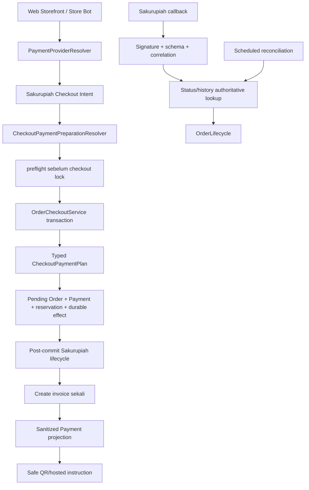

# Rencana Implementasi Payment Provider Sakurupiah

Status: **planning only**. Dokumen ini merencanakan integrasi provider baru; belum ada aktivasi checkout, credential, migrasi, route callback, atau perubahan production traffic.

Panduan agent yang dapat dieksekusi ada di [`docs/agents/sakurupiah-payment-provider-guide.md`](agents/sakurupiah-payment-provider-guide.md). Fakta API, sumber primer, dan daftar unknowns ada di [`docs/agents/sakurupiah-api-research.md`](agents/sakurupiah-api-research.md).

## Problem

Repository sudah memiliki beberapa rail dengan ownership berbeda:

- QR Manual;
- KlikQRIS Native QRIS;
- Binance Pay ID;
- USDT BEP20/BSC;
- Pakasir sebagai compatibility lane historis.

Sakurupiah memakai API invoice berbasis bearer token + HMAC, callback JSON, dan status lookup yang berbeda dari KlikQRIS. Integrasi yang hanya menambah `if ($provider === ...)` di controller atau checkout core akan memecah idempotency, callback verification, safe presentation, dan interpretasi Payment historis.

## Keputusan utama

### 1. V1 satu channel QRIS provider

Release awal menggunakan:

- provider identity `sakurupiah`;
- local payment method `QRIS`;
- provider API method `QRISC`, yaitu channel yang disetujui merchant target;
- currency lokal `IDR` **hanya setelah dikonfirmasi oleh merchant test/provider**;
- `merchant_fee = 1` sebagai default kebijakan awal agar fee ditanggung merchant dan nominal customer tetap sama dengan Order;
- provider switch Owner yang berlaku hanya untuk checkout baru.

Dukungan DANA, GOPAY, ShopeePay, Virtual Account, Alfamart, Indomaret,
QRISMU, QRIS2, channel QRIS generic, atau channel lain bukan bagian V1.
Setiap channel tambahan mempunyai mode `DIRECT`/`REDIRECT`, batas, fee,
expiry, dan copy instruksi sendiri; perlu qualification dan acceptance terpisah.

### 2. Provider memiliki module sendiri

Buat module `App\Services\Sakurupiah` untuk client, DTO, readiness, sanitizer, lifecycle, callback, dan reconciliation. Jangan membuat provider-neutral Native QRIS module. Keputusan ini konsisten dengan ADR-0006: provider-specific lifecycle tetap lokal pada module provider.

### 3. Checkout preparation dua fase tetap menjadi seam

- `preflight()` boleh melakukan readiness/channel HTTP yang bounded sebelum lock checkout.
- `prepare()` hanya boleh melakukan validation, allocation, dan snapshot work transaction-local setelah lock canonical tersedia.
- `prepare()` tidak boleh memanggil Sakurupiah HTTP, RPC, Telegram, queue, atau webhook.
- Create invoice terjadi setelah Payment lokal commit pada lifecycle/instruction path yang memiliki same-Payment lock dan recovery.

### 4. Callback bukan otorisasi paid

Callback Sakurupiah hanya signal. Sistem harus:

1. memverifikasi HMAC atas raw body;
2. memvalidasi event, body, status, dan correlation;
3. melakukan authoritative status/history lookup;
4. memeriksa provider reference, merchant reference, amount/unit, dan state lokal;
5. mendelegasikan transisi hanya ke `OrderLifecycle`.

Karena callback tidak membawa amount dan dokumentasi status endpoint hanya menunjukkan status, automatic paid diblok sampai ada amount-bearing evidence dari history/status response atau klarifikasi tertulis provider.

### 5. Tidak ada fallback otomatis atau Payment kedua

Create yang timeout, connection error, HTTP 5xx, invalid JSON setelah request mungkin terkirim, atau duplicate-reference behavior yang belum diketahui harus masuk recovery pada Payment yang sama. Jangan mengganti Sakurupiah dengan Manual/KlikQRIS dan jangan membuat `Payment` kedua.

### 6. Tidak ada perubahan Payment historis

Payment yang telah dibuat mempertahankan `provider`, `method`, setting snapshot, callback interpretation, dan lifecycle asal. Perubahan provider aktif tidak me-reinterpret Payment lama. Pakasir tetap compatibility lane sampai retirement gate terpisah selesai.

## Bukti dan batas pengetahuan

Sumber resmi yang telah diperiksa:

- [Sakurupiah API Documentation](https://sakurupiah.id/developers/api-dokumentasi)
- [Official Postman collection](https://sakurupiah.id/SAKURUPIAH-DOKUMENTASI-API-v2.1Postman.json)
- [Official-linked HMAC PHP example](https://raw.githubusercontent.com/SAKURUPIAH/SIGNATURE_INVOICE/main/PHP_version.php)

Yang sudah terdokumentasi: base URL production/sandbox, bearer authentication, body `api_id`, HMAC invoice, callback HMAC raw body, endpoint POST, field utama, channel catalogue, status string, dan duplicate callback warning.

Yang belum cukup untuk production: HTTP versus JSON status semantics, error schema, form encoding, signature canonicalization, amount/currency, duplicate `merchant_ref`, expiry rounding, expired code `2` versus `-2`, callback retry/acknowledgement, amount-bearing status evidence, rate limit, dan production IP policy. Daftar lengkap serta confidence per claim ada di research note.

## Baseline repository

Ownership saat ini yang wajib dipertahankan:

| Concern | Current owner |
| --- | --- |
| Provider identity | `src/app/Support/PaymentProvider.php` |
| Active provider selection | `src/app/Services/Checkout/PaymentProviderResolver.php` |
| Owner provider switch | `src/app/Services/Admin/PaymentProviderSwitcher.php` |
| Rail preparation | `src/app/Services/Checkout/CheckoutPaymentPreparation.php` dan resolver-nya |
| Common Payment row | `src/app/Services/Checkout/CheckoutPaymentPlanWriter.php` |
| Shared checkout transaction | `src/app/Services/OrderCheckoutService.php` |
| Payment/order transition | `src/app/Services/OrderLifecycle.php` dan `OrderStateMachine` |
| Stock reservation/sale/release | `src/app/Services/InventoryLedger.php` |
| Payment events | `src/app/Models/PaymentEvent.php` dan provider logger |
| Telegram delivery state | `TelegramOutboundEffectLedgerProtocol` |
| Telegram checkout rendering | `TelegramCheckoutIntents`, `TelegramPaymentInstructionRenderer`, checkout effect pipeline |
| Web Storefront checkout/status | `StorefrontShopCheckout`, `StorefrontShopPaymentStatusRefresh`, signed invoice presenters |
| Scheduler | `src/routes/console.php` |
| Provider HTTP config | `src/config/services.php` + server-side environment |

Payment common fields sudah mencakup `provider`, `merchant_ref`, `provider_reference`, `provider_payload`, `provider_fee`, `provider_total_payment`, `provider_payment_method`, `provider_created_at`, `provider_expires_at`, `provider_payment_number`, `provider_create_state`, `amount`, `currency`, dan lifecycle timestamps. Jangan menambah schema sebelum membuktikan bahwa snapshot Sakurupiah tidak dapat disimpan dengan aman pada boundary yang ada.

## Target flow



## Decision gates sebelum coding

Semua gate P0 harus selesai sebelum provider masuk `PaymentProvider::allowed()` pada environment production.

| Gate | Pertanyaan | Bukti wajib | Dampak bila gagal |
| --- | --- | --- | --- |
| P0-1 | Credential pair dan environment mana yang aktif? | Sandbox API ID/key milik merchant; mapping environment terpisah | Provider disabled |
| P0-2 | Body menerima multipart atau URL-encoded? | Raw request/response sandbox untuk create dan list | Client belum boleh production |
| P0-3 | Signature canonicalization exact? | Test vector dan response accepted untuk method/amount/reference | Create fail closed |
| P0-4 | `amount` benar-benar IDR integer? | Konfirmasi merchant + response channel | Automatic payment disabled |
| P0-5 | Fee payer dan payable total? | Test `merchant_fee=1`, response `total/fee/amount_merchant` | Customer total policy unresolved |
| P0-6 | Expiry integer hour boleh berapa dan timezone apa? | Sandbox create + boundary observation | Local deadline policy unresolved |
| P0-7 | Paid bisa diverifikasi dengan amount? | Status/history raw response memuat evidence yang cocok | No automatic paid |
| P0-8 | Callback expired code `2` atau `-2`? | Callback nyata/test resmi atau written clarification | Expired code must not be trusted alone |
| P0-9 | Duplicate `merchant_ref` dan timeout recovery? | Repeat create/reference lookup sandbox | No blind retry; owner review if unresolved |
| P0-10 | Callback retry, timeout, acknowledgement? | Controlled callback test + raw HTTP result | Queue/ack policy unresolved |
| P0-11 | Production IP allowlist? | Provider confirmation of optional/required policy and proxy IP | Production disabled |
| P0-12 | QR atau hosted URL aman dipresentasikan? | QR EMV/CRC/amount test atau host allowlist evidence | No customer instruction |
| P0-13 | Rate/concurrency limits? | Provider answer or bounded conservative defaults | Limit client/reconciliation |

Dokumen provider yang tidak menjawab gate bukan bukti bahwa behavior aman.

## Phase plan

### Phase 0 — Qualification dan contract freeze

**Tujuan:** mengubah dokumentasi provider yang ambigu menjadi contract record untuk merchant target.

**Pekerjaan:**

1. Buat sandbox merchant terpisah dari production.
2. Panggil `list-payment.php`; simpan hanya metadata redacted dan hash reference.
3. Konfirmasi channel `QRISC`, `tipe`, current min/max, fee, `addition.default_expired`, dan status aktif.
4. Uji `create.php` dengan nominal terkecil yang diizinkan.
5. Uji signature dengan method dan amount representation yang sama persis dengan request.
6. Capture raw HTTP status, content type, JSON root status, response fields, date/time/expiry, `trx_id`, `merchant_ref`, `qr`, dan `checkout_url` tanpa menyalin secret/token.
7. Uji QR/hosted presentation sesuai mode yang dipilih.
8. Amati pending, paid, expired callback; ulangi callback yang sama.
9. Uji status lookup by `trx_id` dan history by `trx_id`/`merchant_ref` untuk amount evidence.
10. Uji duplicate `merchant_ref`, timeout simulation, malformed response, dan provider outage pada test harness.
11. Minta klarifikasi tertulis untuk setiap P0 yang tidak dapat diuji sandbox.

**Output:** contract record berisi request encoding, signature vector, status map, amount/fee/expiry policy, callback ack/retry, safe presentation, error classes, dan provider contact. Tidak ada source activation.

**Exit criteria:** semua P0 closed atau owner secara eksplisit menyetujui manual-review-only mode. Manual-review-only bukan automatic fulfillment dan tidak boleh dipasarkan sebagai payment otomatis.

### Phase 1 — Provider foundation tanpa checkout activation

**File baru yang direncanakan:**

- `src/app/Enums/SakurupiahEnvironment.php`;
- `src/app/Services/Sakurupiah/SakurupiahProviderAdapter.php`;
- `src/app/Services/Sakurupiah/SakurupiahClient.php`;
- `src/app/Services/Sakurupiah/SakurupiahProviderReadiness.php` dan report;
- `src/app/Services/Sakurupiah/SakurupiahInvoice.php`;
- `src/app/Services/Sakurupiah/SakurupiahChannel.php`;
- `src/app/Services/Sakurupiah/SakurupiahStatus.php`;
- `src/app/Services/Sakurupiah/SakurupiahCallback.php`;
- `src/app/Services/Sakurupiah/SakurupiahPayloadSanitizer.php`;
- `src/app/Services/Sakurupiah/SakurupiahSignature.php` atau value object kecil yang setara;
- focused tests di `src/tests/Unit/Services/Sakurupiah/` dan `src/tests/Feature/Sakurupiah*Test.php`.

**Perubahan existing:**

- `src/config/services.php` untuk credential, base URL, environment, timeout, bounded retry, rate limits, dan host policy;
- `.env.example` root/app hanya dengan nama variable kosong dan komentar aman;
- `docker-compose.yml` hanya meneruskan server-side secrets/knobs yang memang dipakai runtime;
- `src/app/Bootstrap/ProductionConfigurationValidator.php` untuk HTTPS dan pair completeness;
- `src/app/Providers/AppServiceProvider.php` untuk binding adapter/readiness bila diperlukan.

**Kontrak client:**

```text
listChannels()       -> list<SakurupiahChannel>
checkBalance()       -> SakurupiahBalance
createInvoice(input) -> SakurupiahInvoice
transactionStatus(trxId) -> SakurupiahStatus
transactionHistory(filter) -> list<SakurupiahHistoryItem>
```

Client bertanggung jawab atas HTTP transport, bearer header, body `api_id`, form encoding yang sudah di-freeze, HMAC invoice, timeout, dan translation error. Client tidak boleh mengubah Order/Payment atau memanggil `OrderLifecycle`.

**Acceptance:** semua parser typed, sanitizer, HMAC, readiness, dan HTTP fake tests pass; provider masih tidak muncul sebagai option checkout production.

### Phase 2 — Checkout intent dan typed payment plan

**Perubahan:**

- tambah `PaymentProvider::SAKURUPIAH`, `known()`, `allowed()` sesuai feature/readiness policy, dan label;
- tambah `SakurupiahCheckoutIntent` atau intent provider-bound yang mengembalikan `provider=sakurupiah`, local `method=QRIS`, provider API method `QRISC`, dan post-creation behavior baru;
- tambah `SakurupiahCheckoutPaymentPreparation`;
- tambah `PaymentPlan/SakurupiahCheckoutPaymentSnapshot`;
- register adapter pada `CheckoutPaymentPreparationResolver` di `AppServiceProvider`;
- tambah typed snapshot class ke validation map `CheckoutPaymentPlan`;
- update `PaymentProviderResolver` hanya untuk normalized provider/method mapping;
- update `PaymentProviderSwitcher`/request readiness validation tanpa mengubah Payment historis;
- update characterization tests.

**`preflight()`:** boleh memeriksa credential, environment, callback route, QRIS active, min/max, dan fingerprint setting. HTTP failure menghasilkan safe unavailable result dan tidak membuat Order/Payment.

**`prepare()`:** menghitung local amount dari locked Product snapshot, memilih expiry sesuai policy yang sudah dibuktikan, membuat snapshot typed, dan tidak mengakses network. Jika expiry Sakurupiah hanya jam sedangkan local setting menit, adapter wajib memakai policy Phase 0; jangan membulatkan diam-diam.

**Payment plan V1:**

```text
provider: sakurupiah
method: QRIS
paymentCurrency: IDR
amount: local Order amount
rail snapshot: method/currency/amount/expiry + Sakurupiah policy snapshot
postCreationBehavior: SakurupiahInstructions
```

**Acceptance:** checkout preparation failure memiliki zero side effect; plan tidak menerima raw associative bag; duplicate `checkout_key` menghasilkan Order/Payment yang sama; `OrderCheckoutService` tidak mendapat Sakurupiah HTTP atau field branch.

### Phase 3 — Invoice lifecycle dan same-Payment recovery

**File baru:**

- `src/app/Services/Sakurupiah/SakurupiahInvoiceLifecycleService.php`;
- `SakurupiahPaymentEventLogger.php`;
- outcome/Payable DTO yang hanya berisi data presentasi safe;
- exception type untuk pre-request failure, outcome unknown, status unavailable, schema/integrity failure;
- `src/app/Jobs/VerifySakurupiahPaymentRecovery.php` jika queue recovery dibutuhkan.

**Behavior:**

1. Load Payment fresh dan lock per Payment; lock harus konsisten untuk create, status, callback, dan reconcile.
2. Pastikan Order/payment pending serta effective deadline belum lewat.
3. Pastikan readiness environment.
4. Create satu invoice dengan `Payment.merchant_ref`.
5. Parse dan validate response.
6. Persist `provider_reference=trx_id`, `provider_payment_method=payment_kode`, `provider_total_payment`, `provider_fee`, provider timestamps, dan sanitized payload secara atomik di bawah Order/Payment lifecycle lock.
7. Return safe outcome; raw provider payload tidak keluar module.
8. Jika outcome unknown, lakukan status/history recovery pada reference yang sudah ada.
9. Jika response tidak memiliki `trx_id` dan duplicate lookup belum terbukti aman, berhenti pada recovery/manual review.

**Persistence rule:**

- `provider_payload` hanya whitelist/redacted fields;
- URL yang mengandung access token tidak boleh masuk plaintext log atau DTO; enkripsi field/new detail table diperlukan bila URL harus dipersist;
- QR string hanya boleh disimpan/presentasikan setelah format/currency/amount validation;
- `payment_no` memakai encrypted cast bila benar-benar dibutuhkan;
- `provider_reference` harus tidak berubah setelah accepted invoice kecuali recovery menemukan ID yang sama;
- semua provider create/recovery/callback/reconcile dicatat sebagai `PaymentEvent` dengan idempotency key.

**Acceptance:** create success, pre-request failure, timeout, HTTP 5xx, invalid JSON, duplicate worker, same-Payment recovery, response mismatch, and provider unavailable tests all pass without duplicate Payment or fallback.

### Phase 4 — Customer surfaces dan Telegram Outbound Effects

**Durable effect:** gunakan effect family Sakurupiah tersendiri bila lifecycle/rendering berbeda dari KlikQRIS. Jangan menyamarkan Sakurupiah sebagai KlikQRIS hanya untuk mengurangi enum case.

**Expected existing changes:**

- `src/app/Enums/TelegramOutboundEffectType.php` — `SakurupiahCheckoutInstructions`;
- `TelegramOutboundEffectService::typeForPayment()` — explicit `provider=sakurupiah` mapping;
- `CheckoutInstructionDeliveryPipeline` — effect allowlist, Payment lookup, safe render, timing labels;
- `TelegramOutboundEffectDispatcher` — dedicated job mapping;
- `SendSakurupiahCheckoutInstructions` — thin queue transport adapter;
- `TelegramCheckoutCallbackHandler` — supported behavior and compatibility fallback;
- `TelegramCheckoutIntents`/`TelegramPaymentInstructionRenderer` — consume safe lifecycle outcome only;
- `StorefrontShopCheckout` — invoke lifecycle after local transaction and reuse same Payment path;
- `StorefrontShopPaymentStatusRefresh` and `StorefrontShopSignedInvoice` — status/presentation via Sakurupiah lifecycle;
- `StorefrontShopOrderQrisController` atau dedicated signed provider route — QR/hosted presentation gate;
- translation/catalog entries for pending, recovery, unavailable, expired, and support copy.

**Presentation rules:**

- Direct QRIS: validate QR EMV/CRC, IDR currency, exact provider total, and effective expiry before image rendering.
- Hosted invoice: validate HTTPS and configured provider host allowlist; never pass arbitrary `checkout_url` as redirect.
- `Payable` is the only state allowed to show payment instruction. `Creating`, `RecoveryPending`, `ProviderTotalPending`, `ProviderPresentationPending`, `InvalidProviderResult`, and `Expired` show safe status/retry/support copy without raw provider data.
- Telegram effects use the existing claim/lease/unknown/manual-review protocol. A Telegram send ambiguity is not permission to call provider create again.

**Acceptance:** Web Storefront and Store Bot keep public checkout contracts; no duplicate outbound effect; a failed/ambiguous effect is reviewable; presentation never leaks key/signature/raw payload; QR and final total are consistent.

### Phase 5 — Callback, status verification, and reconciliation

**File baru:**

- `src/app/Http/Controllers/SakurupiahWebhookController.php`;
- `src/app/Services/Sakurupiah/SakurupiahCallbackProcessor.php`;
- `src/app/Console/Commands/ReconcileSakurupiahPayments.php`;
- `src/app/Jobs/VerifySakurupiahWebhookPayment.php` bila deferred verification diperlukan;
- callback/reconciliation tests.

**Route:**

```text
POST /api/webhook/sakurupiah
```

Tambahkan throttle dengan budget konservatif dan pastikan route tidak menerima GET/HTML fallback.

**Ingress algorithm:**

1. Require JSON content type, size limit, and bounded JSON depth.
2. Read raw body before JSON re-encoding.
3. Verify `X-Callback-Signature` with `hash_equals`.
4. Require `X-Callback-Event=payment_status`.
5. Parse `trx_id`, `merchant_ref`, `status`, `status_kode`.
6. Validate exact status/code pair from frozen contract; unknown pair is untrusted.
7. Correlate only `provider=sakurupiah` and matching local merchant reference/provider reference.
8. Log sanitized callback with deterministic idempotency key and received count.
9. For paid/expired, call authoritative status/history lookup under Payment single-flight lock.
10. Apply `OrderLifecycle` only after all integrity gates.
11. Acknowledge according to measured provider contract; acknowledgement must not imply paid processing.

**Paid gate:**

```text
valid callback signature
+ correct event
+ known Payment
+ matching merchant_ref
+ matching trx_id
+ authoritative status = berhasil
+ amount/currency evidence matches local Payment
+ Payment/order eligible
→ OrderLifecycle::applyPaymentPaid()
```

If amount evidence cannot be obtained, retain `Payment Verification Pending`, record the reason safely, and retry reconciliation. Do not mark paid from callback status alone.

**Expired gate:** require status string and confirmed code, then apply only when local Payment is pending and the effective deadline/late-payment policy allows. A later paid result on terminal Order is Late Payment + Manual Fulfillment Review.

**Scheduler:** add `sakurupiah:reconcile --chunk=100` only after command is bounded, idempotent, and its queue is actually consumed. Use an existing monitored queue or add a dedicated supervisor worker with explicit capacity/release evidence. Never enqueue to an unserved queue such as `payments` without verifying deployment configuration.

**Acceptance:** duplicate/out-of-order/unknown callbacks are safe; status outage never releases stock; paid transition is exactly once; reconciliation covers pending/outcome-unknown and does not create invoices blindly; schedule and queue health are observable.

### Phase 6 — Admin readiness, switch, and controlled rollout

**Expected changes:**

- `PaymentProviderSwitcher` readiness branch for Sakurupiah;
- `UpdatePaymentModeRequest` validation and authorization;
- `AdminDashboardStatsData` provider list/readiness/copy;
- `AdminPaymentOperations` provider reconciliation dispatch if manual reconciliation is exposed;
- `AdminOrderDetailController` safe provider fields and event summary;
- audit copy and owner notification;
- `PaymentDocumentationTest` or equivalent documentation/config contract tests;
- CI/deploy/runbook updates.

**Rules:**

- only Owner changes active provider, as current role policy requires;
- readiness failure prevents activation;
- switch writes setting/version/audit atomically;
- provider switch changes only new checkout;
- existing Sakurupiah Payment continues with its environment/reference snapshot even after switch away;
- no automatic fallback when readiness/create fails;
- production enablement follows the complete production credential pair;
- a missing pair keeps production disabled and a partial pair fails validation.

**Canary:**

1. Deploy code/config with the production credential pair absent.
2. Run migrations only if Phase 3 proves a new schema is necessary.
3. Run readiness and health checks.
4. Run sandbox qualification end-to-end.
5. Enable only for controlled non-production merchant/bot.
6. Observe create success, callback verification, pending backlog, reconciliation, queue depth, errors, and Telegram/Web safe presentation.
7. Add the complete production credential pair and recreate the app/scheduler.
8. Owner selects the production provider switch and performs one controlled low-value transaction.
9. Monitor before increasing traffic.

### Phase 7 — Optional additional channels

After V1 is stable, qualify each code separately from runtime `list-payment.php`:

- direct QRIS variants;
- redirect e-wallet;
- Virtual Account;
- convenience-store payment.

Each added code must define its own payment method identity, min/max, fee payer, expiry, presentation, status evidence, callback behavior, and customer/support copy. Do not create one generic channel field bag or assume all channels share QR/URL semantics.

## Endpoint contract matrix

| Operation | URL suffix | Auth/body | Local use |
| --- | --- | --- | --- |
| List channel | `/list-payment.php` | Bearer + `api_id`, `method=list` | Readiness/runtime metadata |
| Check balance | `/check_balance.php` | Bearer + `api_id`, `method=balance` | Admin read-only observability |
| Create invoice | `/create.php` | Bearer + required invoice fields + HMAC `signature` | Post-commit invoice creation |
| History | `/transaction.php` | Bearer + `api_id`, `method=transaction`, filters | Amount/status reconciliation |
| Status | `/status-transaction.php` | Bearer + `api_id`, `method=status`, `trx_id` | Authoritative status check |
| Callback | merchant callback URL | Raw JSON + `X-Callback-*` headers | Signal ingress only |

Environment base URLs are exactly `https://sakurupiah.id/api/` and `https://sakurupiah.id/api-sanbox/`; preserve provider spelling `api-sanbox`.

## Data and state mapping

### Create response to local snapshot

| Provider | Local field/policy |
| --- | --- |
| `trx_id` | `Payment.provider_reference` |
| `merchant_ref` | Must equal local `Payment.merchant_ref` |
| `payment_kode` | `Payment.provider_payment_method` |
| `total` | `Payment.provider_total_payment` after numeric/integrity validation |
| `fee` | `Payment.provider_fee` after fee payer policy validation |
| `date` + `time` | `Payment.provider_created_at` after timezone confirmation |
| `expired` | `Payment.provider_expires_at`; effective deadline is earliest safe deadline |
| `payment_status` | Provider observation only; local status changes through lifecycle |
| `qr` | Safe QR DTO only after QR contract validation |
| `payment_no` | Encrypted field only if instruction path requires it |
| `checkout_url` | Allowlisted/encrypted/safe DTO only after host/token policy |

### Provider to local status

| Provider observation | Local behavior |
| --- | --- |
| `pending` | Keep Payment pending; keep reservation |
| `berhasil` | Status/history/amount gate, then `applyPaymentPaid()` |
| `expired` | Confirm string/code and lifecycle eligibility, then expiry/release through owner |
| unknown/mismatch | Payment Verification Pending or manual review; no fulfillment |
| no documented cancel/refund | Do not promise provider cancellation/refund; local terminal late-payment policy remains |

## Error and retry policy

| Operation | Retry policy |
| --- | --- |
| `list-payment`, status, history, balance | Bounded retry only for connection, timeout, 408, 429, and 5xx after conservative budget is set; never retry invalid schema indefinitely |
| create invoice before request sent | Retry only after readiness recovers and no request was dispatched |
| create invoice after dispatch/unknown response | No blind create retry; recover same Payment by reference/status/history |
| callback status lookup unavailable | Acknowledge according to measured contract, enqueue durable verification, retain pending state |
| reconciliation provider outage | Leave pending/verification-pending, record safe error, retry next bounded schedule |
| local cancellation | Run existing Provider Cancellation Attempt semantics only if provider contract supports it; otherwise terminal local Order may receive Late Payment |

Every retry budget must be visible in config/readiness and covered by test. Do not use provider docs' `CURLOPT_TIMEOUT=0` as application policy.

## Configuration policy

### Allowed in ENV/config

- sandbox/production API ID and API KEY credential pairs;
- stable provider endpoints, callback/return routes, and host policy pinned in code;
- HTTP timeout/connect timeout and bounded lookup retry budget;
- webhook/status refresh rate limits and lock lease.

API ID is not a customer-facing value but must still remain server-side. No credential-like value belongs in docs or fixtures.

### Not allowed as new presentation ENV

- Do not introduce ENV for product names, prices, icons, channel marketing labels, or other Admin-editable catalogue data. The local rail remains `QRIS`; the provider method is the typed `QRISC` constant. If Owner must change channel, fee payer, or expiry policy, add a database setting and Admin workflow with version/audit/optimistic locking rather than a rebuild-only environment switch.

### Readiness

A Sakurupiah readiness report should separately expose:

- configured versus enabled;
- environment and base URL identity;
- credential pair completeness;
- HTTPS/host validation;
- callback route readiness;
- target channel active and within current runtime limits;
- amount/currency/fee/expiry contract readiness;
- schema/table/queue/scheduler readiness;
- last bounded provider observation and safe failure reason.

Production is enabled automatically when both production credentials are
present. A provider requested but unready must not silently resolve to Manual
or KlikQRIS.

## Test plan

### Unit contract tests

| Test group | Required behavior |
| --- | --- |
| Signature | Exact concatenation, amount string preservation, lowercase HMAC, no delimiter |
| Callback auth | Raw-body HMAC, constant-time compare, event header, malformed body rejection |
| DTO parser | String/number variants only when qualified; missing/overflow/negative/unknown status rejected |
| Channel | Runtime active filter, min/max/fee/default expiry normalization, static conflict ignored |
| Expiry | Asia/Jakarta parsing and selected local/provider deadline policy |
| Presentation | QR EMV/CRC/IDR/amount or hosted HTTPS allowlist; no open redirect |
| Sanitizer | API keys, signatures, raw token URLs, QR/base64 where prohibited, and unnecessary PII removed |
| Plan | Typed snapshot required and common/rail fields cannot diverge |
| Lifecycle outcome | Incomplete/unknown result never becomes Payable |

### HTTP feature tests

Use `Http::fake()` and assertions on request URL/headers/body. Never call provider with real key in PHPUnit.

- environment paths keep `api-sanbox` spelling;
- bearer header and `api_id` are present;
- create has exact form encoding and HMAC for the submitted amount string;
- list/status/history/balance use correct `method` values;
- history keeps the provider spelling `mechant`;
- JSON HTTP success/error and transport failure are distinguished;
- status uses documented `trx_id` and does not invent an unconfirmed lookup field;
- create timeout does not issue an automatic second create;
- retry count/backoff is bounded;
- raw provider values never appear in logs/test artifacts.

### Checkout/lifecycle feature tests

- provider switch readiness and Owner-only authorization;
- provider switch affects new checkout only;
- exact `provider/method/currency/amount/expiry` snapshot;
- no external call from `prepare()`;
- preflight failure creates no Order, Payment, reservation, credential allocation, or effect;
- one checkout key creates one Order/Payment/effect;
- create success persists one `trx_id` and sanitized projection;
- ambiguous create recovers same Payment;
- invalid response never produces Payable instructions;
- valid paid evidence calls `OrderLifecycle` once;
- provider outage keeps Payment Verification Pending and stock reserved;
- expired/late paid behavior preserves existing lifecycle/manual review rules;
- historical Manual/KlikQRIS/Pakasir/Binance/BSC Payment behavior remains unchanged.

### Callback/reconciliation tests

- bad signature, event, body, status, status code, reference, and provider ID produce no lifecycle mutation;
- valid pending callback does not fulfill;
- paid callback performs authoritative lookup before paid;
- status-only evidence without amount blocks paid until policy permits;
- duplicate callback increments event count but does not repeat sale/receipt/Sales Proof;
- callback for unknown Payment logs safe unlinked event;
- status/history 429/5xx/connection error queues bounded retry;
- expired callback uses confirmed code policy;
- concurrent callback/reconcile/expiry has one terminal transition;
- reconciliation is chunked, idempotent, and safe on restart.

### PostgreSQL concurrency

Run `composer test:concurrency-gate` for:

- duplicate checkout key;
- two instruction workers on one Payment;
- create unknown racing callback/reconcile;
- duplicate callback racing paid lifecycle;
- expiry job racing paid evidence;
- provider switch racing checkout;
- preparation/provider failure racing stock reservation.

SQLite is the behavior gate; PostgreSQL is required for lock/index claims.

### Sandbox qualification

Required redacted evidence:

1. readiness with sandbox credentials;
2. active QRIS channel and limits;
3. successful create and safe QR/hosted presentation;
4. exact customer payable amount and local displayed amount;
5. callback pending/paid/expired signature and headers;
6. authoritative status/history amount correlation;
7. duplicate callback;
8. duplicate reference;
9. status/history outage and recovery;
10. local expiry versus provider expiry boundary;
11. production IP allowlist confirmation;
12. queue/scheduler/backlog recovery.

Do not use production transactions to discover undocumented behavior.

## Rollout and rollback

### Rollout

1. Merge research/decision record and contract tests.
2. Deploy foundation with the production credential pair absent; verify configuration validator, route registration, queue schema, and scheduler list.
3. Run sandbox qualification on testing bot and non-production Web Storefront.
4. Enable provider only for controlled non-production traffic.
5. Verify PaymentEvent, callback dedupe, reconciliation, safe presentation, queue depth, failed jobs, and no duplicate effects.
6. Run SQLite and PostgreSQL gates.
7. Deploy production code through the existing GitHub Actions/VPS workflow from green `main`.
8. Set the complete production credential pair and recreate the app/scheduler.
9. Verify deployment health and readiness.
10. Owner enables the provider switch and performs one controlled low-value transaction.
11. Monitor pending/outcome-unknown/verification-pending backlog and provider error rate before widening use.

### Rollback

- Stop new Sakurupiah checkout by switching provider in Admin or removing both production credential variables and recreating the app/scheduler.
- Do not rewrite historical Sakurupiah Payment rows.
- Continue reconciliation/manual review for existing pending/paid/late payments according to their stored provider.
- Do not delete provider credentials/config or drop columns while historical rows reference them.
- Roll back application release through the normal immutable commit/image workflow.
- Do not create Manual/KlikQRIS replacement Payment for an uncertain Sakurupiah create.
- Re-run `migrate:status`, `schedule:list`, `ops:health --db --queue-schema --queue-depth --supervisor`, and provider-safe readiness after rollback.
- Any paid observation on a terminal Order remains Late Payment + Manual Fulfillment Review; rollback must not auto-fulfill it.

## Operational runbook outline

The implementation release must add or extend a runbook with:

1. credential/environment separation;
2. production IP allowlist and proxy source-IP confirmation;
3. readiness command and safe output fields;
4. channel/fee/expiry verification;
5. sandbox create/status/history/callback scenario;
6. provider outage and outcome-unknown recovery;
7. duplicate callback/reference handling;
8. pending/verification-pending backlog investigation;
9. late payment/manual review procedure;
10. queue/scheduler/failed job checks;
11. stop-new-checkout procedure;
12. release rollback and historical Payment preservation;
13. provider support escalation with redacted identifiers only.

Suggested commands, once implemented, should be bounded and redacted:

```bash
cd src
php artisan sakurupiah:check-readiness --json
php artisan sakurupiah:reconcile --chunk=100 --dry-run
php artisan ops:health --db --queue-schema --queue-depth --supervisor
php artisan schedule:list
```

Do not add a command that prints API keys, callback signatures, QR payloads, hosted URL tokens, or raw provider payloads.

## File impact inventory

### New source/test areas

```text
src/app/Enums/SakurupiahEnvironment.php
src/app/Services/Sakurupiah/
src/app/Services/Checkout/SakurupiahCheckoutPaymentPreparation.php
src/app/Services/Checkout/PaymentPlan/SakurupiahCheckoutPaymentSnapshot.php
src/app/Http/Controllers/SakurupiahWebhookController.php
src/app/Console/Commands/ReconcileSakurupiahPayments.php
src/app/Jobs/SendSakurupiahCheckoutInstructions.php
src/app/Jobs/VerifySakurupiahWebhookPayment.php
src/tests/Unit/Services/Sakurupiah/
src/tests/Feature/Sakurupiah*Test.php
```

Exact file count is intentionally not fixed; reduce files only when typed boundaries and ownership stay explicit.

### Existing files to audit

```text
src/app/Support/PaymentProvider.php
src/app/Services/Checkout/PaymentProviderResolver.php
src/app/Services/Checkout/CheckoutPaymentIntents.php
src/app/Services/Checkout/CheckoutPaymentPlan.php
src/app/Services/Checkout/CheckoutPaymentPreparationResolver.php
src/app/Services/Checkout/CheckoutPostCreationBehavior.php
src/app/Services/Checkout/CheckoutPaymentPlanWriter.php
src/app/Services/Admin/PaymentProviderSwitcher.php
src/app/Http/Requests/Admin/UpdatePaymentModeRequest.php
src/app/Services/Admin/AdminDashboardStatsData.php
src/app/Services/Admin/AdminPaymentOperations.php
src/app/Providers/AppServiceProvider.php
src/app/Models/Payment.php
src/app/Services/Telegram/TelegramOutboundEffectService.php
src/app/Services/Telegram/CheckoutInstructionDeliveryPipeline.php
src/app/Services/Telegram/TelegramOutboundEffectDispatcher.php
src/app/Services/Telegram/TelegramCheckoutIntents.php
src/app/Services/Telegram/TelegramPaymentInstructionRenderer.php
src/app/Services/Telegram/Callbacks/TelegramCheckoutCallbackHandler.php
src/app/Storefront/StorefrontShopCheckout.php
src/app/Storefront/StorefrontShopPaymentStatusRefresh.php
src/app/Storefront/StorefrontShopSignedInvoice.php
src/routes/api.php
src/routes/console.php
src/config/services.php
src/app/Bootstrap/ProductionConfigurationValidator.php
```

Use `lsp references` before changing exported symbols and inspect every direct provider comparison. Do not assume `PaymentProvider::known()` callers are only checkout callers; reporting and historical projections also use it.

### Migration expectation

No migration is expected for V1 if existing Payment fields can hold the validated snapshot. Add a migration only if one of these is proven:

- hosted URL requires encrypted durable storage not available in current model;
- QR/payment number needs a protected typed detail record;
- multiple provider attempts/transaction IDs require durable attempt history beyond `PaymentEvent`;
- fee/expiry/channel policy must be owner-editable and cannot use current setting safely.

Any schema change must use expand/contract compatibility and preserve historical rows. Never remove Pakasir compatibility columns as part of Sakurupiah work.

## Risk register

| Risk | Severity | Mitigation |
| --- | --- | --- |
| Callback says paid but has no amount | Critical | Status/history amount gate; no automatic paid until proven |
| Create timeout created remote invoice | Critical | Same `merchant_ref`, provider reference recovery, no blind retry |
| Duplicate callback | High | PaymentEvent idempotency + lifecycle row lock |
| `expired` code conflict | High | Written contract/test before trusting code |
| Provider JSON status masks HTTP failure | High | Parse transport and application status separately |
| Form encoding changes signature/request | High | Freeze raw sandbox request and HMAC vector |
| Provider fee changes payable total | High | V1 merchant-fee policy + response validation + customer display |
| Provider expiry longer than local TTL | High | Explicit earliest-deadline/late-payment policy |
| Untrusted QR/checkout URL | High | EMV/host allowlist, safe DTO, no open redirect |
| Production host/network mismatch | High | Validate HTTPS and configured host policy through readiness |
| Queue not consumed | High | Reuse monitored queue or add worker with health evidence |
| Static channel metadata stale | Medium | Runtime list endpoint wins; cache bounded and invalidatable |
| New provider branch leaks into checkout core | Medium | Preparation seam + provider lifecycle module + deletion test |
| Secrets in payload/log/evidence | Critical | Sanitizer/redactor tests and redacted sandbox artifacts |

## Definition of done

Implementation is complete only when:

- all P0 decision gates are closed;
- V1 channel and presentation behavior are documented;
- typed Sakurupiah adapter, readiness, parser, sanitizer, lifecycle, callback, and reconciliation exist;
- `OrderCheckoutService` remains provider-agnostic for rail-specific assembly;
- create/status/history/callback behavior is idempotent and same-Payment recoverable;
- automatic paid requires authoritative amount/integrity evidence;
- no fallback or second Payment exists;
- existing provider historical flows and switch semantics remain unchanged;
- Telegram/Web safe presentation and durable effect paths pass;
- SQLite, focused provider, and PostgreSQL concurrency suites pass;
- sandbox evidence is redacted and retained;
- scheduler, queue, health, rollout, and rollback checks pass;
- documentation links, runbook, and accepted architecture notes are updated only for decisions actually implemented;
- no Railway command, service, or configuration is introduced.

## Recommended commit sequence

Keep changes reviewable and reversible:

1. Research/decision record and contract fixtures only.
2. Provider config, environment enum, readiness, and client DTO/parser tests.
3. Provider identity, intent, typed preparation, and plan validation.
4. Provider lifecycle, persistence, event idempotency, and same-Payment recovery.
5. Callback ingress, authoritative verification, and reconciliation.
6. Telegram/Web presentation and durable checkout effect.
7. Admin switch/readiness/audit and sandbox command.
8. Scheduler/queue/runbook/release evidence.
9. Cleanup only after all callers use the new seam and verification gates pass.

Do not combine provider activation, broad channel expansion, schema cleanup, or Pakasir retirement into the first Sakurupiah release.

## Agent handoff

The next implementation agent must begin by reading:

- [`CONTEXT.md`](../CONTEXT.md);
- [`docs/agents/codebase.md`](agents/codebase.md);
- [`docs/adr/0006-klikqris-native-qris-and-pakasir-retirement.md`](adr/0006-klikqris-native-qris-and-pakasir-retirement.md);
- [`docs/superpowers/specs/2026-08-25-checkout-payment-assembly-architecture.md`](superpowers/specs/2026-08-25-checkout-payment-assembly-architecture.md);
- [`docs/agents/sakurupiah-api-research.md`](agents/sakurupiah-api-research.md);
- [`docs/agents/sakurupiah-payment-provider-guide.md`](agents/sakurupiah-payment-provider-guide.md).

Before implementation, close P0 gates in the issue. During implementation, keep business transitions in existing owners, use typed DTOs, redacted fixtures, bounded network calls, and explicit same-Payment recovery. After implementation, record exact test commands and sandbox/release evidence; do not claim production readiness from static documentation alone.
