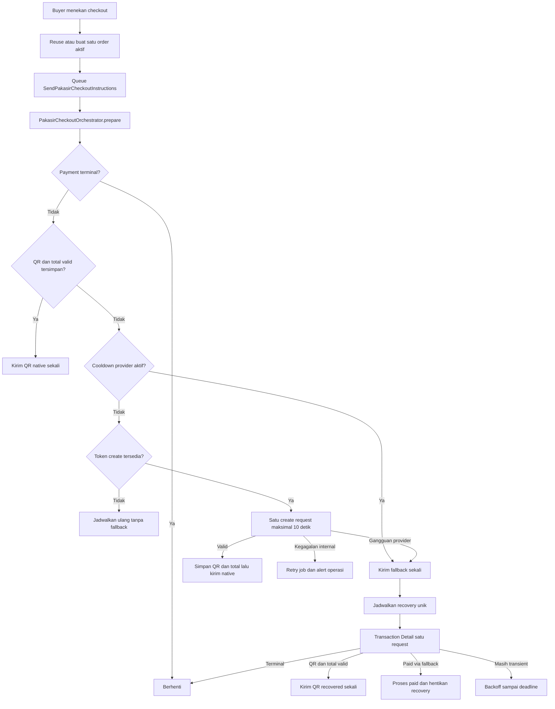

# Desain Ketahanan QRIS Native Pakasir dan Fallback Pembayaran

**Tanggal:** 2026-07-29
**Status:** Disetujui untuk implementation planning
**Ruang lingkup:** Jalur QRIS native Pakasir pada `main` dan production Store Bot, tanpa mengubah Binance Pay atau branch eksperimen KlikQRIS
**Batas operasional:** Dokumen ini tidak mengizinkan deployment production. Deployment hanya boleh dilakukan setelah instruksi eksplisit pemilik.

## Tujuan

Memastikan QRIS native Pakasir tetap menjadi jalur pembayaran utama, tetapi kegagalan provider yang bersifat sementara tidak lagi membuat buyer berhenti pada pesan bahwa QRIS belum tersedia. Jika provider gagal mengirim QRIS dan total final yang valid, buyer memperoleh jalur pembayaran web yang ramah melalui tombol **Lanjutkan Pembayaran** untuk order yang sama.

Desain juga harus mengurangi tekanan request ke Pakasir, mencegah duplicate checkout, menjaga reservasi stok, dan tetap mendeteksi pembayaran terlambat tanpa menghidupkan kembali order yang sudah kedaluwarsa.

## Bukti masalah di production

Snapshot investigasi production pada 2026-07-29 menunjukkan:

- Production memakai `payment_mode=pakasir` dan `pakasir_checkout_flow=api_qris`.
- Sejak create-state tracking tersedia, terdapat 355 checkout Pakasir dengan 22 `outcome_unknown`, sekitar 6,2%.
- Dalam tiga hari terakhir terdapat 10 kegagalan dari 81 checkout, sekitar 12,35%.
- Pada 28 Juli terdapat 6 kegagalan dari 44 checkout, sekitar 13,64%.
- Enam belas insiden berbentuk `ConnectionException` dan enam berbentuk `RequestException`.
- Log menunjukkan HTTP `429` pada `transactioncreate/qris`, cURL error 28 setelah sekitar 10 detik tanpa response body, HTTP `429` dan `520` pada Transaction Detail, serta beberapa `404` saat outcome create belum diketahui.
- Checkout berhasil tetap muncul di antara checkout gagal. Credential dan bentuk request dasar terbukti valid, sehingga gangguan bukan kegagalan konfigurasi permanen.
- Reconciler dijalankan setiap menit dan memeriksa payment pending serta released. Saat investigasi, 19 payment released masih eligible. Transaction Detail dapat melakukan tiga percobaan internal, sehingga satu siklus berpotensi menghasilkan sampai 57 request provider.
- Saat native create gagal, bot mengirim pesan "Provider belum mengirim QRIS dan total bayar final yang valid" tanpa tombol pembayaran web. Job lalu menandai customer sudah diberi instruksi, sehingga tidak ada pengiriman QR otomatis yang terpisah.

Kesimpulan akar masalah:

1. Pakasir mengalami throttling dan gangguan sementara berupa `429`, `520`, timeout, dan connection failure.
2. Polling dan retry internal aplikasi memperbesar tekanan provider.
3. Failure path saat ini mengubah kegagalan sementara menjadi jalan buntu bagi buyer.
4. State notifikasi generik mencampur pesan pending, fallback, dan pengiriman QR native.

## Kontrak provider yang menjadi batas desain

Source of truth provider adalah dokumentasi resmi Pakasir, diperbarui 21 Juli 2026: <https://pakasir.com/p/docs>.

- Hosted payment URL memakai slug, amount, dan `order_id`.
- `POST /api/transactioncreate/qris` adalah endpoint terdokumentasi yang mengembalikan `payment_number`, `total_payment`, fee, method, dan expiry.
- Contoh resmi Transaction Detail mengembalikan status, payment method, dan `completed_at`, tetapi tidak mendokumentasikan QR string atau total final.
- Webhook dan Transaction Detail mendokumentasikan `completed_at`.
- Dokumentasi tidak menjamin bahwa duplicate create dengan `order_id` yang sama idempotent.

Konsekuensinya:

- Setelah create response hilang, recovery QR bersifat best effort dan hanya dapat mengirim QR jika Transaction Detail aktual menyediakan QR serta total final.
- Transaction Detail tetap berguna untuk mendeteksi completed melalui hosted fallback dan mengklasifikasikan waktu pembayaran.
- Implementasi tidak boleh mengasumsikan bahwa Transaction Detail selalu dapat membangun ulang QR native.
- Implementasi tidak boleh mengulang create sampai contract test terpisah membuktikan duplicate behavior aman.

## Keputusan produk

- QRIS native adalah jalur utama.
- Checkout native melakukan paling banyak satu request create per payment pada fase ini.
- Fallback web hanya ditampilkan ketika kegagalan diklasifikasikan sebagai gangguan provider.
- Fallback memakai order, payment, amount, reservasi stok, dan `merchant_ref` yang sama.
- Fallback tidak membuat order, payment, atau reservasi baru.
- Tombol buyer berlabel **Lanjutkan Pembayaran** atau **Continue Payment** sesuai locale.
- UI Telegram tidak menyebut nama provider, istilah hosted, atau detail teknis kegagalan.
- Pada native success normal, tombol pembayaran web tidak ditampilkan.
- Jika QR native kemudian pulih setelah fallback dikirim, bot mengirim QR secara otomatis. Fallback yang sudah diterima buyer tetap menjadi opsi sekunder.
- Duplicate click harus memakai satu checkout aktif dan tidak boleh menambah request provider.
- Pakasir QRIS production memakai deadline payment yang tersimpan, dengan default 10 menit.
- Binance Pay tetap memakai default 20 menit dan tidak termasuk perubahan ini.
- QRIS KlikQRIS 15 menit berada pada branch eksperimen dan tidak termasuk ruang lingkup.
- Tidak ada deployment production otomatis.

## Non-goals

- Mengubah flow atau TTL Binance Pay.
- Menggabungkan atau memindahkan kode KlikQRIS ke `main`.
- Mengaktifkan retry otomatis `transactioncreate/qris` sebelum idempotensi duplicate create terbukti.
- Mem-proxy atau menyalin halaman hosted provider.
- Menyamarkan branding yang mungkin muncul di halaman pihak ketiga setelah redirect.
- Mengubah provider production atau menambahkan branch production baru.
- Melakukan deployment, mengubah environment production, atau menjalankan compose production sebagai bagian implementasi tanpa arahan baru.

## Arsitektur target

### Modul utama

Tambahkan `PakasirCheckoutOrchestrator` sebagai modul dalam yang memiliki satu tanggung jawab tingkat tinggi: membawa satu payment Pakasir dari kondisi lokal menuju keputusan instruksi buyer yang aman.

Antarmuka konseptual:

```php
interface PakasirCheckoutOrchestrator
{
    public function prepare(Payment $payment): PakasirCheckoutDecision;

    public function recover(Payment $payment): PakasirCheckoutDecision;
}
```

`PakasirCheckoutDecision` adalah value object atau enum-backed result yang hanya dapat menghasilkan salah satu keputusan berikut:

- `native_ready`: QR string dan total final valid sudah tersimpan.
- `fallback_ready`: gangguan provider terklasifikasi dan payment masih aktif.
- `deferred`: budget lokal sedang habis tanpa bukti error provider. Request dijadwalkan ulang tanpa mengirim fallback.
- `terminal`: order atau payment sudah paid, expired, failed, refunded, atau cancelled.
- `internal_failure`: kegagalan lokal yang harus di-retry atau di-alert, bukan disamarkan sebagai gangguan provider.

Orchestrator menyembunyikan detail berikut dari layer Telegram:

- Lock dan idempotensi create.
- Klasifikasi response dan exception provider.
- Traffic gate dan global cooldown.
- Persistensi create-state dan recovery-state.
- Penjadwalan recovery berikutnya.
- Keputusan native, fallback, deferred, atau terminal.

Layer Telegram hanya merender keputusan. Ia tidak menangkap semua `Throwable` lalu mengubahnya menjadi satu pesan provider seperti perilaku saat ini.

### Komponen pendukung

- `PakasirProviderTrafficGate` mengatur kuota global, kuota background, cooldown `429`, dan prioritas request.
- `PakasirProviderException` membawa operation, HTTP status, error code aman, klasifikasi, dan `Retry-After` tanpa payload sensitif.
- `RecoverPakasirNativeQris` adalah job unik per payment untuk recovery aktif.
- `PakasirFallbackUrl` atau perluasan `StorefrontInvoiceUrl` menghasilkan signed internal URL yang berlaku sampai deadline payment.
- `ContinuePakasirPaymentController` memvalidasi payment masih aktif lalu melakukan `302` ke hosted payment URL untuk payment yang sama.
- Reconciler Pakasir berubah dari polling seluruh kandidat menjadi pemrosesan kandidat yang memang due.

### Aliran tingkat tinggi



## State dan model data

### State create yang dipertahankan

`provider_create_state` tetap memakai state yang sudah dikenal:

```text
null -> creating -> created
                -> outcome_unknown -> created
                -> provider_total_pending -> created
```

Makna state:

- `null`: belum ada create attempt.
- `creating`: attempt sudah diklaim secara lokal.
- `created`: `payment_number` dan `total_payment` valid sudah dipersist.
- `outcome_unknown`: request gagal atau response tidak dapat dipercaya, sehingga hasil provider belum diketahui.
- `provider_total_pending`: QR atau sebagian payload tersedia, tetapi nominal final belum valid.

Fallback bukan state create. Fallback adalah state delivery terpisah agar recovery native tetap dapat berjalan.

### Field tambahan yang direncanakan

Tambahkan field aditif pada `payments`:

- `provider_create_attempts` unsigned small integer, default `0`. Invariant fase ini adalah maksimal `1`.
- `provider_check_attempts` unsigned small integer, default `0`. Counter ini mencakup check untuk active recovery, pending reconciliation, atau late reconciliation dan di-reset saat phase berubah.
- `provider_next_check_at` timestamp nullable dan indexed.
- `provider_last_http_status` unsigned small integer nullable.
- `provider_last_error_code` string nullable untuk kode tersanitasi seperti `rate_limited`, `timeout`, `connection`, `server_error`, `invalid_response`, atau `not_found`.
- `provider_completed_at` timestamp nullable untuk waktu completed otoritatif dari Transaction Detail.
- `provider_fallback_sent_at` timestamp nullable.
- `provider_native_qris_sent_at` timestamp nullable.
- `released_payment_detected_at` timestamp nullable saat completed baru ditemukan setelah resource order dilepas.
- `late_payment_detected_at` timestamp nullable.
- `late_payment_admin_notified_at` timestamp nullable.
- `late_payment_customer_notified_at` timestamp nullable.

Index kandidat due harus mendukung query terbatasi, misalnya:

```text
(provider, status, provider_next_check_at)
```

Nama final migration boleh mengikuti konvensi repository, tetapi semantik field tidak boleh digabung ke JSON bebas karena field tersebut dipakai untuk concurrency, scheduling, idempotensi, dan observability.

Phase check diturunkan dari state yang sudah ada, bukan disimpan sebagai string baru:

- Payment pending dengan `outcome_unknown` atau `provider_total_pending` berarti active recovery.
- Payment pending dengan native QR valid berarti pending reconciliation.
- Payment expired atau failed dalam lookback berarti late reconciliation.

Saat payment berpindah phase, `provider_check_attempts` di-reset ke `0` dan `provider_next_check_at` dihitung dari jadwal phase baru.

### State `creating` yang stale

`creating` harus aman terhadap worker crash di antara persistence claim dan provider response:

- Saat menandai `creating`, simpan `provider_create_attempted_at`, naikkan `provider_create_attempts`, dan isi `provider_next_check_at` dengan akhir claim lease dalam transaksi yang sama.
- `creating` yang masih berada dalam claim lease dianggap sedang dikerjakan dan menghasilkan keputusan `deferred`.
- `creating` yang melewati claim lease diperlakukan sebagai `outcome_unknown` karena aplikasi tidak dapat membuktikan apakah request sempat mencapai provider.
- State stale tidak boleh di-reset menjadi `null` dan tidak boleh memicu create kedua.
- State stale mengirim fallback hanya setelah diklasifikasikan sebagai create outcome ambigu, lalu masuk Transaction Detail recovery.
- Dispatcher harus dapat menemukan stale `creating` walaupun worker awal mati sebelum mendispatch recovery job.

### Keamanan migration dan existing rows

- Schema migration hanya menambah kolom dan index. Migration tidak melakukan request provider, dispatch job, atau Telegram send.
- Existing payment dengan `provider_create_attempted_at` atau `provider_create_state` terisi tetap dianggap sudah memakai satu create attempt, walaupun counter baru masih `0` sebelum lazy normalization.
- Orchestrator tidak boleh mengulang create hanya karena counter hasil migration bernilai `0`.
- Existing payment pending atau released yang `provider_next_check_at` masih `null` masuk dispatcher secara bertahap dan dibatasi budget, bukan diproses sekaligus.
- Existing `creating` yang sudah melewati claim lease dinormalisasi secara lazy menjadi `outcome_unknown` tanpa create ulang.
- Dispatcher memberi deterministic jitter sebelum check pertama agar deploy tidak menghasilkan thundering herd.
- Historical paid, refunded, dan terminal records tidak ditulis ulang oleh migration.
- Perubahan perilaku late payment berlaku ke depan. Historical rows tidak direklasifikasi otomatis.

### Invariant data

1. Satu buyer dan cart hanya mempunyai satu order QRIS aktif untuk checkout yang sama.
2. Native dianggap siap hanya jika payment masih pending, method `qris`, `provider_payment_number` terisi, dan `provider_total_payment >= amount`.
3. Satu payment hanya boleh melakukan satu native create pada fase ini.
4. Native create selalu memakai `merchant_ref` dan amount dari payment yang sudah dipersist.
5. Fallback menggunakan payment yang sama dan tidak mengubah method atau provider.
6. `provider_fallback_sent_at` hanya diisi setelah Telegram berhasil menerima pesan fallback.
7. `provider_native_qris_sent_at` hanya diisi setelah Telegram berhasil menerima foto QR.
8. Retry Telegram memakai QR terenkripsi yang sudah tersimpan dan tidak memanggil create lagi.
9. Recovery hanya berjalan untuk payment yang belum terminal dan belum melewati deadline.
10. Duplicate job, duplicate callback, dan restart worker harus kembali ke state payment yang sama.

## Klasifikasi kegagalan

### Fallback-eligible

Kondisi berikut diperlakukan sebagai gangguan provider dan mengizinkan fallback:

- HTTP `429`.
- HTTP `408`.
- HTTP `500` sampai `599`, termasuk `520`.
- Connect timeout, read timeout, DNS failure, TLS connection failure, atau connection reset.
- Response `2xx` bukan JSON yang valid.
- Response `2xx` tidak mempunyai QR yang valid.
- Response `2xx` tidak mempunyai total final yang valid.
- Transaction Detail belum menemukan transaksi setelah create outcome ambigu.
- Request ditunda karena global provider cooldown masih aktif.

Klasifikasi harus berasal dari typed exception atau typed response, bukan pencarian substring pada pesan exception.

Budget lokal yang habis tanpa cooldown atau error provider bukan fallback-eligible. Initial create dijadwalkan ulang pada slot terdekat dan duplicate click hanya mengembalikan status bahwa QR sedang disiapkan.

Global cooldown dianggap bukti gangguan provider hanya jika record cooldown aktif menyimpan origin `provider_429`. Cooldown administratif, cache failure, atau budget lokal biasa tidak boleh memicu fallback.

### Tidak fallback-eligible

Kondisi berikut bukan alasan mengirim fallback:

- Cart kosong atau tidak valid.
- Stok tidak cukup.
- Order atau payment gagal dipersist.
- Database deadlock yang belum habis retry.
- Queue atau cache storage gagal.
- Telegram send gagal.
- Konfigurasi provider kosong atau readiness gagal.
- HTTP `400`, `401`, `403`, atau `422` yang menunjukkan request, credential, atau konfigurasi tidak valid.
- Signature internal URL tidak valid.

Kegagalan lokal dan konfigurasi harus memicu retry yang sesuai serta alert operasional. Buyer menerima pesan netral hanya setelah delivery layer berhasil, tetapi tidak diarahkan ke hosted flow yang kemungkinan juga tidak dapat dipercaya.

### Provider terminal

Jika Transaction Detail memberi status terminal seperti cancelled atau failed:

- Hentikan native recovery.
- Terapkan lifecycle terminal secara idempotent.
- Signed fallback route menolak redirect karena payment tidak lagi pending.
- Buyer harus membuat checkout baru jika masih ingin membeli.

`404` setelah outcome ambigu tidak langsung dianggap terminal karena dapat berasal dari eventual consistency. Ia mengikuti backoff sampai deadline.

## Aliran checkout

### Native success

1. Checkout service membuat order, payment, reservasi stok, dan `merchant_ref` dalam transaksi database.
2. Provider call tidak dilakukan di dalam transaksi reservasi stok.
3. `SendPakasirCheckoutInstructions` berjalan pada queue outbound.
4. Orchestrator mengambil lock per payment.
5. Jika QR payable sudah tersimpan, provider tidak dipanggil.
6. Jika create belum pernah dilakukan dan traffic gate mengizinkan, lakukan satu create request.
7. Batas total request tetap 10 detik dan connect timeout tetap 3 detik secara default.
8. Persist QR terenkripsi, hash QR, total final, fee, expiry, payload tersanitasi, dan state sebelum Telegram dipanggil.
9. Kirim QR native dengan tombol Cek Pembayaran dan Batalkan Order.
10. Jangan tampilkan tombol pembayaran web pada native success normal.

### Gangguan provider dan fallback

1. Orchestrator menyimpan klasifikasi error, status HTTP jika tersedia, dan waktu recovery berikutnya.
2. Telegram mengirim satu pesan fallback:

> QR pembayaran belum tersedia. Anda tetap dapat menyelesaikan pembayaran melalui tombol di bawah.

3. Tombol utama adalah **Lanjutkan Pembayaran**.
4. Tombol tambahan tetap menyediakan Cek Pembayaran dan Batalkan Order.
5. Copy tidak menyebut Pakasir, hosted, rate limit, timeout, atau detail teknis lain.
6. Pesan tetap menampilkan invoice, ringkasan item, dan deadline payment.
7. Jangan menampilkan total produk sebagai total final QRIS. Jelaskan bahwa nominal akhir tersedia pada halaman pembayaran.
8. `provider_fallback_sent_at` diisi hanya setelah sendMessage berhasil.
9. Dispatch satu recovery job unik setelah commit.
10. Jika fallback sudah pernah berhasil dikirim, duplicate checkout mengembalikan status order tanpa mengirim fallback kedua.

### Signed internal fallback route

Telegram tidak diberi URL provider secara langsung. Gunakan route internal seperti:

```text
GET /shop/orders/{order}/continue-payment
```

Ketentuan route:

- Memakai temporary signed URL.
- Signature berlaku paling lama sampai deadline payment.
- Controller tetap memeriksa deadline server-side karena link dapat sudah dibuka atau disalin.
- Order harus pending payment.
- Payment harus provider Pakasir dan terikat pada order tersebut.
- Amount dan `merchant_ref` dibaca dari payment, bukan query buyer.
- Jika valid, controller melakukan redirect ke hosted payment URL untuk payment yang sama.
- Jika paid atau terminal, tampilkan atau redirect ke status invoice yang aman, bukan ke provider.
- Route tidak membuat order, payment, reservasi, atau provider create request.
- Route rate-limited untuk mencegah abuse.

Signed route menyembunyikan nama dan domain provider dari pesan Telegram. Halaman tujuan pihak ketiga dapat menampilkan brandingnya sendiri dan tidak akan diproxy oleh aplikasi.

### Native recovery

1. Recovery memakai Transaction Detail, bukan mengulang `transactioncreate/qris`.
2. Satu eksekusi job melakukan maksimal satu outbound request.
3. Jika payload detail menyediakan QR dan total valid, persist lalu kirim pesan:

> QR pembayaran sudah siap. Silakan pindai QR di bawah untuk menyelesaikan pembayaran.

4. QR recovery dikirim maksimal sekali dan hanya jika payment masih pending serta belum expired.
5. Jika payment sudah completed melalui fallback, proses paid secara normal dan jangan kirim QR lagi.
6. Jika detail tidak menyediakan QR, fallback tetap menjadi jalur pembayaran.
7. Jika status masih ambigu, jadwalkan attempt berikutnya sesuai backoff.
8. Jika payment terminal atau deadline lewat, hentikan recovery aktif.

Dokumentasi provider belum menjamin duplicate create dengan `order_id` yang sama bersifat idempotent. Oleh karena itu create ulang tetap dilarang sampai contract test terkontrol membuktikan perilakunya. Jika bukti tersebut tersedia di masa depan, retry create harus menjadi perubahan terpisah dan default-nya tetap off.

## Idempotensi dan concurrency

### Duplicate checkout

Ketika buyer menekan checkout berulang atau callback Telegram terduplikasi:

- Reuse order QRIS aktif yang sudah ada.
- Reuse payment dan `merchant_ref` yang sama.
- Jangan menambah reservasi stok.
- Jangan membuat provider transaction kedua.
- Jangan menambah recovery job jika satu job untuk payment tersebut sudah terjadwal atau berjalan.
- Kembalikan status terbaru kepada buyer.
- Jika create hanya tertunda karena budget lokal, beri status netral "QR pembayaran sedang disiapkan. Tidak perlu membuat checkout baru" tanpa menampilkan fallback.

### Locks

- Gunakan database row lock untuk keputusan yang mengubah order atau payment.
- Gunakan cache lock per payment untuk single-flight provider call.
- Lock lease harus lebih panjang dari HTTP timeout tetapi bounded.
- Jangan menahan database transaction ketika menunggu HTTP atau Telegram.
- Setelah HTTP selesai, buka transaksi pendek untuk persistence dan re-check terminal state.

### Notification delivery

`manual_checkout_customer_notified_at` boleh tetap menandai bahwa instruksi awal pernah diberikan, tetapi tidak boleh menjadi satu-satunya guard untuk semua pesan Pakasir.

Gunakan timestamp payment yang eksplisit:

- `provider_fallback_sent_at` untuk fallback.
- `provider_native_qris_sent_at` untuk native atau recovered QR.
- Timestamp late-payment terpisah untuk admin dan buyer.

Dengan demikian kegagalan sendPhoto dapat di-retry tanpa create ulang, dan fallback tidak memblokir pengiriman QR yang berhasil dipulihkan.

## Traffic gate dan perlindungan performa

### Batas awal

Semua request Pakasir melewati shared traffic gate:

```env
PAKASIR_API_RATE_LIMIT_PER_MINUTE=10
PAKASIR_BACKGROUND_RATE_LIMIT_PER_MINUTE=4
PAKASIR_RATE_LIMIT_DEFAULT_COOLDOWN_SECONDS=60
PAKASIR_RATE_LIMIT_MAX_COOLDOWN_SECONDS=300
```

Gate memakai state atomik pada shared cache yang terlihat oleh seluruh app, worker, dan scheduler. Jangan memakai process-local counter. Rate smoothing memakai token bucket atau sliding window dengan semantik berikut:

- Bucket total berkapasitas 10 token dan mengisi kembali rata-rata satu token setiap 6 detik.
- Bucket background berkapasitas 4 token dan mengisi kembali rata-rata satu token setiap 15 detik.
- Setiap request background harus memperoleh token total dan token background.
- Implementasi tidak boleh mengizinkan burst 20 request hanya karena melewati batas dua fixed windows yang bersebelahan.

Nilai adalah default awal dan harus dapat diubah lewat konfigurasi. Nilai aktual tidak boleh tersebar sebagai magic number.

### Prioritas

Urutan prioritas request:

1. Initial create untuk checkout baru.
2. Recovery QR untuk payment aktif.
3. Verifikasi status yang dipicu buyer atau webhook.
4. Reconciliation payment pending normal.
5. Pengecekan payment released untuk late payment.

Global limit berlaku untuk semua request. Background limit berlaku untuk recovery dan reconciliation. Late reconciliation harus ditunda jika terdapat recovery aktif yang due agar request customer-facing mendapat prioritas.

### Cooldown global

Saat provider mengembalikan `429`:

- Ambil `Retry-After` jika valid.
- Jika tidak ada, gunakan 60 detik.
- Batasi cooldown yang berasal dari input provider sampai maksimum 300 detik.
- Simpan cooldown pada shared cache agar seluruh worker dan scheduler melihat kondisi yang sama.
- Record cooldown menyimpan origin `provider_429`, waktu dibuat, dan `cooldown_until` tanpa response body.
- Selama cooldown, jangan melakukan HTTP request Pakasir.
- Checkout baru boleh langsung memperoleh fallback dan recovery terjadwal.
- Deferral karena cooldown tidak dihitung sebagai outbound attempt.

Jika global token biasa habis tetapi tidak ada cooldown yang berasal dari error provider, initial create masuk state `deferred`, dijadwalkan pada slot terdekat, dan tidak mengirim fallback. Initial create tetap mendapat prioritas lebih tinggi daripada seluruh pekerjaan background.

Checkout lain yang masuk ketika cooldown `provider_429` masih aktif boleh langsung menerima fallback tanpa melakukan create request. Ini tetap memenuhi kebijakan provider-only fallback karena cooldown berasal dari response provider yang teramati, bukan dari limit lokal.

### Menghapus retry burst

`transactionDetail()` saat ini dapat melakukan tiga HTTP attempts di dalam satu pemanggilan. Dalam desain target:

- Client melakukan satu HTTP request per operasi.
- Retry dan backoff berada di orchestration/job layer.
- Satu failure tidak boleh berubah menjadi tiga request dalam beberapa milidetik.
- Reconciler tidak boleh memanggil seluruh kandidat setiap menit.

### Backoff recovery aktif

Recovery untuk `outcome_unknown` atau `provider_total_pending` memakai interval:

```text
15 detik -> 30 detik -> 60 detik -> 2 menit -> 5 menit
```

Setelah interval 5 menit, ulangi 5 menit hanya jika masih berada sebelum deadline. Untuk default Pakasir 10 menit, jumlah attempt otomatis tetap bounded.

Jika traffic gate menolak attempt, jadwalkan ulang pada waktu paling akhir antara slot berikutnya, akhir cooldown, dan backoff payment.

### Reconciliation pending normal

Payment dengan QR valid mengandalkan webhook sebagai jalur cepat. Reconciliation menjadi safety net dan memakai interval bertahap, misalnya:

```text
1 menit -> 2 menit -> 4 menit sampai deadline
```

User-triggered Cek Pembayaran memakai single-flight lock dan throttle yang sudah ada, serta tetap melewati global provider traffic gate.

### Webhook verification

Webhook adalah sinyal yang belum dipercaya dan tidak boleh menambah burst request di jalur HTTP ingress:

- Ingress memvalidasi bentuk minimum, menyimpan event tersanitasi, dan mendispatch verification job unik.
- Transaction Detail dijalankan di luar request webhook dan tetap melewati traffic gate.
- Jika gate atau cooldown menunda verification, event tetap tersimpan dan job dijadwalkan ulang.
- Response webhook tidak menunggu rangkaian retry Transaction Detail.
- Payment hanya menjadi paid setelah Transaction Detail yang cocok mengonfirmasi completed.
- Setelah verifikasi completed, processor harus me-lock dan membaca ulang order serta payment. Jika salah satunya sudah berada pada terminal released state, processor menjalankan late-payment path dan tidak memanggil paid transition normal.

### Late-payment schedule

Setelah payment expired atau failed, cek secara jarang hingga batas lookback 72 jam:

```text
5 menit -> 15 menit -> 30 menit -> 1 jam -> 2 jam -> 4 jam -> setiap 8 jam sampai 72 jam
```

Reconciler hanya memilih row dengan `provider_next_check_at <= now()`, dibatasi oleh background budget, dan diurutkan berdasarkan prioritas serta waktu due. Query tidak boleh memuat semua payment eligible lalu memanggil provider satu per satu.

## Expiry

### Pakasir

Sumber kebenaran runtime adalah deadline yang sudah dipersist pada order dan payment:

- Default QRIS Pakasir production adalah 10 menit dari setting `qris_payment_ttl_minutes`.
- Jika provider memberi `expired_at` yang lebih awal, gunakan waktu paling awal.
- Provider expiry tidak boleh memperpanjang deadline lokal yang sudah lebih awal.
- Fallback route dan native recovery berhenti pada deadline yang sama.
- Setelah expiry, QR dan hosted fallback untuk payment lama tidak boleh dipakai.
- Checkout berikutnya membuat order dan `order_id` baru.

### Provider lain

- Binance Pay tetap default 20 menit.
- KlikQRIS 15 menit tetap berada pada branch eksperimen.
- Implementasi scope ini tidak boleh mengubah konstanta, setting, test, atau copy expiry provider lain kecuali assertion shared yang benar-benar provider-agnostic.

## Released dan late payment

Pakasir mendokumentasikan `completed_at` pada webhook dan Transaction Detail. Klasifikasi tidak boleh didasarkan hanya pada waktu callback diterima atau waktu reconciliation berjalan:

- Callback adalah sinyal dan `completed_at` callback tidak dipercaya sendirian.
- Transaction Detail harus mengonfirmasi completed dan memberikan `completed_at` yang cocok serta dapat diparse.
- Simpan hasil terverifikasi pada `provider_completed_at` dengan timezone yang dinormalisasi.
- Bandingkan `provider_completed_at` dengan deadline payment paling awal yang sudah dipersist.
- `provider_completed_at <= deadline` berarti pembayaran dilakukan tepat waktu.
- `provider_completed_at > deadline` berarti pembayaran benar-benar terlambat.

Jika completed baru terdeteksi setelah order atau payment lokal sudah expired atau failed:

- Jangan memanggil transition paid normal.
- Order mempertahankan terminal state yang sudah ada, biasanya `expired` atau `cancelled`.
- Payment lokal tetap `expired` atau `failed` sesuai terminal state sebelumnya.
- Stok tidak dipesan ulang.
- Receipt, credential delivery, dan sales proof tidak dikirim otomatis.
- Simpan `released_payment_detected_at`, `provider_completed_at`, dan PaymentEvent tersanitasi sebagai bukti finansial.
- Isi `late_payment_detected_at` hanya ketika `provider_completed_at` melewati deadline.
- Jika payment sebenarnya tepat waktu tetapi baru terdeteksi setelah release, catat event `timely_payment_detected_after_release` dan tetap minta resolusi admin karena stok mungkin sudah dialokasikan ke order lain.
- Jika Transaction Detail completed tidak mempunyai `completed_at` valid, fail closed ke review admin dan jangan otomatis menghidupkan atau memenuhi order.
- Kirim alert admin maksimal sekali agar admin memutuskan refund atau pemenuhan manual.
- Buyer menerima maksimal satu pesan sesuai klasifikasi.

Untuk pembayaran yang benar-benar melewati deadline:

> Pembayaran diterima setelah batas waktu dan sedang diperiksa oleh admin.

Untuk pembayaran tepat waktu yang baru ditemukan setelah resource order dilepas, atau ketika `completed_at` tidak dapat dipercaya:

> Pembayaran Anda sudah terdeteksi, tetapi order telah ditutup dan sedang diperiksa oleh admin.

- Checkout baru dengan `order_id` baru tetap sah.
- Released-payment detection tidak boleh mengubah atau membatalkan order baru buyer.

Perilaku ini menggantikan current path yang dapat mengubah `payment_status` order expired menjadi paid. Financial truth dicatat melalui provider-completion metadata dan event tanpa menghidupkan lifecycle order lama.

Aturan ini berlaku identik untuk seluruh entry point completed:

- Webhook callback.
- Scheduled reconciliation.
- User-triggered Cek Pembayaran.
- Recovery job setelah hosted fallback.

Semua entry point harus melewati satu released-payment decision di bawah row lock. Race antara expiry command dan provider completion tidak boleh menghasilkan receipt, credential delivery, atau reservasi ulang jika expiry menang lebih dahulu. `provider_completed_at` tetap menentukan apakah pembayaran secara finansial tepat waktu atau terlambat, tetapi local resource release tetap tidak dibalik otomatis.

## UX Telegram

### Native siap

- Tampilkan QR native dan total final.
- Tampilkan deadline Pakasir.
- Tampilkan Cek Pembayaran dan Batalkan Order.
- Jangan tampilkan Lanjutkan Pembayaran pada native success normal.
- Jangan menyebut provider.

### Provider gagal

Copy Indonesia:

> QR pembayaran belum tersedia. Anda tetap dapat menyelesaikan pembayaran melalui tombol di bawah.

Copy Inggris:

> The payment QR is not available yet. You can still complete your payment using the button below.

Tombol utama:

- Indonesia: **Lanjutkan Pembayaran**
- Inggris: **Continue Payment**

Tombol tambahan:

- Cek Pembayaran atau Check Payment.
- Batalkan Order atau Cancel Order.

### QR pulih

Copy Indonesia:

> QR pembayaran sudah siap. Silakan pindai QR di bawah untuk menyelesaikan pembayaran.

Copy Inggris:

> Your payment QR is ready. Scan the QR below to complete your payment.

Pengiriman QR recovery tidak menghapus fallback lama. Ia hanya memberi buyer jalur native yang kembali tersedia.

### Error internal

Buyer tidak boleh menerima stack trace, HTTP status, nama exception, credential state, atau nama provider. Jika aplikasi belum dapat mengirim instruksi karena error internal, queue retry tetap menjadi mekanisme utama. Alert admin harus menjelaskan error secara tersanitasi.

## Observability

### Structured log

Setiap operasi provider mencatat:

- `provider=pakasir`.
- operation seperti `create_qris`, `transaction_detail`, atau `hosted_redirect`.
- payment ID atau correlation ID internal.
- klasifikasi request `foreground`, `active_recovery`, `pending_reconcile`, atau `late_reconcile`.
- HTTP status nullable.
- error code tersanitasi.
- duration milliseconds.
- traffic gate result.
- cooldown-until jika relevan.
- recovery attempt number.

Jangan mencatat:

- API key.
- QR string.
- Raw authorization header.
- Unsanitized provider payload.
- Signed URL lengkap.
- Credential produk.

### Metrik

Metrik minimum:

- Native create success rate.
- Native create provider-failure rate.
- Fallback sent count dan rate.
- Error count per status dan class.
- Recovery success count dan latency.
- Provider request count per operation.
- Request deferred oleh global limit, background limit, atau cooldown.
- Duplicate checkout suppression count.
- Recovery queue depth dan oldest job age.
- Late payment detected count.
- Telegram native/fallback delivery failure count.

Alert awal yang disarankan:

- Native success di bawah 95% untuk window dengan minimal 20 checkout.
- Fallback rate di atas 10% untuk window dengan minimal 20 checkout.
- Lima atau lebih `429` dalam lima menit.
- Oldest recovery job melebihi lima menit ketika payment masih aktif.
- Queue notifications atau default melewati threshold health operation yang sudah ada.

Threshold harus configurable dan dikalibrasi setelah observasi production. Perubahan threshold tidak memerlukan perubahan state machine.

## Strategi pengujian

### Unit tests

- Failure classifier memetakan `429`, `408`, `5xx`, `520`, timeout, connection, malformed JSON, dan incomplete `2xx` sebagai fallback-eligible.
- Failure classifier menolak fallback untuk DB, queue, readiness, auth, validation, dan Telegram errors.
- Budget lokal habis tanpa cooldown provider menghasilkan `deferred`, bukan fallback.
- Traffic gate menegakkan 10 request total per menit dan menghaluskan request lintas batas window.
- Background gate menegakkan 4 request per menit.
- `Retry-After` valid, invalid, absent, dan terlalu besar menghasilkan cooldown yang benar.
- Backoff active recovery dan late reconciliation menghasilkan `provider_next_check_at` yang benar.
- Signed continue URL memakai deadline payment dan tidak menerima provider URL dari input buyer.
- Telegram fallback reply markup hanya memuat signed internal URL. Ia tidak boleh memuat host provider, path `/pay/`, atau project slug.
- Renderer normal tidak memuat tombol web.
- Renderer fallback memakai label Lanjutkan Pembayaran dan tidak memuat kata Pakasir atau hosted.

### Feature dan integration tests

1. Response `200` valid menyimpan QR dan total lalu mengirim QR sekali tanpa fallback.
2. Response `200` tanpa QR mengirim fallback sekali dan menjadwalkan recovery.
3. Response `200` tanpa total final mengirim fallback sekali dan menjadwalkan recovery.
4. Response `429` menghormati `Retry-After`, membuka global cooldown, dan tidak retry langsung.
5. Response `520`, `5xx`, timeout, dan connection error menghasilkan fallback serta backoff.
6. HTTP `400`, `401`, `403`, dan `422` tidak menghasilkan hosted fallback otomatis.
7. Budget lokal habis tanpa error provider menunda create dan tidak mengirim fallback.
8. Duplicate checkout sequential menghasilkan satu order, satu payment, satu reservasi, satu create, dan satu recovery chain.
9. Duplicate checkout concurrent menghasilkan invariant yang sama.
10. Duplicate jobs tidak menghasilkan dua provider calls bersamaan.
11. Telegram sendPhoto gagal setelah native create, lalu retry memakai QR tersimpan tanpa create ulang.
12. Telegram fallback send gagal tidak mengisi `provider_fallback_sent_at`, sehingga retry tetap dapat mengirim.
13. Recovery `outcome_unknown` menjadi `created` ketika detail mengandung QR dan total valid.
14. Recovery detail `404` melakukan backoff tanpa create ulang.
15. Payment completed melalui fallback menghentikan recovery dan mengirim receipt normal hanya sekali.
16. QR recovered tidak dikirim jika payment sudah paid, expired, failed, refunded, atau cancelled.
17. QR recovered dikirim maksimal sekali jika payment masih aktif.
18. Signed fallback route redirect memakai payment, amount, dan `merchant_ref` yang sama.
19. Signed fallback route menolak signature salah, payment milik order lain, atau payment terminal.
20. Webhook menyimpan event dan mengantrikan verification tanpa menjalankan retry burst di ingress.
21. Duplicate webhook hanya menghasilkan satu verification chain.
22. Default deadline Pakasir berada sekitar 10 menit.
23. Provider expiry yang lebih awal memperketat deadline.
24. Provider expiry yang lebih lambat tidak memperpanjang deadline lokal.
25. Checkout setelah expiry membuat order dan `order_id` baru, sementara order lama tetap expired.
26. Late payment dalam 72 jam dicatat tanpa menghidupkan order, stok, receipt, atau credential delivery.
27. Admin dan buyer late-payment notification masing-masing dikirim maksimal sekali.
28. Reconciler hanya memproses payment due dan berhenti saat budget background habis.
29. Satu reconciliation attempt menghasilkan maksimal satu outbound HTTP request.
30. QR, API key, dan signed URL tidak muncul pada log atau PaymentEvent.
31. Existing Binance Pay tests tetap membuktikan TTL 20 menit dan flow tidak berubah.
32. Existing KlikQRIS branch atau file tidak disentuh oleh perubahan pada `main`.
33. Active global cooldown hanya menghasilkan fallback jika origin-nya `provider_429`.
34. Cache failure, local budget exhaustion, dan administrative cooldown tidak menghasilkan fallback.
35. Fresh `creating` menghasilkan deferred tanpa provider call kedua.
36. Stale `creating` menjadi `outcome_unknown`, mengirim fallback, dan melakukan detail recovery tanpa create ulang.
37. Dispatcher memulihkan stale `creating` setelah worker awal mati sebelum dispatch recovery.
38. Telegram fallback reply markup memakai host internal dan tidak memuat provider host, `/pay/`, atau slug.
39. Completed callback untuk order expired mencatat late payment tanpa mengubah order atau payment menjadi paid.
40. Completed reconciliation untuk order expired menghasilkan state yang sama dengan callback.
41. Race expiry dan completed verification menghasilkan tepat satu terminal outcome, dan expiry yang lebih dahulu tidak dapat dihidupkan kembali.
42. Callback `completed_at` yang dipalsukan atau berbeda dari Transaction Detail tidak digunakan sebagai waktu pembayaran.
43. Transaction Detail `completed_at` sebelum deadline tetapi baru ditemukan setelah release dicatat sebagai `timely_payment_detected_after_release` tanpa fulfillment otomatis.
44. Transaction Detail `completed_at` setelah deadline mengisi `late_payment_detected_at` tanpa fulfillment otomatis.
45. Completed released payment tanpa `completed_at` valid masuk review admin dan tidak menghidupkan order.

### Performance checks

- Seed sejumlah payment pending dan released, lalu buktikan jumlah outbound request tidak melebihi budget.
- Buktikan 100 duplicate checkout callbacks tetap menghasilkan satu provider create.
- Buktikan scheduler tidak memuat dan memanggil seluruh payment released setiap menit.
- Buktikan queue tidak bertambah tanpa batas ketika provider berada dalam cooldown.
- Jalankan query plan untuk kandidat `provider_next_check_at` dan pastikan index digunakan.

## Rollout dan gerbang produksi

### Implementasi

Agent implementasi harus:

1. Bekerja pada worktree atau branch terisolasi.
2. Menggunakan TDD untuk setiap perubahan behavior.
3. Menjalankan focused tests, full relevant test suite, lint, dan static checks repository.
4. Melakukan review kode dan security review untuk signed route, logs, locks, serta state transitions.
5. Commit perubahan secara terpisah dan jelas.
6. Berhenti setelah handoff hasil implementasi dan bukti verifikasi lokal.

### Production

Tidak boleh dilakukan otomatis:

- Tidak menjalankan SSH command yang mengubah production.
- Tidak mengubah `.env` production.
- Tidak menjalankan Docker Compose production.
- Tidak push atau trigger deployment workflow sebagai efek samping plan.
- Tidak menjalankan `gh workflow run deploy-production.yml` tanpa arahan eksplisit pemilik.

Jika pemilik kemudian memerintahkan deployment, sumber release tetap `main` melalui workflow GitHub Actions **Deploy production**. Tidak ada branch `production` baru. Production Compose harus tetap memakai project `telegram-bot-prod` dan `--env-file .env` sesuai dokumentasi repository.

### Verifikasi pascadeploy jika kelak diperintahkan

Verifikasi terpisah harus mencakup:

- CI dan admin asset smoke lulus.
- Deployment workflow sukses.
- Service health, queue schema, queue depth, supervisor, dan container status sehat.
- Error rate Pakasir dan queue lag tidak memburuk.
- Satu checkout terkendali hanya dilakukan jika pemilik memberi persetujuan operasional terpisah.
- Jangan sengaja merusak credential, memaksa `429`, atau membuat provider error di production untuk menguji fallback.
- Bukti fallback berasal dari automated tests atau environment non-production. Di production, amati natural provider error jika terjadi.
- Observasi minimal 30 sampai 60 menit sebelum menganggap rollout stabil.

Existing hosted-only setting tetap menjadi emergency rollback operasional, tetapi perubahan setting production juga memerlukan arahan eksplisit pemilik.

## Acceptance criteria

Desain dianggap terimplementasi dengan benar ketika:

- Buyer memperoleh QR native pada response provider yang valid.
- Buyer memperoleh Lanjutkan Pembayaran pada gangguan provider tanpa nama provider di UI Telegram.
- Native success normal tidak mendorong buyer membuka browser.
- Satu checkout aktif tidak pernah menghasilkan duplicate order, payment, reservasi, atau provider create.
- Satu provider failure tidak menghasilkan burst tiga Transaction Detail requests.
- Total provider traffic dan background traffic tunduk pada batas konfigurasi.
- Global cooldown mencegah request storm setelah `429`.
- Recovery berhenti pada deadline Pakasir, default 10 menit.
- Checkout baru setelah expiry memakai `order_id` baru.
- Late payment terdeteksi sampai 72 jam tanpa menghidupkan order lama.
- QR, API key, payload sensitif, dan signed URL tidak bocor ke log.
- Seluruh tests yang disebutkan lulus.
- Tidak ada perubahan Binance Pay atau KlikQRIS.
- Tidak ada deployment production tanpa instruksi eksplisit pemilik.
