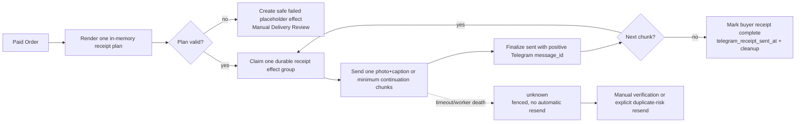

# RFC: One Logical Telegram Paid Receipt per Order

- **Tanggal:** 2026-08-22
- **Status:** Draft — siap direview; belum ada implementasi
- **Scope:** Receipt buyer pada Store Bot Telegram setelah Paid Order. Web Storefront, Store Channel Sales Proof Post, checkout, payment rail, inventory, dan lifecycle Order tidak diubah.
- **Decision owner:** Product/system design
- **Brand canonical:** `LHIE STORE`

## 1. Problem statement

Buyer saat ini menerima receipt sebagai beberapa delivery unit: invoice photo `sendPhoto`, lalu satu atau lebih Product Detail/text unit melalui `sendMessage`. Pada Order dengan beberapa Structured Account Credential, unit akun, access action, tutorial, dan footer menjadi banyak bubble Telegram. Buyer harus menggabungkan sendiri invoice, detail pembayaran, credential, Product Detail, dan ucapan terima kasih.

Implementasi saat ini memang sudah memiliki Telegram Outbound Effect Ledger, ordered receipt effects, in-memory `CredentialDeliveryPresentation`, account-boundary chunking, OTP inline button, Auth Token code entity, dan ambiguous-delivery review. Masalahnya adalah bentuk presentasi dan granularity delivery, bukan alasan untuk melewati ledger atau memindahkan secret ke outbox.

Target UX membutuhkan satu logical receipt dalam private chat buyer:

- satu Order menghasilkan satu logical receipt group;
- satu `sendPhoto` pertama membawa public-safe invoice image dan caption yang memuat invoice, detail pembayaran, credential, dan guidance selama caption masih muat;
- bila caption photo melebihi 1.024 karakter, satu photo tetap menjadi chunk pertama lalu continuation `sendMessage` memakai jumlah message minimum;
- Telegram message/caption limit tetap dihormati;
- jika harus split, jumlah message adalah minimum yang diperlukan dan tidak ada secret field yang dipotong;
- tidak ada pesan tambahan per account, payment acknowledgement terpisah, invoice photo kedua, atau footer bubble terpisah.

## 2. User outcome

Buyer membuka private chat yang sama dan melihat receipt yang bisa dibaca dari atas ke bawah pada layar mobile 320–390 px:
Pada receipt normal, bubble itu adalah satu foto invoice public-safe dengan caption gabungan. Hanya caption-limit yang boleh memaksa continuation message.

1. judul bahwa pembayaran lunas;
2. Order ID, produk, metode bayar, tanggal WIB, jumlah, dan total;
3. Product Detail dengan semua account yang dibeli, tetap terpisah per credential;
4. access method yang tepat untuk setiap account;
5. Product-level secret/tutorial dan usage guide maksimal satu kali per Product;
6. guidance copyable dan ucapan terima kasih dari `LHIE STORE`.

Buyer tidak perlu menebak account mana milik Product mana. Admin tidak perlu memasukkan tutorial per account untuk stock baru. Operator tetap dapat membedakan `sent`, `failed`, `unknown`, dan `manual_review` tanpa melihat credential.

## 3. Current behavior

### 3.1 Paid lifecycle dan receipt

`OrderStateMachine` menandai receipt eligible setelah payment paid dan inventory sale mengikuti aturan lifecycle yang sudah ada. `TelegramOutboundEffectService::recordReceipt()` membuat ordered `Telegram Outbound Effect` group dalam transaksi durable. `TelegramOutboundEffectDispatcher` memetakan effect ke `SendTelegramReceipt`.

Untuk receipt baru pada codebase saat ini:

- sequence pertama memakai `sendPhoto` dengan template `receipt-invoice-v2`;
- sequence berikutnya memakai `sendMessage` untuk Product Detail/text;
- `TelegramReceiptNotifier` memuat `customer`, `orderItems.stockItems`, `orderItems.product`, dan `payments`;
- `CredentialDeliveryPresentation` melakukan paid eligibility, customer ownership, ordering, legacy/structured projection, effective tutorial, dan usage guide projection;
- `TelegramCredentialDeliveryRenderer` menjaga account boundary dan memakai operational limit 3.900 karakter pada atomic unit saat ini;
- OTP Mail Link ditampilkan sebagai server-validated domain di text dan full HTTPS URL di inline button;
- Auth Token dikirim sebagai code entity;
- `ReceiptDeliveryPipeline` claim/finalize melalui `TelegramOutboundEffectLedgerProtocol` dan mengisi `orders.telegram_receipt_sent_at` setelah text delivery complete.

ADR-0007 memberi pengecualian ordering untuk invoice photo: photo `failed` atau `unknown` dapat dilewati agar Product Detail tetap dikirim. Product Detail/credential/text setelah photo tetap strict ordered. `unknown` tidak pernah otomatis dikirim ulang.

### 3.2 Credential presentation

`CredentialDeliveryPresentation` adalah seam yang dipakai Store Bot dan Web Storefront. Ia mengembalikan projection in-memory yang tidak dapat diserialisasi/debug-dump dengan secret. Sumber utama:

- `OrderItem` snapshot untuk Product name, quantity, delivery note, dan usage guide;
- `ProductStockItem` yang dialokasikan ke `OrderItem`;
- structured payload terenkripsi untuk email, password, access method, access value, dan legacy `tutorial_override`;
- legacy encrypted secret yang tetap diformat tanpa menebak schema baru.

Effective tutorial saat ini adalah item-specific `tutorial_override` bila ada, lalu Product/OrderItem delivery note. Web Storefront menampilkan group Product note dan tutorial account override yang berbeda.

### 3.3 Admin Account Input

Account Input saat ini memakai `ProductStockIntake` sebagai canonical owner dan controller sebagai adapter. Form request dan browser draft menerima:

- email;
- password;
- access method;
- access value;
- `tutorial_override` opsional.

`ProductStockIntake::review()` mengembalikan projection aman berupa email ternormalisasi, access method, OTP domain, tutorial source, dan identity conflict metadata. Password, OTP URL, Auth Token, dan credential payload tidak dikembalikan oleh review endpoint. `submit()` mengulang validasi dan identity claim secara authoritative dalam satu transaksi dengan `operation_key` idempotency.
### 3.4 Dua audience Telegram yang berbeda

Buyer private chat dan Store Channel sudah memiliki delivery family, target, bahasa, dan privacy contract yang berbeda. Perubahan receipt buyer tidak boleh menyatukan atau mengganti caption public Sales Proof.

| Surface | Current owner | Media/caption | Bahasa | Isi yang boleh tampil | Credential/access secret |
| --- | --- | --- | --- | --- | --- |
| Buyer private receipt | `TelegramReceiptNotifier` + `ReceiptDeliveryPipeline` | `sendPhoto` invoice public-safe dengan caption buyer; continuation hanya bila caption 1.024 karakter tidak cukup | Locale Customer melalui `TelegramLocale` (`id`, `en`, `ms`) | Invoice, payment summary, semua credential, access method/button, Product note/guide, footer | Boleh tampil hanya pada authorized buyer delivery; OTP URL tetap button-only |
| Store Channel Sales Proof | `SalesProofDeliveryPipeline` + `SalesProofPostFormatter` | Satu `sendPhoto` public-safe dengan English caption dan `Shop Now` button | English tetap, melalui `TelegramLocale::STORE_CHANNEL_LOCALE`/effect locale `en` | Public-safe status, masked Telegram buyer name, Order ID, Product summary, payment method, completion time WIB, quantity, subtotal, amount paid, successful-order number, thanks | Tidak boleh ada email, password, Auth Token, OTP URL/domain, Product note/tutorial, usage guide, atau Recovery Key |

Repository saat ini sudah mengirim Store Channel Sales Proof sebagai satu `sendPhoto` dengan caption English. Caption itu memakai `SalesProofPostFormatter`, bukan `CredentialDeliveryPresentation`, dan effect-nya bertarget `store_channel`. Screenshot channel adalah referensi hierarchy/visual; implementation tidak perlu menyalin literal copy atau branding `SA STORE`.

Caption buyer harus memakai copy locale-specific milik Customer dan boleh memuat credential. Caption channel harus tetap English, public-safe, dan ringkas walaupun Order buyer memiliki banyak credential. Keduanya boleh memakai `PaidInvoiceRenderer` yang sama untuk image public-safe, tetapi tidak boleh memakai caption renderer, audience data, atau privacy policy yang sama.

## 4. Target behavior

### 4.1 One logical receipt per Order

Untuk receipt yang baru dimaterialisasi:

- target selalu `customer.telegram_id` yang telah lolos customer/order ownership check;
- tidak ada chat baru, thread baru, atau pesan per credential;
- effect family tetap `ReceiptCredentials` dan queue tetap queue receipt yang sudah ada (`notifications` pada current implementation);
- child effect pertama memakai satu `sendPhoto` dengan public-safe paid invoice image dan caption receipt;
- bila seluruh caption receipt muat dalam batas `sendPhoto` 1.024 karakter, satu photo message adalah seluruh logical receipt;
- bila caption melebihi 1.024 karakter, photo message tetap menjadi chunk pertama dan continuation memakai jumlah minimum `sendMessage` chunks di bawah batas 4.096 karakter;
- N bukan jumlah credential. N adalah hasil packing dengan budget caption 1.024 untuk chunk pertama dan budget text 4.096 untuk continuation;
- footer hanya ada pada child chunk terakhir;
- invoice header lengkap hanya ada pada child chunk pertama;
- chunk lanjutan boleh memiliki penanda `📦 PRODUCT DETAIL — lanjutan`, tetapi tidak mengulang invoice lengkap;
- `telegram_receipt_sent_at` hanya diisi setelah seluruh child effects canonical group `sent`.

Caption photo boleh memuat invoice, payment summary, Product Detail, credential, access method, Product note, usage guide label, dan footer selama semuanya masih muat. Untuk receipt yang melebihi batas caption, credential tetap dilanjutkan sebagai message chunk yang terurut; tidak pernah dibuat satu message/job per account.

`send()` sebagai compatibility entry point tetap boleh dipanggil oleh caller lama, tetapi implementasi baru harus masuk melalui `ReceiptDeliveryPipeline` dan shared ledger. Tidak boleh ada jalur notifier yang mengirim langsung di luar effect group.

Untuk group baru, semua child effect strict ordered sejak sequence pertama. Caption pertama dapat berisi secret, sehingga hasil `sendPhoto` `failed` atau `unknown` tidak boleh dilewati otomatis seperti pengecualian invoice-photo lama. Existing persisted invoice-photo groups tetap mengikuti ADR-0007 berdasarkan template versinya.

### 4.2 Canonical invoice image dan caption

Receipt buyer baru memakai **satu public-safe invoice image dengan caption gabungan**. Image tidak pernah memuat credential, OTP URL, Auth Token, Recovery Key, atau Product secret. Caption-lah yang membawa invoice text, detail pembayaran, credential, access action, Product guidance, dan footer.

Untuk receipt yang muat, bentuknya:

```text
[1 pesan Telegram: foto invoice public-safe + caption]

Caption:
🧾 INVOICE PEMBELIAN LUNAS ✅

🆔 Order ID: ORD-MT2LEJHQ-AA6EF2
🛍️ Produk:
• .PAYPAL KOSONGAN × 1
💳 Metode Bayar: QRIS
📅 Tanggal: Jumat, 21 Agustus 2026 13:53 WIB
📊 Jumlah: 1 pcs
💵 Total Bayar: Rp 12.500

━━━━━━━━━━━━━━━━━━━━━━
📦 PRODUCT DETAIL

.PAYPAL KOSONGAN

Kredensial 1
email: email-1@example.test
password: <code entity>
akses: Auth Token
Auth Token: <code entity>

💡 Ketuk nilai akun untuk menyalin. Jangan bagikan data ini.

Terima kasih sudah berbelanja di LHIE STORE! 🙏
```

Telegram membatasi caption photo hingga 1.024 karakter setelah entity parsing. Karena itu desain tidak boleh menjanjikan semua Order akan muat di caption. Bila caption penuh, photo tetap dikirim sekali sebagai chunk pertama dan continuation `sendMessage` dikirim pada chunk berikutnya dengan aturan Section 9. Ini adalah fallback Telegram yang memaksa splitting, bukan default satu message per credential.

Rules invoice:

- `Order ID` memakai invoice number; fallback ke stable Order key hanya bila invoice number memang tidak tersedia.
- Product name, quantity, unit price, dan subtotal berasal dari immutable `OrderItem` snapshot, bukan mutable Product saat receipt dikirim.
- Multi-product Order memiliki satu bullet per OrderItem dalam urutan deterministic yang sama dengan credential projection.
- `Jumlah` adalah jumlah seluruh OrderItem; angka tidak dihitung dari jumlah text credential.
- `Metode Bayar`, paid timestamp, currency, dan total memakai canonical paid Payment serta fallback yang sama dengan existing payment receipt rules. Provider total dipakai bila tersedia; jika tidak, gunakan Order total.
- Format nominal mengikuti locale dan currency yang sudah didukung. IDR memakai format Rupiah; USDT memakai presisi yang telah dipakai repository.
- Fee/payment detail tambahan hanya ditampilkan bila ada nilai provider fee yang authoritative dan customer-facing; jangan menciptakan discount/fee snapshot baru.
- Image dan caption header tidak memuat checkout key atau unnecessary buyer identity.
### 4.3 Product Detail dan credential contract

Setelah header dan separator, setiap logical Product memiliki blok sendiri. Account numbering dimulai dari 1 pada setiap Product.

```text
━━━━━━━━━━━━━━━━━━━━━━
📦 PRODUCT DETAIL

Produk A

Kredensial 1
email: email-1@example.test
password: ********
akses: Auth Token
Auth Token: <copyable token>

Kredensial 2
email: email-2@example.test
password: ********
akses: OTP Mail Link · mail.example.test
[ Buka OTP Mail #2 ]

📌 Pesan Product:
Gunakan panduan login resmi untuk Product A.

📘 Panduan Product A
[ Buka Panduan ]
```

Text di atas hanya contoh format; `<copyable token>` tidak boleh muncul literal. Nilai credential asli berada pada caption `sendPhoto` pertama bila muat; bila tidak, nilainya berada pada continuation `sendMessage`. Semua nilai mendapat explicit Telegram `code` entity.

#### `none`

Hanya field berikut yang dikirim, tetap di dalam blok credential yang bersangkutan:

```text
Kredensial 1
email: <email>
password: <password>
```

Tidak ada `access_value`, token, atau URL. Baris `akses: Tidak ada` tidak diperlukan karena method `none` memang berarti hanya email dan password.

#### `otp_mail_link`

- Caption/continuation text only displays `akses: OTP Mail Link · <validated-domain>`.
- Full URL never appears in caption/text, invoice image, log, exception, effect metadata, queue payload, review response, or browser storage.
- Inline keyboard memiliki button `Buka OTP Mail #<n>` dengan full URL yang sudah lulus validasi HTTPS, hostname, no userinfo, dan URL length policy.
- Button ditempel pada chunk yang memuat credential tersebut. Jika credential berada di caption, button berada pada `sendPhoto`; jika berada di continuation, button berada pada `sendMessage`. Jika seluruh logical receipt muat dalam satu photo message, semua OTP buttons tetap berada pada message yang sama, satu row per account.
- Invalid persisted URL adalah render failure; jangan fallback ke raw URL dan jangan mengirim account secara parsial.

#### `auth_token`

```text
akses: Auth Token
Auth Token: <token>
```

Email, password, dan Auth Token masing-masing mendapat `type: code` entity. Token tidak pernah dimasukkan ke `reply_markup` atau options. Token tidak di-split di tengah nilai.

#### Legacy credential

Legacy `ProductStockItem` tetap menggunakan formatter legacy yang ada. Renderer tidak mengarang email/password/access method dari free-form text. Nilai legacy tetap berada di bawah `Kredensial <n>` dan diberi code entity hanya bila formatter dapat menentukan field dengan aman. Legacy payload malformed atau satu field unbounded menyebabkan receipt plan fail closed; jangan memotong atau mengirim partial credential.

### 4.4 Product note, usage guide, copy guidance, footer

- `delivery_note`/Product secret ditampilkan maksimal satu kali per logical Product, sesudah account terakhir Product tersebut.
- `usage_guide` ditampilkan maksimal satu kali per logical Product. Judul dapat menjadi text; URL aman dipasang sebagai inline button, bukan raw URL berulang di setiap credential.
- Guide deduplication memakai pasangan title + canonical safe URL. Guide yang sama tidak diulang karena jumlah account.
- Product note dan usage guide mempertahankan historical snapshot precedence. Untuk new Orders, `OrderItem` snapshot adalah authoritative.
- Existing account-specific legacy override yang berbeda dari Product note tetap boleh ditampilkan sekali di dekat account yang memilikinya, sebagai compatibility exception. Itulah data legacy, bukan Product note baru; ia tidak boleh dibuat oleh Account Input baru.
- Guidance global diletakkan setelah semua Product block:

```text
💡 Ketuk nilai akun untuk menyalin. Jangan bagikan data ini.

Terima kasih sudah berbelanja di LHIE STORE! 🙏
```

- Footer hanya berada pada chunk terakhir. Support button boleh berada di footer chunk terakhir; tidak membuat message baru.
- Bila receipt tidak memiliki credential, kirim public-safe invoice image dengan caption invoice + safe status `Detail produk belum memiliki data akun untuk ditampilkan.` + footer bila caption muat. Jika tidak muat, gunakan continuation sesuai Section 9. Jangan mengarang credential.

## 5. Before/after message examples

### 5.1 Before

```text
[Telegram bubble 1]
[foto invoice paid]

[Telegram bubble 2]
✅ Pembayaran diterima
Order ID: ...
Produk pesanan kamu: ...
Metode pembayaran: ...

[Telegram bubble 3]
🔐 Detail Produk
Product A
Data akun 1 ...

[Telegram bubble 4]
Product A
Data akun 2 ...

[Telegram bubble 5]
📌 Catatan pengiriman ...
Terima kasih sudah belanja di LHIE STORE.
```

Bentuk ini masih dapat terjadi untuk existing effect groups yang sudah menggunakan template invoice-photo; deployment tidak boleh mengubah effect yang sudah `sent` atau `unknown` secara diam-diam.

### 5.2 After: one structured account

```text
[1 pesan Telegram: 1 foto invoice public-safe + caption]

Caption:
🧾 INVOICE PEMBELIAN LUNAS ✅

🆔 Order ID: ORD-MT2LEJHQ-AA6EF2
🛍️ Produk:
• Product A × 1
💳 Metode Bayar: QRIS
📅 Tanggal: Jumat, 21 Agustus 2026 13:53 WIB
📊 Jumlah: 1 pcs
💵 Total Bayar: Rp 12.500

━━━━━━━━━━━━━━━━━━━━━━
📦 PRODUCT DETAIL

Product A

Kredensial 1
email: account@example.test
password: <code entity>
akses: OTP Mail Link · mail.example.test

💡 Ketuk nilai akun untuk menyalin. Jangan bagikan data ini.

Terima kasih sudah berbelanja di LHIE STORE! 🙏

[ Buka OTP Mail #1 ]
```

Foto hanya invoice public-safe. OTP URL asli hanya berada pada inline button. Password, email, dan token bukan literal markdown backticks; semuanya explicit `code` entities. Jika caption ini melewati 1.024 karakter, caption berhenti di boundary credential terakhir yang utuh dan sisanya dikirim sebagai continuation `sendMessage`.
### 5.3 After: two Products

```text
[1 pesan Telegram bila caption total <= 1.024 karakter]
[1 foto invoice public-safe + caption gabungan]

Caption:
🧾 INVOICE PEMBELIAN LUNAS ✅
...
📦 PRODUCT DETAIL

Product A

Kredensial 1
email: a@example.test
password: ...

Kredensial 2
email: b@example.test
password: ...

📌 Pesan Product A:
Tutorial Product A satu kali.

Product B

Kredensial 1
email: c@example.test
password: ...
akses: Auth Token
Auth Token: ...

📌 Pesan Product B:
Tutorial Product B satu kali.

💡 Ketuk nilai akun untuk menyalin. Jangan bagikan data ini.

Terima kasih sudah berbelanja di LHIE STORE! 🙏
```

Jika caption melebihi 1.024 karakter, bentuknya menjadi:

```text
[chunk 1] 1 foto invoice public-safe + caption: invoice → Product A → credential utuh yang muat
[chunk 2..N] sendMessage continuation: credential/Product blocks berikutnya → footer pada chunk terakhir
```

Caption/invoice tidak diulang pada continuation.
## 6. Recommended architecture

### 6.1 Renderer seam

Pertahankan `TelegramReceiptNotifier` sebagai adapter ke `TelegramBotClient`, tetapi evolve receipt rendering menjadi satu in-memory receipt plan:

1. Load one complete Order graph.
2. Call `CredentialDeliveryPresentation::forCustomer()` exactly once for that render attempt.
3. Build one ordered plan containing the public-safe invoice photo, caption blocks, Product/account blocks, Product notes, usage-guide actions, and footer.
4. Pack the first plan segment into the `sendPhoto` caption budget of 1.024 characters.
5. Pack remaining segments into the minimum `sendMessage` chunks under 4.096 characters.
6. Select transport unit by effect sequence and discard the plan after the attempt.

`TelegramCredentialDeliveryRenderer` tetap menjadi owner channel formatting untuk credential fields, access method, code entities, and OTP markup. It must return account/Product atomic blocks to the receipt planner; it must not own ledger state.

A minimal in-memory `TelegramReceiptPlan`/equivalent is justified because the existing `TelegramMessageUnit` is already intentionally non-serializable and the new behavior needs one consistent chunk count plus ordered chunk selection. It is not a durable model, cache value, queue DTO, or effect payload. Its `__serialize()` and debug behavior must remain fail-closed/redacted.

### 6.2 Source loading and N+1 avoidance

The render path must eager-load the complete graph before iterating accounts:

- Order and its customer;
- canonical candidate Payments;
- OrderItems in deterministic order;
- each OrderItem's Product snapshot relation;
- all allocated Product Stock Items for those OrderItems;
- Product usage/delivery fields needed by existing snapshot precedence.

The target is a bounded query count independent of account count and Product count, not one query per account. The renderer must not call `ProductUsageGuide::forItem()` in a lazy-loading loop. A production-like benchmark must record query count and fail if it grows with N.

Credential ordering remains `OrderItem` order then `ProductStockItem` order. The planner must validate that a credential block belongs to its source OrderItem/Product before rendering it.

### 6.3 Paid and ownership checks

Before planning and before each chunk send, retain all current authorization gates:

- Payment is canonically `paid` and has a valid paid timestamp;
- Order lifecycle projection allows paid delivery and there is no open late-payment review;
- Order belongs to the target Customer;
- Customer Telegram ID equals the effect's fenced chat ID;
- `CredentialDeliveryPresentation` is called through the customer-scoped entry point;
- Order is still eligible for receipt delivery.

A later refund/cancellation or ownership mismatch stops unsent chunks. Already sent secrets are not retracted by this RFC; the ledger records the partial/blocked outcome for operator handling.

### 6.4 Durable effect group contract

New receipt groups use a new versioned deterministic key so existing invoice-photo groups are not rewritten:

```text
order:<order_id>:telegram_receipt_credentials:v2
order:<order_id>:telegram_receipt_credentials:v2:chunk:<sequence>
```

The exact constant name may follow repository naming, but the version boundary is mandatory. New child effect rows contain only safe transport metadata:

| Field | New receipt value |
| --- | --- |
| `effect_type` | existing `ReceiptCredentials` family |
| `source_type/source_id` | `Order` / Order ID |
| `target_type` | `customer` |
| `telegram_chat_id` | customer Telegram ID, already existing target metadata |
| `queue` | existing receipt queue; do not add a queue |
| `telegram_method` | `sendPhoto` for sequence 1; `sendMessage` for continuation chunks |
| `template_version` | new photo-caption receipt version |
| `sequence` | 1..N |
| `state` | `pending` initially |
| `outcome_metadata` | delivery context, `unit_role=invoice_caption`/`receipt_chunk`, chunk index/count, has-photo/header/footer booleans, Product/account counts, safe caption/text size bucket |

`outcome_metadata` must never contain rendered text, email, password, Auth Token, OTP URL/domain when domain is sensitive, Product note, usage guide URL, Recovery Key, or a content hash derived from secrets. Safe review metadata allowlists must be updated only for non-secret numeric/boolean category fields.

`TelegramOutboundEffectService` remains the materialization and safe review-summary owner. `TelegramOutboundEffectDispatcher` remains the type-to-job mapping owner. `ReceiptDeliveryPipeline` remains the family adapter. None of these may grow a second claim/finalization state machine.

### 6.5 Queue processing

Normal path dispatches the first child effect/group through the existing `SendTelegramReceipt` boundary. The worker may process consecutive chunks from the same group in one in-memory plan, subject to the existing outbound worker's bounded job time. It must not create one job per account.

If the group cannot finish within the bounded worker batch budget, the worker releases the in-memory plan, leaves the next child `pending`, and dispatches/recovery-publishes the next chunk through the same ledger boundary. Recovery after worker death uses `effect_id`/Order ID/sequence metadata only.

A queue retry carries only:

```text
order_id
receipt_effect_id
force/resend marker
job_enqueued_at
```

No credential-bearing plan, text, inline keyboard URL, PNG, or request payload is serialized into the queue.

### 6.6 Render/materialization failure

Paid lifecycle must not roll back merely because a credential payload or invoice image cannot be rendered. During same-transaction materialization:

- valid photo-caption plan: create all N pending child effects and dispatch after commit;
- malformed credential/access value: create one safe failed placeholder effect, do not send a partial receipt, and expose only Manual Delivery Review metadata;
- deterministic invoice-image render failure before any Telegram request: create an explicit text-fallback receipt effect version with the complete receipt plan, because no photo could have been remotely accepted;
- transport `unknown` after a photo request starts: never create an automatic text fallback, because the photo caption may already contain credentials;
- never put the exception's message containing a secret into `last_error` or logs.

For a valid materialized group, a later render count/index mismatch is `receipt_render_changed`, non-retryable, and blocks later chunks. No content fingerprint is persisted to detect this because even a hash can become a secret oracle.

## 7. Exact Telegram message contract

### 7.1 `sendPhoto` first unit

Every new buyer receipt starts with exactly one Bot API `sendPhoto` call:

```text
chat_id: effect.telegram_chat_id
photo: public-safe paid invoice PNG from PaidInvoiceRenderer
caption: 0..1024 Telegram characters after entities parsing
caption_entities: explicit MessageEntity[]; no parse_mode
reply_markup: optional InlineKeyboardMarkup
protect_content: true
```

The image is public-safe and contains no credential. The caption is the first receipt segment and may contain credential values. If the complete receipt plan fits in this caption, the photo message is the only message. If it does not fit, the caption ends at an atomic boundary and subsequent receipt segments use `sendMessage`.

The existing `TelegramPhotoUnit`/`TelegramBotClient::sendPhoto` boundary must encode `caption_entities` and reply markup without persisting PNG bytes, caption text, or URLs. A successful response still requires a positive Telegram message ID before the effect is `sent`.

### 7.2 `sendMessage` continuation

Continuation chunks use:

```text
chat_id: effect.telegram_chat_id
text: 1..4096 Telegram characters after entities parsing
entities: explicit MessageEntity[]; no parse_mode
reply_markup: optional InlineKeyboardMarkup
protect_content: true
```

Telegram's official limits are 1,024 characters for a photo caption and 4,096 characters for `sendMessage` text after entity parsing. Entity offsets and lengths use Telegram's UTF-16 convention; the planner's size counter and entity offset counter are separate and must not use PHP bytes.

Reference: [Telegram Bot API — `sendMessage`](https://core.telegram.org/bots/api#sendmessage), [`sendPhoto`](https://core.telegram.org/bots/api#sendphoto), and [`InlineKeyboardButton`](https://core.telegram.org/bots/api#inlinekeyboardbutton).
### 7.3 Text and entities

- Caption and continuation `text` are plain UTF-8 text.
- `parse_mode` is omitted to avoid Markdown/HTML corruption of secrets and Product-authored content.
- Each structured email, password, and Auth Token value is an explicit `code` entity.
- Entity offsets and lengths refer to the exact chunk text after all localized copy is assembled.
- An entity must span an entire field value, never a prefix, suffix, or partial token.
- Entity overlaps are invalid; renderer fails before send rather than sending malformed text.
- Legacy code entities use the existing formatter only when field boundaries are proven.

### 7.4 Inline keyboard

Only safe action URLs may appear in `reply_markup`:

```json
{
  "inline_keyboard": [
    [{"text": "Buka OTP Mail #1", "url": "https://validated.example/..."}],
    [{"text": "Buka Panduan Product A", "url": "https://safe.example/guide"}],
    [{"text": "Hubungi Support", "url": "https://safe.example/support"}]
  ]
}
```

- Exactly one action per button.
- OTP buttons are account-numbered and attached to the relevant chunk.
- OTP URL is never included in text or logged payload metadata.
- Auth Token, password, and email never appear in a button.
- Product usage-guide URL goes through existing safe URL projection.
- Support button remains the existing safe support target.

### 7.5 Privacy transport option

Use `protect_content=true` for the photo and all new receipt chunks if the existing Bot API client accepts arbitrary send options, which it does. This reduces forwarding/saving exposure but does not prevent screenshots or every client notification preview. The caption starts with invoice/payment summary before credential blocks whenever the budget permits; raw OTP URLs never appear in caption/text. Buyer device notification privacy remains an unavoidable Telegram-client responsibility and must be called out in UX copy/support guidance.

## 8. Multi-account and multi-product behavior

### 8.1 Same Product, multiple accounts

- One Product heading.
- Account numbers restart at 1 for that Product.
- Each account has its own email/password/access fields and own OTP button if applicable.
- Product note appears once after the last account.
- Product usage guide appears once for that Product.
- No password/token value is concatenated with another account.
- Short accounts are packed into the photo caption whenever it fits; otherwise they are packed into the earliest continuation chunk that can hold the complete account.

### 8.2 Multiple Products

- Product sections follow deterministic OrderItem order.
- Each Product's accounts, note, usage guide, and buttons remain scoped to that Product.
- A repeated Product ID in a historical Order is merged only when its snapshot semantics are identical; otherwise it remains a separate historical section to avoid changing paid content. New checkout normally produces one OrderItem per Product.
- Quantity is shown in the invoice summary and actual allocated credentials are shown in each Product block. A mismatch between expected allocated items and persisted credential rows is a fail-closed delivery error, not a silent omission.

### 8.3 Multi-quantity

Quantity affects invoice summary and Product heading context. Credential numbering follows actual Product Stock Item order, not a global quantity counter. Every allocated Product Stock Item must be present exactly once in the plan.

### 8.4 Malformed credential or access value

If one credential is malformed, one access value fails validation, or a legacy secret cannot be safely rendered:

- do not send other credentials or an invoice-only partial receipt;
- mark the receipt plan/effect with a safe non-retryable render category;
- expose only `Manual Delivery Review` metadata to authorized operators;
- preserve the encrypted source row and paid Order for repair/manual action;
- Web Storefront retains its existing safe fallback and support/manual-fulfillment behavior.

This is intentionally conservative: a receipt with a missing account is worse than a delayed complete delivery, and partial secret delivery cannot be repaired by automatically sending more bubbles.

### 8.5 Recovery Key

Recovery Key is not included in the combined Telegram receipt. The repository defines it as one-time-displayed and stores only its hash. If a legacy flow has already issued a Recovery Key, the receipt may refer to the existing Web Storefront access path without repeating the key. This RFC does not create a new key, persist plaintext, or make the key resendable.

## 9. Telegram length-limit fallback

### 9.1 Hard limit and packing algorithm

The first receipt unit is a `sendPhoto` with a 1,024-character caption budget. Every continuation unit is a `sendMessage` with a 4,096-character budget, both measured after entity parsing. Build the receipt as ordered atomic blocks:

1. complete invoice header;
2. Product heading;
3. one complete credential field block;
4. Product-level note;
5. Product usage-guide action/label;
6. global copy guidance;
7. final thank-you/support footer.

Pack consecutive blocks greedily into the photo caption first. Once the caption reaches its limit, pack remaining blocks into the minimum number of 4,096-character continuation chunks. This produces the minimum number of Telegram messages subject to the no-secret-split invariant. A one-message result always means one `sendPhoto`, not one `sendMessage`.

The planner must test caption boundaries at 1,023/1,024/1,025 characters and continuation boundaries at 4,095/4,096/4,097 characters after entity parsing. Entity offsets remain UTF-16 code units. The current 3,900-character chunker is an implementation predecessor and must not force unnecessary continuation messages.

### 9.2 Boundary rules

- The first photo unit is never omitted from a normal new receipt group.
- Email, password, Auth Token, OTP domain, account label, Product heading, and access method line are never split in the middle.
- If the next complete credential does not fit in the remaining photo caption budget, leave the credential intact for the first continuation chunk.
- A long Auth Token may be placed in its own continuation chunk with Product/account context; the token value remains one code entity.
- A long Product note or usage guide text may split only at line/word boundaries and never inside a credential value. It remains one Product-level note semantically, not a repeated tutorial.
- A legacy free-form credential whose indivisible text exceeds 4,096 is not split because its structure cannot be proven; fail closed instead of corrupting it.
- Every continuation chunk omits the complete invoice header.
- The final chunk alone contains the thank-you/footer block.
- Inline buttons follow their relevant credential/Product chunk; a button does not create a standalone message.
- If any single structured field exceeded the existing parser limit and therefore could not be represented safely, validation fails before materialization.

### 9.3 Examples of chunking

For a short five-account Order:

```text
N = 1
one sendPhoto: public-safe invoice image + caption containing header → Product A → accounts 1..5 → Product note → footer
```

For a long five-account Order:

```text
N = 2 (minimum under atomic credential blocks)
chunk 1: sendPhoto + caption: full header → Product A → accounts 1..2
chunk 2: sendMessage: accounts 3..5 → Product note → usage guide → footer
```

For a very long continuation:

```text
chunk 1: sendPhoto + caption: header → complete credential blocks that fit under 1,024
chunk 2..N: sendMessage continuation chunks under 4,096
```

The invoice is not repeated in continuation chunks. A timeout after the photo or any continuation is an ambiguous outcome for the current effect; later chunks remain blocked until ledger resolution.

## 10. Admin UX changes

### 10.1 Account Input form

New Account Input displays only:

- Email;
- Password;
- Access method: `none`, `otp_mail_link`, `auth_token`;
- Access value when the selected method requires it.

Remove `tutorial_override` from the new form, client state, validation messages, review card, and submit payload. Product delivery note/secret and usage guide remain managed in Product admin.

The form copy must say that each card is one Product Stock Item and that Product guidance is delivered once per Product. It must not promise one Telegram message when the Telegram hard limit can require chunks.

### 10.2 Review screen

Review remains mandatory and server-authoritative. It must show:

- normalized email and account number;
- access method;
- safe OTP domain only;
- Auth Token presence (`token siap dikirim sebagai teks`), never token value;
- identity conflict status/source;
- account count;
- Product note occurrence = 1 when configured;
- usage guide occurrence = 1 when configured;
- masked final combined receipt layout preview;
- estimated photo caption characters against the 1,024 limit;
- estimated continuation text characters/chunk count against the 4,096 limit;
- warning when the caption or continuation requires splitting, or a credential-local block needs its own chunk.

Because Account Input happens before a Paid Order exists, the preview uses placeholders for Order ID, paid timestamp, payment method, quantity, and total. It is explicitly labelled as a final-layout preview, not a real invoice. Server review returns metadata only; the browser may render a masked preview from its existing in-memory draft. Password, Auth Token, and OTP URL must not be returned in the review JSON.

No draft credential may enter localStorage, sessionStorage, URL/query parameters, analytics, browser history, error telemetry, or a hidden persisted form. Clear the in-memory draft when the modal closes or submit completes.

### 10.3 Request contract

New JSON request:

```json
{
  "operation_key": "uuid",
  "accounts": [
    {
      "email": "account@example.test",
      "password": "<plaintext in request memory only>",
      "access_method": "none",
      "access_value": null
    }
  ]
}
```

Rules remain authoritative in `ProductStockIntake`:

- 1–20 accounts;
- email normalized and max 254 characters;
- password required and max 1,024 characters;
- `access_method` is exactly one of the three enum values;
- `none` requires null/blank `access_value`;
- OTP Mail Link requires safe HTTPS URL and max 2,048 characters;
- Auth Token requires non-empty value and max 3,500 characters;
- identity conflict checks and keyed fingerprint claims remain unchanged;
- `operation_key` is UUID and idempotent.

A non-empty incoming `tutorial_override` is rejected with a safe `legacy_field_not_writable` validation error. A blank/null value from a stale client may be normalized to null for rolling-page compatibility, but it never writes a new override. The new client omits the field entirely.

### 10.4 Response contract

Successful review response may contain:

```json
{
  "message": "Review server selesai.",
  "review": {
    "operation_key": "uuid",
    "status": "ready",
    "account_count": 1,
    "duplicate_count": 0,
    "accounts": [
      {
        "account_number": 1,
        "email": "account@example.test",
        "access_method": "none",
        "otp_domain": null,
        "tutorial_source": "product_default",
        "duplicate_status": "clear",
        "duplicate_fields": [],
        "duplicate_sources": []
      }
    ],
    "receipt_estimate": {
      "photo_caption_limit": 1024,
      "continuation_text_limit": 4096,
      "estimated_caption_characters": 0,
      "estimated_continuation_message_count": 0,
      "estimated_total_message_count": 1,
      "requires_split": false,
      "product_note_count": 1,
      "usage_guide_count": 1,
      "warning_code": null
    }
  }
}
```

`estimated_caption_characters` and continuation counts are calculated server-side from the in-memory normalized draft and returned only as integers. The illustrative `0` values are placeholders, not implementation output.

`201` remains the first successful atomic intake; `200` is an idempotent replay of the same operation and payload; `409` remains a different-payload reuse of an existing operation key; `422` contains indexed safe validation errors; `503` remains the existing persisted identity-readiness response. Controllers only adapt these outcomes to JSON.

### 10.5 Edit structured stock

- Remove tutorial editing from the new structured-stock edit UI and request contract.
- Existing `tutorial_override` remains encrypted and readable for legacy rows.
- Editing email/password/access fields must preserve an existing legacy override unchanged rather than silently dropping it.
- Admin cannot create a new override through edit after this cutover.
- A malformed structured row remains read-only/`REPAIR` as the current admin policy requires.
- A separate future data migration may retire the field only after an explicit inventory, rollback, and Web Storefront compatibility review; this RFC does not delete it.

## 11. Server, queue, and performance design

### 11.1 Transaction and idempotency

The paid lifecycle and initial receipt effect group remain in the same database transaction, preserving ADR-0007. `afterCommit()` is only dispatch optimization. Recovery can find committed pending effects when queue dispatch is lost.

`recordReceipt()` is idempotent under the locked Order and deterministic v2 group key. A repeated paid callback/lifecycle call returns the existing group and cannot create another group. Explicit resend remains a separate, auditable version with duplicate-risk acknowledgement.

For a multi-chunk group:

- each child sequence has its own claim token and lease;
- one worker may claim only one child at a time;
- `sent` requires a successful Telegram response with a positive message ID;
- prior `sent` chunks are never resent by normal retry;
- current `failed` chunk retries only when the shared policy proves a definite retryable failure;
- current `unknown` chunk never auto-retries;
- later chunks remain blocked until the current predecessor is `sent` or explicitly resolved by Manual Delivery Review;
- explicit resend creates a new full receipt group, leaves the old group immutable, and requires duplicate-risk acknowledgement.

For new photo-caption groups there is no invoice-photo ordering exception: sequence 1 may contain credentials in its caption, so `failed`/`unknown` blocks later continuation chunks. A deterministic pre-send image failure may use the explicit text-fallback version described in Section 6.6; an ambiguous photo request never falls back automatically.

### 11.2 Ambiguity and retries

The existing definitions remain authoritative:

- timeout, connection failure, HTTP 408, uncertain 5xx, or worker death after request start → `unknown` / `Manual Delivery Review`;
- definite pre-send validation failure or Telegram terminal 400/403 → `failed` with safe category;
- definite retryable failure/429 → policy-controlled retry on the same effect, honoring bounded `Retry-After` and a maximum of three definite attempts for this family;
- lease expiry → `unknown`, claim-token fenced; never reset to `pending` automatically.

If Telegram accepted chunk N but the client timed out, the system must not resend the whole receipt automatically. The operator either verifies and marks N sent, allowing N+1 to proceed, or explicitly resends a complete new group after acknowledging duplicate risk.

### 11.3 Plaintext lifetime and persistence boundary

Credential plaintext may exist only while the current request/worker has the encrypted `ProductStockItem` hydrated and the in-memory presentation/plan is being rendered. The implementation must:

- call `CredentialDeliveryPresentation` once per plan attempt, outside account loops;
- avoid copying credential strings into multiple long-lived collections;
- never serialize `CredentialDelivery`, `CredentialDeliveryAccount`, `TelegramMessageUnit`, or receipt plan;
- release/unset plan and hydrated secret-bearing references after transport in `finally`;
- never put secret values in `TelegramOutboundEffect`, queue job payload, audit log, application log, exception text, cache, browser persistence, or metrics;
- preserve existing encrypted `ProductStockItem.secret` and `credential_payload` persistence. The invariant is no new plaintext/rendered-secret persistence; existing encrypted ciphertext remains the inventory source of truth and may exist in encrypted database backups.

No secret-bearing content may be added to a `content_fingerprint`, even if the fingerprint is one-way. Safe metadata is limited to counts, booleans, categories, and coarse length buckets.

### 11.4 Query and memory targets

Required eager-load target: no account-count-dependent query growth; benchmark query count must remain constant for 1, 5, 20, and 50 credentials. The expected graph is a bounded set of Order, Customer, Payment, OrderItem/Product, and ProductStockItem loads, not one query per row.

Photo-caption receipt rendering reuses the existing GD/FreeType `PaidInvoiceRenderer`; no browser renderer or new image daemon is introduced. Targets are measured in production-equivalent Docker/PostgreSQL, not guessed from SQLite:

| Fixture | Credentials | Photo+plan render p95 | Additional worker RSS p95 | Normal dispatch p95 | Hard render budget |
| --- | ---: | ---: | ---: | ---: | ---: |
| Small | 1 | ≤ 250 ms | ≤ 24 MB | ≤ 2 s | 500 ms |
| Typical | 5 | ≤ 250 ms | ≤ 24 MB | ≤ 3 s | 500 ms |
| Large | 20 | ≤ 250 ms | ≤ 24 MB | ≤ 8 s | 500 ms |
| Stress | 50 | ≤ 250 ms | ≤ 24 MB | ≤ 20 s | 500 ms |

The PNG remains public-safe, bounded by the existing 720×960/300 KB invoice renderer contract. `Normal dispatch` excludes an external outage; each Telegram API call retains the current client timeout/connect-timeout contract. A group worker batch has a 45-second internal budget under the existing 60-second outbound worker timeout. It may stop after a successfully finalized chunk and leave the next pending for dispatcher/recovery. A network timeout becomes `unknown`, not an automatic duplicate attempt.

The benchmark records: query count, PNG render time, plan render time, caption/text character length, chunk count, queue wait, per-chunk Telegram duration, group completion time, memory before/after, and failure/ambiguity category. It never records content.

## 12. Security and privacy invariants

The new presentation must preserve all existing invariants:

- paid eligibility check is authoritative and repeated at delivery;
- customer ownership and exact Telegram chat-target check remain mandatory;
- order access and credential delivery authorization remain in `CredentialDeliveryPresentation`/existing access seams;
- no-secret-persistence rule covers effect, queue, log, audit, exception, cache, browser storage, and new database writes;
- `ProductStockItem` encryption remains unchanged;
- OTP Mail Link is only a safe HTTPS inline button plus validated domain display;
- Auth Token is redacted from logs and review metadata and appears only as an in-memory code entity in the photo caption or continuation text;
- Telegram claim-token fencing and lease expiry behavior from ADR-0007 remain unchanged;
- `unknown` is explicit Manual Delivery Review, never blind retry;
- Recovery Key remains one-time and private; it is never embedded in the receipt;
- no raw Telegram request/response payload, credential-bearing inline-keyboard URL, rendered receipt, or credential value enters operator review pages, logs, or implementation documentation;
- Product note is shown only in the authorized buyer receipt and existing authorized Web Storefront surface;
- `protect_content=true` is used as a Telegram client mitigation, while support copy acknowledges it cannot prevent screenshots or all notification previews.

### Secret preview mitigation

A photo-plus-caption receipt concentrates credential content in one Telegram message when the caption fits, which can increase notification-preview/forwarding exposure. Mitigations are:

1. invoice/payment summary and non-secret Product heading appear before credentials in the caption whenever the budget permits;
2. the invoice PNG itself contains no credential or access secret;
3. raw OTP URLs never appear in caption/text;
4. copyable fields use explicit code entities rather than duplicated button payloads;
5. `protect_content=true` is sent on the photo and continuation chunks;
6. no username, Recovery Key, checkout key, or unnecessary buyer identity is included;
7. admin/browser preview masks password, Auth Token, and OTP URL and never persists draft data.

Telegram cannot guarantee screenshot prevention or notification redaction; the RFC does not claim that it can.

## 13. Data model and backward compatibility

### 13.1 No credential schema migration

Do not change or delete `StructuredCredentialPayload::tutorial_override` from version 1 in this RFC. It remains parseable so existing encrypted Product Stock Items and existing paid Orders continue to work. New intake and edit paths cannot write a non-empty value.

Do not migrate existing account overrides into Product delivery note automatically:

- the override may be account-specific;
- Product/OrderItem snapshot semantics may differ historically;
- migration could duplicate or alter a paid customer's historical instructions;
- a failed migration would be difficult to reverse without plaintext exposure.

Compatibility behavior is read-only legacy behavior. New Products use Product-level delivery note/usage guide once per Product.

### 13.2 Existing paid Orders and effects

- Existing sent effects are immutable.
- Existing pending/failed/unknown invoice-photo groups remain dispatchable/reviewable under their persisted template and ADR-0007 rules.
- New groups use the v2 group key and photo-caption template; deterministic photo-render failure may use the explicit text-fallback version.
- Recovery selects behavior by persisted template/group version, not an environment flag.
- A legacy effect must never be silently transformed into a new effect after a possible remote send.
- Existing `telegram_receipt_sent_at` remains the completion projection; no reset during rollout.

### 13.3 Telegram surfaces and Web Storefront

Store Bot automatic paid receipt changes to the buyer locale-specific photo-plus-caption plan. `TelegramReceiptNotifier` may use the shared `PaidInvoiceRenderer` image, but its caption is private, localized with the Customer locale, and credential-bearing. Interactive order-detail retrieval remains a separate authorized action and is not an automatic post-payment bubble.

Store Channel Sales Proof is already a separate implemented surface: `SalesProofDeliveryPipeline` sends one public-safe invoice photo with `SalesProofPostFormatter`'s English caption and the existing `Shop Now` button. Its effect is `SalesProofPost`, target is `store_channel`, locale is `en`, and it must never load or render `CredentialDeliveryPresentation`. The buyer receipt change must add regression coverage for this existing contract, not replace it with buyer-localized copy or expose credentials publicly.

Web Storefront continues to use `CredentialDeliveryPresentation` and its existing account-group response. It may continue displaying legacy per-account tutorial overrides for existing rows, because this RFC changes Telegram buyer receipt UX only. Shared presentation DTO privacy/eligibility invariants remain unchanged.

### 13.4 Product Stock Item and encrypted persistence

`ProductStockIntake` remains canonical for positive stock intake, identity claim, atomic movement/audit, and idempotency. `ProductStockItem` continues to store legacy `secret` or structured `credential_payload` encrypted at rest. No plaintext receipt plan is copied into Product Stock Item, OrderItem, Telegram Outbound Effect, or queue jobs.

## 14. Migration and rollout plan

1. **Specification gate:** approve this RFC and its acceptance matrix. No code, schema, Docker, env, queue, or production change occurs before approval.
2. **Compatibility implementation:** add the photo-caption receipt planner and template/group version while retaining a read-only dispatcher path for existing invoice-photo groups. Add tests for photo caption boundaries, continuation chunks, and the explicit pre-send text fallback before changing default materialization.
3. **Atomic application release:** deploy the PHP and built admin assets as one release so the new Account Input UI and server contract change together. Do not add an environment feature flag.
4. **New materialization cutover:** any receipt with no existing group receives the photo-caption v2 group. Existing group lookup wins over new default so an already-materialized receipt is not duplicated or rewritten.
5. **Admin cutover:** remove tutorial override from Account Input, reject non-empty legacy writes, add masked preview and server estimate, and preserve blank stale-client compatibility only as null normalization.
6. **Queue drain/recovery:** allow old groups to reach terminal sent/failed/manual-review states under their existing policy. Recovery remains the source-discovery safety net. Do not mass-resend or rewrite old groups.
7. **Observability window:** monitor safe counts for new-vs-legacy template, chunk count, render failures, ambiguity, completion latency, query-count budget, and no-secret scan. Stop rollout on any secret-bearing log/effect/queue artifact.
8. **Cleanup after retention:** removal of the old buyer invoice-photo-only path is a separate follow-up after no old buyer effect remains. The public-safe invoice image renderer remains required for the new buyer photo and Store Channel Sales Proof.

No database migration, Docker change, queue name change, new env variable, or identity-registry backfill is required for this cutover.

## 15. Rollback plan

- Rollback is application-version-aware, not a database reset.
- Do not downgrade to a binary that cannot recognize the persisted v2 photo-caption template. If the previous release cannot read v2, pause receipt dispatch and deploy a compatibility fix/forward rollback that can safely leave v2 effects in `pending`/`manual_review`.
- Never delete v2 effect rows, reset claims, clear `telegram_receipt_sent_at`, or convert `unknown` to `pending` as a rollback shortcut.
- Existing v1 invoice-photo groups continue under their own persisted renderer.
- If the admin UI must be rolled back, preserving existing `tutorial_override` payloads is safe; do not run a destructive payload rewrite. A re-enabled legacy field remains a deliberate emergency compatibility action and must not be treated as the new default.
- For a partially delivered v2 group, use Manual Delivery Review or an explicit duplicate-risk-acknowledged full resend. Do not auto-resend the whole receipt after timeout.

## 16. Test matrix

Every test below must assert observable behavior and the named invariant. Secret fixtures are synthetic and must never be copied into logs/artifacts.

| ID | Setup | Action | Expected observable result | Invariant protected |
| --- | --- | --- | --- | --- |
| 1. One structured account | Paid, owned Order; one Structured Account Credential; method `none`; Product note present; complete caption under 1,024. | Run paid lifecycle and receipt worker. | Exactly one `sendPhoto`; public-safe invoice image plus caption containing invoice, payment summary, one credential, Product note once, guidance, and footer; no `sendMessage` or per-account message. | One logical photo receipt; paid authorization; no legacy extra bubble. |
| 2. Two structured accounts | Same Product; two valid rows with different email/password/access methods; caption fixture both fits and overflows. | Render and dispatch receipt. | Both complete credential blocks appear under one Product; values are not interleaved; Product note occurs once; one photo message when caption fits, otherwise one photo plus minimum continuation chunks. | Account boundary, caption limit, and Product-note deduplication. |
| 3. Five accounts and limit | Five valid accounts; run short caption fixture and a fixture whose total exceeds 1,024 but fits/overflows 4,096 continuation boundaries. | Render plan and send. | Short fixture uses one photo+caption. Long fixture uses one photo plus minimum continuation count; no email/password/token is split; header only first and footer only last. | Telegram caption/text limits and minimum bounded splitting. |
| 4. Multiple Products | Paid Order with at least two Products, different quantities, notes, guides, and account counts. | Render/dispatch. | Every Product has its heading; accounts and notes remain with the correct Product; numbering restarts per Product; guide appears once per Product. | OrderItem/product grouping and snapshot association. |
| 5. Access method `none` | Structured row with valid email/password and `none`, no access value. | Render receipt. | Only email/password fields appear; no access URL/token/value appears. | Conditional access-field contract. |
| 6. Access method `otp_mail_link` | Valid HTTPS OTP URL with query secret. | Render and inspect Telegram photo/continuation requests. | Caption or continuation text shows only validated domain; one numbered inline button contains full URL; URL is absent from caption/text/options/effect/log. | OTP URL safety and account-specific action. |
| 7. Access method `auth_token` | Valid Auth Token. | Render and inspect request entities/markup. | Token appears exactly once as one `code` entity; email/password are separate code entities; token is absent from markup/options. | Copyability without secret duplication. |
| 8. Long token/tutorial | Auth Token near current 3,500-character limit and Product note near 2,000-character limit. | Render at boundary sizes. | Token remains whole and copyable; Product note appears once and may occupy a separate non-secret chunk; no truncation or accidental repetition. | Secret-field atomicity and Product-note deduplication. |
| 9. Legacy credential path | Paid Order with legacy encrypted free-form credential. | Render and deliver. | Legacy text remains intact using existing formatter; no guessed structured access line; receipt still follows one-message/chunk contract. | Backward-compatible legacy delivery. |
| 10. Existing structured override | Existing encrypted row has non-empty `tutorial_override` different from Product note. | Render Telegram receipt and read Web Storefront projection. | Telegram Product note appears once; legacy account-specific override remains attached once to its account; Web output retains existing behavior. | Historical data non-breakage and cross-surface compatibility. |
| 11. Account Input contract | Open admin Account Input at 320/390 px; submit payload with no override and with non-empty legacy override. | Review, inspect request/response, then submit. | UI has no override field; masked combined-layout preview and count/size warning appear; non-empty override returns safe 422; no secret in response. | Server-authoritative contract and no new override writes. |
| 12. Duplicate submit/retry | Same `operation_key` and identical payload; duplicate paid callback/queue dispatch. | Submit twice and run recovery. | One ProductStockIntake operation, one movement/audit, one receipt effect group, and one buyer receipt; identical replay returns 200. | Atomic idempotency across intake and delivery. |
| 13. Telegram timeout after acceptance | Valid photo-caption receipt with continuation; fake Telegram times out after photo or continuation request starts. | Process effect and run recovery. | Current effect is `unknown`; no automatic text fallback or resend; later chunks remain blocked; prior sent chunks are not resent; operator review shows safe metadata only. | Ambiguous Telegram Delivery, caption secret safety, and claim-token fencing. |
| 14. Queue retry and worker restart | Valid group; definite retryable failure on one chunk, then worker death with a live/expired lease. | Run queue retry/recovery. | Definite failure retries bounded by policy on same effect; lease expiry becomes `unknown`; restart does not duplicate sent chunks or bypass review. | Durable effect recovery and no blind duplicate. |
| 15. Plaintext non-persistence | Synthetic email/password/token/OTP URL; capture DB effect rows, queue payload, audit/log/error/cache/browser storage. | Complete render, failure, timeout, and review paths. | No plaintext secret or rendered receipt appears in any durable/diagnostic channel; only encrypted stock source remains. | No-secret-persistence rule. |
| 16. Foreign customer | Paid Order belongs to Customer A; attempt delivery with Customer B/chat B or tampered effect target. | Run receipt pipeline. | No credential or receipt is sent; effect is safely not deliverable; ownership mismatch is not exposed with secrets. | Customer ownership and target fencing. |
| 17. Unpaid/cancelled/refunded | Orders in pending/unpaid, cancelled, expired, refunded, or open late-payment review states. | Attempt materialization and delivery. | No credential-bearing receipt/effect is delivered; paid Order eligibility remains closed. | Paid eligibility and late-payment rules. |
| 18. Browser smoke Admin Account Input | Real admin dashboard at 320, 390, and desktop widths; 1, 5, and 20 draft cards. | Edit, review, invalid submit, duplicate submit, close modal. | Fields remain readable; no horizontal overflow; review shows masked final layout, account count, estimated size/chunk warning; draft never enters storage/URL; errors focus correct field. | Admin UX, responsive behavior, browser privacy. |
| 19. Docker/PostgreSQL queue smoke | Production-like Docker app/PostgreSQL/database queue with real worker and synthetic 20/50-account stock. | Pay a test Order, dispatch, restart worker between chunks, inspect claims/recovery. | Eager-load query count is bounded; effect group survives queue loss; claim/lease/recovery/manual review behave as specified; no secret artifacts are written. | Real durable queue/DB semantics, not SQLite-only confidence. |
| 20. Receipt render benchmark | Production-equivalent container fixtures with 1, 5, 20, and 50 accounts; short/boundary caption and continuation lengths; public-safe PNG. | Measure PNG/plan render, memory, query count, chunk count, per-chunk dispatch, and completion. | Meets photo-caption table budgets; one receipt plan is used per attempt; chunk count is minimum under atomic boundaries; metrics contain only safe buckets. | Performance, image safety, and observability safety. |
| 21. Malformed structured row | One valid and one malformed encrypted structured payload, invalid persisted access URL, or deterministic invoice-image render failure. | Trigger receipt render. | Malformed credential produces no partial send and manual review; deterministic image failure produces explicit full text fallback only before any photo request; valid sibling is not leaked separately. | Fail-closed credential handling and no ambiguous fallback. |
| 22. Recovery Key/privacy preview | Paid Web Order has Recovery Key hash and a one-time issued key in the separate existing flow. | Render photo-caption receipt and inspect image, caption prefix, and privacy options. | Recovery Key is absent; PNG contains no secret; caption starts with invoice/payment summary; `protect_content` is enabled; no raw key/URL or notification-oriented secret duplication. | Recovery Key privacy and preview mitigation. |

| 23. Store Channel Sales Proof regression | Paid processable Order with Sale proof, Store Channel enabled, masked Telegram buyer name, and credential-bearing stock. | Run Sales Proof delivery alongside buyer receipt path. | Exactly one channel `sendPhoto` uses the public-safe PNG, English `SalesProofPostFormatter` caption, `locale=en`, masked Telegram buyer name, public payment/product summary, and `Shop Now`; no raw username, full display name, credential, OTP URL, Auth Token, Product note, usage guide, Recovery Key, or buyer-localized caption appears. Buyer private caption remains Customer-locale-specific and separate. | Public/private audience separation, Store Channel privacy, and no regression to existing implementation. |
Prior art for implementation tests is `TelegramReceiptOutboundEffectTest`, `StructuredCredentialDeliveryTest`, `CredentialDeliveryPresentationTest`, `ProductStockIntakeTest`, `StructuredStockSecurityAndRolloutTest`, `TelegramOutboundEffect*Test`, existing Browser admin tests, and the PostgreSQL concurrency gate. Tests must assert behavior through fake Telegram requests/real queue boundaries, not private helper names.

## 17. Observability and safe metrics

Record only:
- template/group version (`legacy_photo`, `photo_caption`, or explicit `text_fallback`);
- audience surface (`buyer_private` or `store_channel`) and locale category (`customer_locale` or `en`);
- PNG render duration bucket and plan render duration bucket;
- Product count, credential count, and chunk count;
- caption/text character-length buckets, never message text;
- queue wait, claim, lease, finalize, and group completion durations;
- per-chunk Telegram method/status category and ambiguity count;
- `failed`, `unknown`, `manual_review`, and `receipt_render_changed` counts;
- bounded query count and memory delta from benchmark/dogfood timing;
- hashed/correlated Order/customer/effect identifiers using existing correlation helper.

Never record email, password, Auth Token, OTP URL/domain where it identifies a secret destination, Product note/tutorial, usage-guide URL, Recovery Key, reply markup, rendered text, PNG bytes, request body, claim token, or secret-derived hash.

Operator Manual Delivery Review remains metadata-only: effect type, target redaction, method, queue, template, sequence, attempts, safe error code, chunk count, and timestamps. It must not display the receipt preview or credential content.

Suggested alerts:

- any secret-scan match in effect/queue/log/audit artifacts: release blocker;
- render-failure rate above a small baseline or any spike after template cutover;
- ambiguous receipt count above baseline;
- p95 render/memory/query budget regression;
- groups stuck in `unknown`/`manual_review` beyond operator SLA;
- receipt completion latency increasing while payment paid rate remains normal.

## 18. Risks and mitigations

| Risk | Mitigation |
| --- | --- |
| One photo caption exposes more secret content in a notification preview | Non-secret invoice header first, safe PNG with no credentials, no raw OTP URL, `protect_content=true`, concise labels, buyer privacy guidance; acknowledge Telegram preview/screenshot limits. |
| Telegram 4,096 limit is mishandled for Unicode | Measure Telegram's post-entity character count and separately validate UTF-16 entity offsets; test 4,095/4,096/4,097 boundaries. |
| Account/password/token is split or corrupted | Atomic field blocks; long structured token gets its own block; overlong legacy free-form fails closed. |
| A timeout after remote acceptance duplicates credentials | `unknown`, lease fencing, no automatic retry, operator verification or explicit duplicate-risk resend only. |
| One malformed row causes partial delivery | Whole receipt plan fails closed; no sibling credential/invoice-only fallback. |
| Existing invoice-photo effects are changed during rollout | Versioned group/template; persisted old effects keep old adapter; no rewrite of sent/unknown rows. |
| Account Input and server contract drift during deployment | Atomic app/asset release; server rejects non-empty legacy field; blank stale field normalizes to null only. |
| Product note is repeated for every account | Product-level block generated outside account loop and tested by occurrence count. |
| Web Storefront breaks when tutorial field changes | Keep shared projection/parser backward-compatible; Telegram-specific dedupe; preserve Web account-group contract. |
| N+1 query or memory regression | Eager-load graph, one presentation call per render attempt, bounded query/memory benchmark for 1/5/20/50. |
| Operator review leaks data | Safe metadata allowlist and review projection; no rendered content. |
| Rollback sends v2 effects through old code | Compatibility-first release; do not downgrade unreadable template; pause/forward-fix rather than delete or reset effects. |
| Product/authored text is malformed or too long | Validate at source; chunk non-secret note at safe boundaries; fail closed for unbounded credential values. |

## 19. Alternatives rejected

1. **Force every credential into the photo caption.** Rejected as an unconditional rule because Telegram caps captions at 1,024 characters. Adopted as the preferred first chunk when each atomic block fits, with bounded continuations when it does not.
2. **Always send photo then a separate full text receipt.** Rejected as the default because it guarantees two bubbles even for short receipts. Kept only as the explicit pre-send image-failure fallback and for persisted legacy effects.
3. **One Telegram message/job per account.** Rejected as the exact UX problem, increases duplicate and queue overhead, and makes Product guidance/footer repetition likely.
4. **Put plaintext credential content in Telegram Outbound Effect or durable queue.** Rejected because it violates the existing no-secret-persistence and ADR-0007 boundary.
5. **Split any long text at arbitrary character offsets.** Rejected because it can corrupt password/token/legacy credential semantics and invalidate code entities.
6. **Automatic resend after timeout/unknown.** Rejected because Telegram lacks an outbound idempotency key and remote acceptance is unknowable.
7. **Migrate all old account tutorials into Product immediately.** Rejected because old overrides may be account-specific and historical Order snapshots must not be rewritten without an explicit reversible migration.
8. **Delete `tutorial_override` from the encrypted payload now.** Rejected because existing rows, Web Storefront, and legacy deliveries still depend on backward-compatible parsing.
9. **Change Web Storefront to mirror Telegram's one-message format.** Rejected because Web is an authorized access surface with different copy/accessibility needs; the requested change is Telegram buyer receipt presentation.
10. **Add an environment feature flag.** Rejected by repository policy and unnecessary with persisted template/group versioning and compatibility-first rollout.
11. **Add a browser/Chromium renderer for invoice image or caption preview.** Rejected; reuse the existing GD/FreeType public-safe invoice renderer and keep the caption planner in memory.

## 20. Open decisions

None blocking. The final copy must be added to all supported Telegram locales through `TelegramLocale` (`id`, `en`, and `ms` with existing fallback), but the behavior, message contract, persistence boundary, and rollout decision are fixed by this RFC.

## 21. Final recommendation

Approve a **photo-first, one-logical-receipt-per-Order** cutover for newly materialized buyer receipts:

- render one public-safe invoice image and one in-memory caption/continuation plan containing payment summary, Product Stock Item credentials, access actions, Product note/usage guide, and footer;
- call `CredentialDeliveryPresentation` once per render attempt and never once per account;
- send one `sendPhoto` when the complete caption fits within Telegram's 1,024-character caption limit;
- otherwise send that one photo with the maximum safe caption prefix, then the minimum ordered `sendMessage` continuations under 4,096 characters;
- keep all chunks inside one durable Telegram Outbound Effect group with claim-token fencing and manual review for ambiguity;
- remove `tutorial_override` from new Account Input writes while preserving encrypted legacy values as read-only compatibility behavior;
- keep Web Storefront, Store Channel Sales Proof, paid eligibility, ownership, Recovery Key privacy, encrypted persistence, and ADR-0007 semantics intact;
- do not add an env flag, queue, schema migration, Docker change, or production mutation for this specification.

This is the smallest safe design that achieves the requested buyer UX without pretending Telegram has unlimited message size or exactly-once remote delivery.

## 22. Flow


